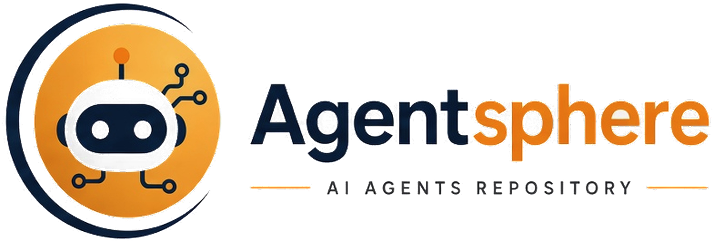

<p align="center">
  <picture>
    <source media="(prefers-color-scheme: dark)" srcset="assets/banner-dark.png">
    
  </picture>
</p>

<p>
  <a href="paths/power-user/README.md"></a>
</p>

# Contributing

agentsphere grows when a page gets clearer, a citation gets tighter, or a missing idea gets a home. This file is how to add that work without inventing facts.

The shape of a good edit is the memory pattern in [wiki memory](docs/01-agent-patterns/wiki-memory.md): search the guide first, then write the answer back into a page.

| Path | Role | You may |
| --- | --- | --- |
| `docs/` | The guide | Add a page, correct a stale claim, add a link. |
| `docs/references.md` | Influences | Add a post, article, or repository that a page actually cites. |
| `assets/` | Diagrams and identity | Add or update a figure when the architecture changes. |
| `CHANGELOG.md` | History of the guide | Add an entry when a batch of pages ships. |

## Principles

1. **Cite the URL.** A claim that comes from a post, a paper, or a repository names that source and links it. If the source is new, add a row to [Social references & inspirations](docs/references.md) and name every page that cites it.
2. **Mark the claim.** Use **Established**, **Per post**, or **Synthesis**, as defined in [how to read](docs/how-to-read.md). A number, a repo count, a speedup, or a product feature from a post is **per post** until a primary source is opened and named.
3. **Do not invent the missing link.** If a post only offers a shortened URL, send the reader to the post. Do not guess the destination.
4. **One idea, one home.** Prefer updating an existing page to opening a near-duplicate. A case study may retell a source, and it should link to the concept page rather than fork the explanation.
5. **Search the guide first.** Before you add a page, look in [the map](docs/README.md), the [glossary](docs/glossary.md), and the [references](docs/references.md).
6. **Security stays high level.** Name threats, review gates, and supply-chain checks. Do not add exploit procedures, payloads, or steps for abusing provider quotas.
7. **Keep the visual system.** New figures follow [the style guide](docs/style-guide.md): an 830-wide viewBox, transparent background, a light file and a dark file, titles at 36px and labels at 16px or larger. Pages choose the file with `<picture>` and `prefers-color-scheme`. Diagrams that explain an architecture also have a Mermaid block. The harness hero, the journey map, and the landscape stay SVG only. Both kinds must render on GitHub. Put a level badge on the page for every path it belongs to.
8. **Leave the next reader smarter.** Update the references list if you cited something new, the learning path if the sequence changed, the glossary if you introduced a term, and the changelog.

## Preview the website

The same markdown is the GitHub Pages site. You do not keep a second copy of a page.

Pages has to use the Actions workflow in `.github/workflows/pages.yml`. A Jekyll build of the `docs/` folder drops the images and the learning paths. The workflow switches the source to GitHub Actions on publish. If the live site is still the plain theme, set **Settings → Pages → Build and deployment → Source** to **GitHub Actions**.

From the repository root, with Python 3.11 or newer:

```bash
python -m venv .venv
source .venv/bin/activate
pip install -r requirements.txt
mkdocs serve
```

On Windows, activate with `.venv\Scripts\activate`.

Open the URL the command prints, usually http://127.0.0.1:8000. Use the light and dark toggle in the header, and open a page that has a diagram, not only the home page.

Before you open a pull request, run `mkdocs build --strict`. The build stops if a relative link or an anchor does not resolve.

`docs-src/` is how MkDocs sees this repository. It is symlinks to `README.md`, `CHANGELOG.md`, `CONTRIBUTING.md`, `docs/`, `paths/`, and `assets/`. A new page in those directories is picked up. A new markdown file beside this one needs a symlink there too.

## Add or update a page

1. Decide where the knowledge goes:
   - **Update** an existing concept page when the source extends a topic the guide already teaches.
   - **Add** a page when the topic is new. Put it in the closest section, and add it to that section's `index.md` and to [docs/README.md](docs/README.md).
   - **Appendix** account lists and link dumps without a method in [community](docs/community.md) or a short case-study note, and say why they are thin.
2. On the concept page, write the idea in the guide's voice. Put figures from a post in a claim table. Link the post. If you checked a paper or an official repo, link that too and say what it supports.
3. If the source is not already listed, add a row to [Social references & inspirations](docs/references.md), including every page that cites it.
4. If the change affects an architecture the guide draws, update the SVG and the Mermaid block together. See the [diagram atlas](docs/diagrams.md).
5. Add a case-study page only when the story is useful on its own. Otherwise a section in an existing case study is enough.
6. Update [CHANGELOG.md](CHANGELOG.md) under `Unreleased`, then move that text into a version section when a batch ships.
7. Read the page on GitHub's preview, or with `mkdocs serve`, and confirm the SVG and the Mermaid block both render in light and in dark. Confirm every new relative link resolves. `mkdocs build --strict` is the check for the website.

## Page template

Copy this shape. It is what makes the guide feel like one book.

```markdown
<p align="center">
  <picture>
  <source media="(prefers-color-scheme: dark)" srcset="../../assets/sections/0N-name-dark.png">
  
</picture>
</p>

<p>
  <a href="../../paths/explorer/README.md"></a>
</p>

# Page title

One sentence a newcomer can repeat.

| | |
| --- | --- |
| Path | Explorer, Builder, Operator, or Power user |
| Time | About N minutes |
| You need | The previous page, or "nothing" |

## What you will be able to do

- Outcome, in the reader's hands

## Body

Teach the idea. Use a table for claims.

> [!NOTE]
> **Per post.** What was claimed, who said it, and the URL.

## Check yourself

1. A question the page answers.
2. A question that should send the reader back to a source.
3. A question about what this guide refuses to invent.

## Sources

- [@author](url) — date. One line on what was taken from it.

## Continue

- Previous: …
- Next: …

---

[Map](../README.md) | [Paths](../learning-paths.md) | [Glossary](../glossary.md) | [References](../references.md)
```

Section landing pages use the section SVG. Deep pages in the same section may reuse it or use the relevant diagram.

## Voice

Write to a capable reader who is new to the term you are defining. Define it on first use. Prefer short sections and tables. Keep the page in plain sentences.

State the claim you mean. "The post reports a 6.17x speedup" is a different sentence from "Inference is 6.17x faster."

## Diagrams on GitHub

- SVG files are images. Wrap them in `<picture>`: a `source` for `(prefers-color-scheme: dark)` pointing at the `-dark.svg`, and an `img` fallback pointing at the `-light.svg`, with a real `alt` and `width="100%"`. The canvas is transparent. Do not put a dark panel behind the type.
- Keep SVG self-contained: no scripts, no external fonts, no `foreignObject`. Use presentation attributes (`fill`, `stroke`, `font-family`) so a sanitizer that drops `<style>` still leaves a picture.
- Use `Segoe UI, Helvetica, Arial, sans-serif` for diagram labels. Author at viewBox width 830. Titles are about 36px. Body labels are at least 16px, and 18px when the line is a gloss.
- Mermaid blocks sit in a ` ```mermaid ` fence at the root of the page, not indented under a list. Stick to `flowchart`, `sequenceDiagram`, and `stateDiagram-v2`. Quote labels that contain parentheses, slashes, or colons. Do not use `end` as a node id.
- After a diagram change, open the file on GitHub and look at it. A diagram that only renders locally is unfinished.

## Palette

| Name | Hex | Use |
| --- | --- | --- |
| Deep space | `#0d1117` | GitHub dark page, showing through transparent art |
| Paper | `#ffffff` | GitHub light page, showing through transparent art |
| Navy | `#10243F` | Crescent, visor, structure |
| Orange | `#F5A31A` | Disc, antenna, eyes, the word sphere |
| Ink | `#1F2328` | Primary text on the light figure |
| Graphite | `#424A53` | Secondary text on the light figure |
| Paper text | `#E6EDF3` | Primary text on the dark figure |
| Mist | `#C9D1D9` | Secondary text on the dark figure |

The wordmark is `Agentsphere`, one word. `Agent` is navy on light and white on dark. `sphere` is orange. The mark is the owner's robot on an orange disc: a navy crescent on light pages, a white crescent on dark pages, with the glow on `sphere` kept in the dark masthead. The masthead and the icon are those PNGs. Full notes: [style guide](docs/style-guide.md).
