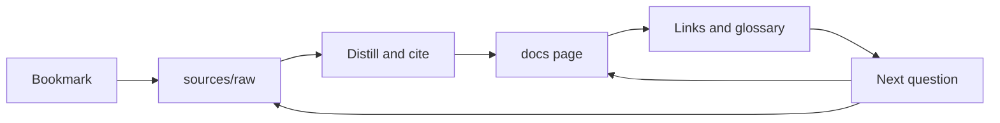

  

  
  &nbsp;
  
  &nbsp;
  
  &nbsp;
  

  

# agentsphere

**The living field guide to the agent era.** Start as a beginner. Leave able to design an agent's memory, tools, orchestration, runtime, and security, and able to tell a sourced claim from a rumor.

This repository is built the way a good research agent should be built. Raw posts stay in [`sources/`](sources/bookmarks.md). Distilled pages live in [`docs/`](docs/README.md). Each new bookmark is written back into the guide, so the next reader starts ahead of the last one.

The seed is ten X bookmarks from 8–10 October 2026. The guide keeps growing as new bookmarks are added.

## Choose a path

| Path | Start here if you | Read | You will be able to |
| --- | --- | --- | --- |
| **Explorer** | are new to agents | [Foundations](docs/00-foundations/index.md), the [glossary](docs/glossary.md), and [the loop](docs/00-foundations/the-agent-loop.md) | explain an agent, its loop, and its memory |
| **Builder** | want to make one | [Tools and MCP](docs/02-tools-mcp/index.md), [skills](docs/03-prompting-skills/index.md), and [wiki memory](docs/01-agent-patterns/wiki-memory.md) | design a research agent that writes pages back |
| **Operator** | run agents for a team | [Cloud and local](docs/05-runtime-infra/cloud-and-local.md), [orchestration](docs/04-multi-agent/orchestration.md), [evals](docs/06-evals/index.md), and [security](docs/07-security/index.md) | pick a runtime and name the risks |
| **Power user** | want the practice | [Playbooks](docs/09-playbooks/index.md), [case studies](docs/08-case-studies/index.md), and [contributing](CONTRIBUTING.md) | add a bookmark without inventing facts |

Sequences, timing, and a readiness check for each path: [Learning paths](docs/learning-paths.md).

## Map

| | Section | What it covers |
| --- | --- | --- |
| 00 | [Foundations](docs/00-foundations/index.md) | Definition, the loop, memory, tools, planning |
| 01 | [Agent patterns](docs/01-agent-patterns/index.md) | ReAct, plan-and-execute, wiki memory |
| 02 | [Tools and MCP](docs/02-tools-mcp/index.md) | Tools, Model Context Protocol, gateways |
| 03 | [Prompting and skills](docs/03-prompting-skills/index.md) | Prompts, skill packs, creative stacks |
| 04 | [Multi-agent](docs/04-multi-agent/index.md) | Lead agents, phases, merging results |
| 05 | [Runtime and infra](docs/05-runtime-infra/index.md) | Cloud and local runs, efficient inference |
| 06 | [Evals](docs/06-evals/index.md) | How to tell that an agent got better |
| 07 | [Security](docs/07-security/index.md) | Threat model, review gates, supply chain |
| 08 | [Case studies](docs/08-case-studies/index.md) | The ten seed bookmarks, distilled |
| 09 | [Playbooks](docs/09-playbooks/index.md) | Recipes you can run this week |

Also: [glossary](docs/glossary.md), [how to read a claim](docs/how-to-read.md), [community list](docs/community.md), [diagram atlas](docs/diagrams.md), [bookmark index](sources/bookmarks.md).

## How this guide learns

  

A question searches the pages first. A gap sends you back to the raw post. The answer is written down before the session ends.

That pattern comes from a bookmarked account of a research-agent workflow attributed to Andrej Karpathy: raw sources stay raw, useful parts become linked wiki pages, and the wiki is checked first. [Source, per post](https://x.com/fleyta88/status/2108619644399415565).

## How claims are marked

| Mark | Meaning |
| --- | --- |
| **Established** | Widely documented practice, a public paper, or an official project page |
| **Per post** | Stated in a bookmarked post. Kept, cited, and left unverified by this guide |
| **Synthesis** | This guide's own organization of the two |

Read the short rules before you quote a number from these pages: [How to read agentsphere](docs/how-to-read.md).

## Seed

Ten bookmarks, 8–10 October 2026. [Full index, with the pages that cite each one](sources/bookmarks.md).

| | Post | Topic |
| --- | --- | --- |
| B1 | [@oliviscusAI](https://x.com/oliviscusAI/status/2108786434991923251) | bitnet.cpp, 1-bit inference |
| B2 | [@fleyta88](https://x.com/fleyta88/status/2108619644399415565) | Wiki memory for research agents |
| B3 | [@ai_explorer25](https://x.com/ai_explorer25/status/2108746842620014807) | Accounts to follow |
| B4 | [@ClaudeDevs](https://x.com/ClaudeDevs/status/2108591328732856655) | Managed multi-agent workflows |
| B5 | [@himanshubuildss](https://x.com/himanshubuildss/status/2108540618553356666) | Libraries for building sites with AI |
| B6 | [@Bober_smart](https://x.com/Bober_smart/status/2108293657552117850) | OmniRoute, a local model gateway |
| B7 | [@antigenco](https://x.com/antigenco/status/2108334286978113634) | Antigen, a security agent |
| B8 | [@thesupermannx](https://x.com/thesupermannx/status/2108098865073410484) | LittleBit, sub-1-bit compression |
| B9 | [@N01ennn](https://x.com/N01ennn/status/2108182955671580771) | Motion-design skill repositories |
| B10 | [@ryancarson](https://x.com/ryancarson/status/2108286700468191266) | Cloud agents and local licenses |

## Add the next bookmark

The update rules live in [CONTRIBUTING](CONTRIBUTING.md). The short checklist is [sources/ADDING_BOOKMARKS.md](sources/ADDING_BOOKMARKS.md). New material lands in `sources/` first, then in the page a reader will actually open.
