

  <picture>
    <source media="(prefers-color-scheme: dark)" srcset="assets/banner-dark.png">
    
  </picture>

  <a href="https://morohn.github.io/agentsphere/">
    <picture>
      <source media="(prefers-color-scheme: dark)" srcset="assets/badges/read-online-dark.svg">
      
    </picture>
  </a>

  <a href="CHANGELOG.md">
    <picture>
      <source media="(prefers-color-scheme: dark)" srcset="assets/badges/version-dark.svg">
      
    </picture>
  </a>
  &nbsp;
  <a href="docs/learning-paths.md">
    <picture>
      <source media="(prefers-color-scheme: dark)" srcset="assets/badges/paths-dark.svg">
      
    </picture>
  </a>
  &nbsp;
  <a href="docs/references.md">
    <picture>
      <source media="(prefers-color-scheme: dark)" srcset="assets/badges/references-dark.svg">
      
    </picture>
  </a>

# agentsphere

**A field guide to AI agents.** A chatbot answers and waits. An agent takes the next steps for you. Start with the level that matches you. No coding required to begin.

  
  &nbsp;
  
  &nbsp;
  
  &nbsp;
  

New here? Open [Explorer](paths/explorer/README.md). It takes about fifteen minutes. You will know what an agent is, and you will have a task you can paste into one.

The rest of the pages live in [`docs/`](docs/README.md). Posts and papers that shaped them are in [Social references & inspirations](docs/references.md). A claim from a post stays linked. A claim from a paper stays linked too.

## Choose a level

  <picture>
  <source media="(prefers-color-scheme: dark)" srcset="assets/diagrams/journey-map-dark.svg">
  
</picture>

| Level | Start here if you | Open the guide | You will be able to |
| --- | --- | --- | --- |
| **[Explorer](paths/explorer/README.md)** | have never used an agent, or you only know chatbots | [Explorer](paths/explorer/README.md) | explain an agent in everyday words, and try one safely |
| **[Builder](paths/builder/README.md)** | want to make one | [Builder](paths/builder/README.md) | build one small agent: a loop, a tool, notes, a skill, and a check |
| **[Operator](paths/operator/README.md)** | run agents for a team | [Operator](paths/operator/README.md) | choose where a job runs, and score it |
| **[Power user](paths/power-user/README.md)** | already run them, and one is stuck | [Power user](paths/power-user/README.md) | fix it by changing one thing |

The short sequences and the readiness checks: [Learning paths](docs/learning-paths.md).

| If you need to | Open |
| --- | --- |
| Explain an agent to someone else | [Foundations](docs/00-foundations/index.md) |
| See why the same model scores differently | [Harness engineering](docs/01-agent-patterns/harness-engineering.md) |
| Leave notes the next chat can find | [Wiki memory](docs/01-agent-patterns/wiki-memory.md), then the [research playbook](docs/09-playbooks/research-agent.md) |
| Save a repeated job so you stop pasting it | [Write a skill](docs/09-playbooks/write-a-skill.md) |
| Choose your laptop or a cloud computer | [Operate agents](docs/09-playbooks/operate-agents.md) |
| Decide whether a middleman can read your prompts | [Review a gateway](docs/09-playbooks/review-a-gateway.md) |
| Tell whether a change helped | [Score a run](docs/09-playbooks/score-a-run.md) |
| Stop an agent that repeats itself or invents facts | [Unstick a loop](docs/09-playbooks/unstick-a-loop.md) |
| Compare Grok Bot, Dots, Muse, and Claude | [Hosted agents](docs/10-hosted-agents/index.md) |

## The idea under the guide

The AI model writes the next step. The system around it decides what the model can see, what it may do, what it remembers, and when it must stop. This guide calls that system the **harness**. Guo, Hao, Wang, and colleagues lay this out in [From Question Answering to Task Completion: A Survey on Agent System and Harness Design](https://arxiv.org/abs/2606.20683). The full page is [Harness engineering](docs/01-agent-patterns/harness-engineering.md).

  <picture>
  <source media="(prefers-color-scheme: dark)" srcset="assets/diagrams/harness-hero-dark.svg">
  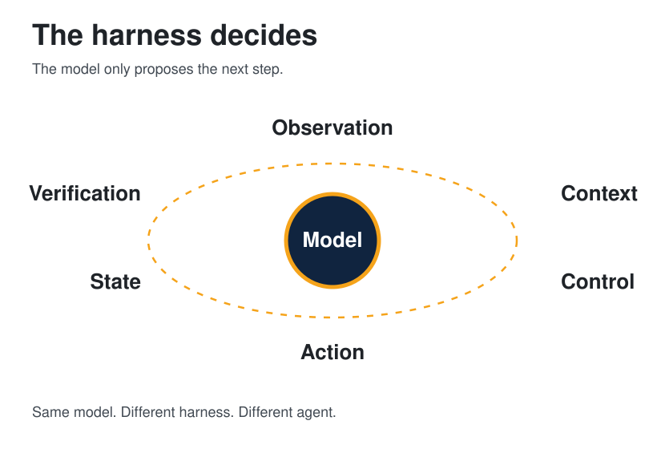
</picture>

| | The model alone | The model plus the harness |
| --- | --- | --- |
| What it can do | Suggest a next step in words | See, act, save, and check that step |
| What is still there tomorrow | Only this chat, if you leave it open | Pages, files, and saved steps |
| What a score means | "The model scored N" | "This model, in this setup" |
| Where you change it | A longer prompt | The weak piece: what it sees, what it may do, what it remembers, or the check |

The six parts, in one screen

| Part | In everyday words | Read |
| --- | --- | --- |
| Observation | What it is allowed to look at | [The loop](docs/00-foundations/the-agent-loop.md) |
| Context | What you put in front of it for this step | [How agents remember](docs/01-agent-patterns/how-agents-remember.md) |
| Control | Whether it plans, acts, retries, or stops | [ReAct](docs/01-agent-patterns/react-and-plan-execute.md), [several agents](docs/04-multi-agent/orchestration.md) |
| Action | The move it is allowed to make | [Tools](docs/02-tools-mcp/tools-and-mcp.md) |
| State | What is still there tomorrow | [Wiki memory](docs/01-agent-patterns/wiki-memory.md) |
| Verification | The check before the result counts | [Threat model](docs/07-security/threat-model.md) |

People still mix four habits: a careful prompt, a careful packet of context, a harness around the model, and training that leaves access and safety outside the weights. A later habit does not retire an earlier one.

## Map

Eleven sections. Each card is a link. The pill is who the section is written for.

<a href="docs/00-foundations/index.md"><picture>
  <source media="(prefers-color-scheme: dark)" srcset="assets/map/foundations-dark.svg">
  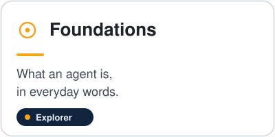
</picture></a>
<a href="docs/01-agent-patterns/index.md"><picture>
  <source media="(prefers-color-scheme: dark)" srcset="assets/map/patterns-dark.svg">
  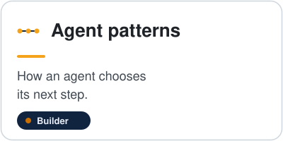
</picture></a>

<a href="docs/02-tools-mcp/index.md"><picture>
  <source media="(prefers-color-scheme: dark)" srcset="assets/map/tools-dark.svg">
  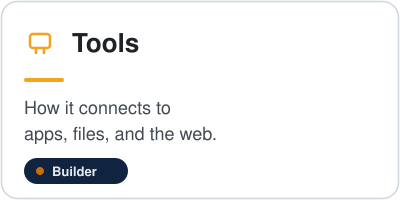
</picture></a>
<a href="docs/03-prompting-skills/index.md"><picture>
  <source media="(prefers-color-scheme: dark)" srcset="assets/map/skills-dark.svg">
  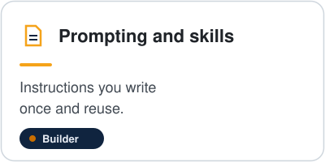
</picture></a>

<a href="docs/04-multi-agent/index.md"><picture>
  <source media="(prefers-color-scheme: dark)" srcset="assets/map/multi-dark.svg">
  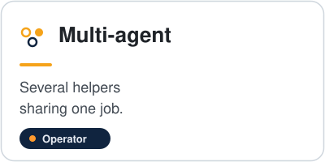
</picture></a>
<a href="docs/05-runtime-infra/index.md"><picture>
  <source media="(prefers-color-scheme: dark)" srcset="assets/map/runtime-dark.svg">
  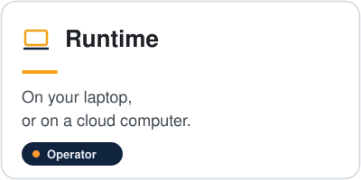
</picture></a>

<a href="docs/06-evals/index.md"><picture>
  <source media="(prefers-color-scheme: dark)" srcset="assets/map/evals-dark.svg">
  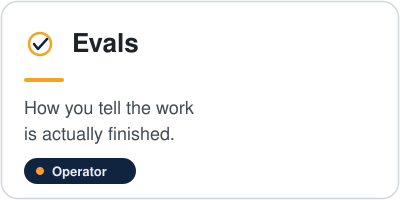
</picture></a>
<a href="docs/07-security/index.md"><picture>
  <source media="(prefers-color-scheme: dark)" srcset="assets/map/security-dark.svg">
  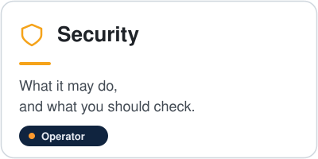
</picture></a>

<a href="docs/08-case-studies/index.md"><picture>
  <source media="(prefers-color-scheme: dark)" srcset="assets/map/stories-dark.svg">
  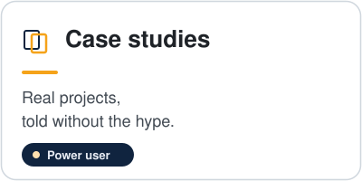
</picture></a>
<a href="docs/09-playbooks/index.md"><picture>
  <source media="(prefers-color-scheme: dark)" srcset="assets/map/playbooks-dark.svg">
  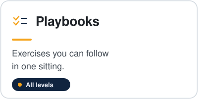
</picture></a>

<a href="docs/10-hosted-agents/index.md"><picture>
  <source media="(prefers-color-scheme: dark)" srcset="assets/map/hosted-dark.svg">
  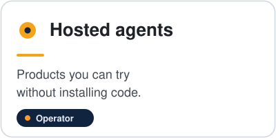
</picture></a>

Same links, as text:

- [Foundations](docs/00-foundations/index.md) — what an agent is, in everyday words.
- [Agent patterns](docs/01-agent-patterns/index.md) — how an agent chooses its next step.
- [Tools](docs/02-tools-mcp/index.md) — how it connects to apps, files, and the web.
- [Prompting and skills](docs/03-prompting-skills/index.md) — instructions you write once and reuse.
- [Multi-agent](docs/04-multi-agent/index.md) — several helpers sharing one job.
- [Runtime and infra](docs/05-runtime-infra/index.md) — your laptop, or a cloud computer.
- [Evals](docs/06-evals/index.md) — how you tell the work is actually finished.
- [Security](docs/07-security/index.md) — what it may do, and what you should check.
- [Case studies](docs/08-case-studies/index.md) — real projects, told without the hype.
- [Playbooks](docs/09-playbooks/index.md) — exercises you can follow in one sitting.
- [Hosted agents](docs/10-hosted-agents/index.md) — products you can try without installing code.

Also: [glossary](docs/glossary.md), [how to read a claim](docs/how-to-read.md), [community list](docs/community.md), [diagram atlas](docs/diagrams.md), [social references & inspirations](docs/references.md). The shelf behind the harness page is [Guo et al. 2026](https://arxiv.org/abs/2606.20683).

## Products you can rent

Some agents are not a repo you clone. They are a product that already chose the computer, the memory, and the gate. The page reads official docs opened on 11 October 2026 and maps each product onto the six harness parts. A feature that was not on those pages is not listed.

  <picture>
  <source media="(prefers-color-scheme: dark)" srcset="assets/diagrams/hosted-agents-dark.svg">
  
</picture>

The comparison, the limits, and the power-user checklist are [Hosted agents](docs/10-hosted-agents/index.md).

## How a research agent keeps what it learns

An agent remembers only what it writes down outside the context window. The window is working memory: rebuilt every call, and worse at using a fact buried in the middle of a long input than a fact at either end. Episodic memory is the trace of what happened. Semantic memory is a page that says what is true, with a source. Procedural memory is a skill or a checklist. A search that pastes passages into the window is not a fifth kind. It is a load. It becomes memory when the conclusion is written back.

  <picture>
  <source media="(prefers-color-scheme: dark)" srcset="assets/diagrams/knowledge-flow-dark.svg">
  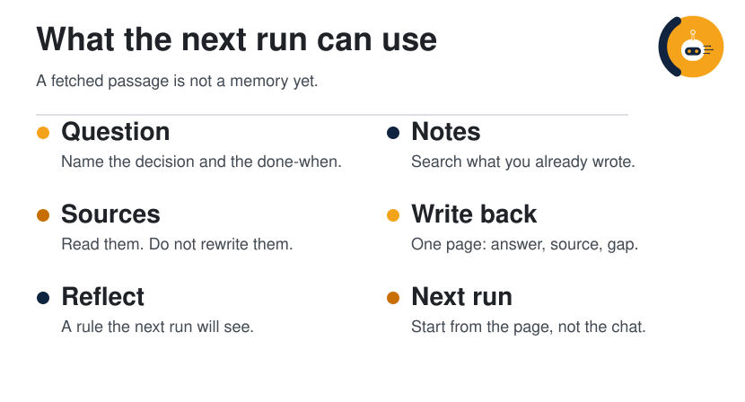
</picture>

  <picture>
  <source media="(prefers-color-scheme: dark)" srcset="assets/diagrams/memory-map-dark.svg">
  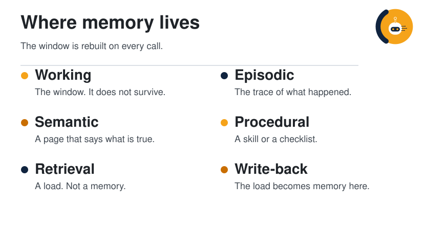
</picture>

| Memory | Lives | Survives the call? |
| --- | --- | --- |
| Working | The window | No |
| Episodic | Traces, logs, reflections | Yes, if you stored them |
| Semantic | Wiki pages with sources | Yes, if you update them |
| Procedural | Skills and checklists | Yes, if they are files |

The loop in the first figure is how a research agent uses those stores. Name the decision and the done-when. Search notes and past traces before the open web. Read sources without rewriting them. Write one page: answer, evidence, gap. Reflect as a rule the next run will see, and drop what that rule does not need. The next question starts on the page.

Three methods sit on top of that loop.

| Method | The move | Where to read it |
| --- | --- | --- |
| Plan, act, observe | Interleave a step with a check of what the tool returned | [ReAct](https://arxiv.org/abs/2210.03629) |
| Reflection | Store a judgment that changes the next attempt | [Reflexion](https://arxiv.org/abs/2303.11366), [Generative Agents](https://arxiv.org/abs/2304.03442) |
| Notes and compaction | Keep a file outside the window. Summarize the window without making the summary the only copy of the decision | [Context engineering](https://www.anthropic.com/engineering/effective-context-engineering-for-ai-agents) |

Patterns, and what to forget

Five patterns follow from those methods.

| Pattern | Use it when |
| --- | --- |
| Notes first | The question might already have a page |
| One page per question | A stranger should be able to answer tomorrow |
| Claim, source, gap | A number or a product feature is in play |
| Reflection as a rule | The same miss will happen again |
| Compact the trace, keep the note | The window is mostly tool output |

Forget on purpose. Raw logs can go once the conclusion is on the page. A stale page cannot stay beside a newer one. A reflection nobody will read is just more text in the window.

| What you see | Change this |
| --- | --- |
| The same search every session | Write the page |
| A fluent answer with no source | Stop treating retrieval as memory |
| After a summary, it forgot the task | Put the decision in a note |
| The same mistake, plus a long self-critique | Store a rule where the next run looks first |

**Checklist.** Done-when is written first. Notes are searched before the web. The page has an answer, a source, and a gap. The raw source was not edited. Something was dropped on purpose. The next run can start without the transcript.

**A worked pass.** The window is full of test logs and the agent has forgotten the file it was migrating. The note already names `billing/client.ts`. The run writes the failing assertion into the note, leaves the log on disk, and drops the log body from the window. The next run opens the note. It does not reread the morning's logs to recover a filename.

The full argument, the paper list, and a longer example: [How agents remember](docs/01-agent-patterns/how-agents-remember.md).

## How claims are marked

| Mark | Meaning |
| --- | --- |
| **Established** | Widely documented practice, a public paper, or an official project page |
| **Per post** | Stated in a cited post. Kept, linked, and left unverified by this guide |
| **Synthesis** | This guide's own organization of the two |

Read the short rules before you quote a number from these pages: [How to read agentsphere](docs/how-to-read.md).

## Social references & inspirations

The posts, articles, and repositories behind the pages are listed, with the page each one shaped, in [Social references & inspirations](docs/references.md).

## Extend the guide

The writing rules live in [CONTRIBUTING](CONTRIBUTING.md). New material is a page a reader will open, with the source linked and the claim marked.
