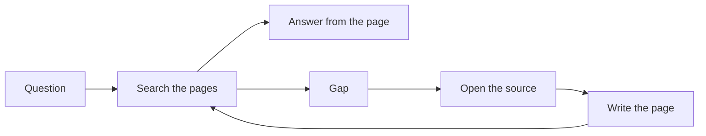

  <picture>
    <source media="(prefers-color-scheme: dark)" srcset="assets/banner-dark.svg">
    
  </picture>

  <a href="CHANGELOG.md">
    <picture>
      <source media="(prefers-color-scheme: dark)" srcset="assets/badges/version-dark.svg">
      
    </picture>
  </a>
  &nbsp;
  <a href="docs/learning-paths.md">
    <picture>
      <source media="(prefers-color-scheme: dark)" srcset="assets/badges/paths-dark.svg">
      
    </picture>
  </a>
  &nbsp;
  <a href="docs/references.md">
    <picture>
      <source media="(prefers-color-scheme: dark)" srcset="assets/badges/references-dark.svg">
      
    </picture>
  </a>

# agentsphere

**The living field guide to the agent era.** Start as a beginner. Leave able to design an agent's memory, tools, orchestration, runtime, and security, and able to tell a sourced claim from a rumor.

The pages in [`docs/`](docs/README.md) are the guide. Posts, articles, and repositories that shaped them are collected in [Social references & inspirations](docs/references.md). A claim from a post stays linked and marked. A claim from a paper or a project page is marked separately.

## Choose a path

| Path | Start here if you | Read | You will be able to |
| --- | --- | --- | --- |
| **Explorer** | are new to agents | [Foundations](docs/00-foundations/index.md), the [glossary](docs/glossary.md), and [the loop](docs/00-foundations/the-agent-loop.md) | explain an agent, its loop, and its memory |
| **Builder** | want to make one | [Tools and MCP](docs/02-tools-mcp/index.md), [skills](docs/03-prompting-skills/index.md), and [wiki memory](docs/01-agent-patterns/wiki-memory.md) | design a research agent that writes pages back |
| **Operator** | run agents for a team | [Cloud and local](docs/05-runtime-infra/cloud-and-local.md), [orchestration](docs/04-multi-agent/orchestration.md), [evals](docs/06-evals/index.md), and [security](docs/07-security/index.md) | pick a runtime and name the risks |
| **Power user** | want the practice | [Playbooks](docs/09-playbooks/index.md), [case studies](docs/08-case-studies/index.md), and [contributing](CONTRIBUTING.md) | extend a page without inventing facts |

Sequences, timing, and a readiness check for each path: [Learning paths](docs/learning-paths.md).

## Map

| | Section | What it covers |
| --- | --- | --- |
| 00 | [Foundations](docs/00-foundations/index.md) | Definition, the loop, memory, tools, planning |
| 01 | [Agent patterns](docs/01-agent-patterns/index.md) | ReAct, plan-and-execute, wiki memory |
| 02 | [Tools and MCP](docs/02-tools-mcp/index.md) | Tools, Model Context Protocol, gateways |
| 03 | [Prompting and skills](docs/03-prompting-skills/index.md) | Prompts, skill packs, creative stacks |
| 04 | [Multi-agent](docs/04-multi-agent/index.md) | Lead agents, phases, merging results |
| 05 | [Runtime and infra](docs/05-runtime-infra/index.md) | Cloud and local runs, efficient inference |
| 06 | [Evals](docs/06-evals/index.md) | How to tell that an agent got better |
| 07 | [Security](docs/07-security/index.md) | Threat model, review gates, supply chain |
| 08 | [Case studies](docs/08-case-studies/index.md) | Posts and projects, with the claim kept separate from the pattern |
| 09 | [Playbooks](docs/09-playbooks/index.md) | Recipes you can run this week |

Also: [glossary](docs/glossary.md), [how to read a claim](docs/how-to-read.md), [community list](docs/community.md), [diagram atlas](docs/diagrams.md), [social references & inspirations](docs/references.md).

## How a research agent keeps what it learns

  

A question searches the pages first. A gap sends you back to the source. The answer is written down before the session ends.

That pattern comes from an account of a research-agent workflow attributed to Andrej Karpathy: raw sources stay raw, useful parts become linked wiki pages, and the wiki is checked first. [Source, per post](https://x.com/fleyta88/status/2108619644399415565).

## How claims are marked

| Mark | Meaning |
| --- | --- |
| **Established** | Widely documented practice, a public paper, or an official project page |
| **Per post** | Stated in a cited post. Kept, linked, and left unverified by this guide |
| **Synthesis** | This guide's own organization of the two |

Read the short rules before you quote a number from these pages: [How to read agentsphere](docs/how-to-read.md).

## Social references & inspirations

The posts, articles, and repositories behind the pages are listed, with the page each one shaped, in [Social references & inspirations](docs/references.md).

## Extend the guide

The writing rules live in [CONTRIBUTING](CONTRIBUTING.md). New material is a page a reader will open, with the source linked and the claim marked.
