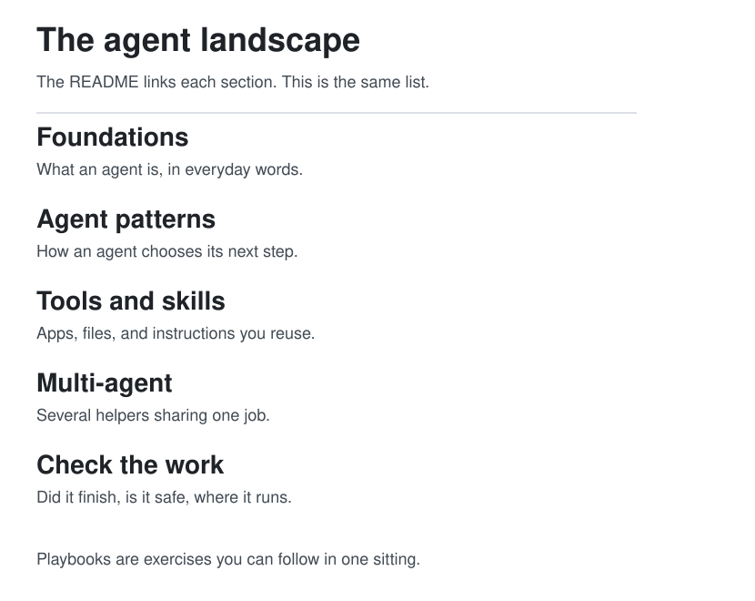

  <picture>
    <source media="(prefers-color-scheme: dark)" srcset="assets/banner-dark.png">
    
  </picture>

  <a href="CHANGELOG.md">
    <picture>
      <source media="(prefers-color-scheme: dark)" srcset="assets/badges/version-dark.svg">
      
    </picture>
  </a>
  &nbsp;
  <a href="docs/learning-paths.md">
    <picture>
      <source media="(prefers-color-scheme: dark)" srcset="assets/badges/paths-dark.svg">
      
    </picture>
  </a>
  &nbsp;
  <a href="docs/references.md">
    <picture>
      <source media="(prefers-color-scheme: dark)" srcset="assets/badges/references-dark.svg">
      
    </picture>
  </a>

# agentsphere

**The living field guide to the agent era.** An agent is a model plus the harness around it. Start as a beginner. Leave able to design that harness: memory, tools, orchestration, runtime, and security, and able to tell a sourced claim from a rumor.

  
  &nbsp;
  
  &nbsp;
  
  &nbsp;
  

The pages in [`docs/`](docs/README.md) are the guide. Posts, articles, and repositories that shaped them are collected in [Social references & inspirations](docs/references.md). A claim from a post stays linked and marked. A claim from a paper or a project page is marked separately.

## Start here in 5 minutes

1. Look at the diagram below and say which circle is the model.
2. Name one harness part that is not the model: observation, context, control, action, state, or verification.
3. Write one sentence a later run would need: the decision, the source, or the gap. That sentence is [wiki memory](docs/01-agent-patterns/wiki-memory.md) in miniature.

Then pick a level and open its guide: [Explorer](paths/explorer/README.md), [Builder](paths/builder/README.md), [Operator](paths/operator/README.md), or [Power user](paths/power-user/README.md).

When you have an hour, do the three that leave you holding a page:

1. [What is an agent](docs/00-foundations/what-is-an-agent.md)
2. [The agent loop](docs/00-foundations/the-agent-loop.md)
3. [Your first agent](docs/09-playbooks/first-agent.md)

## The harness is the agent

Agent quality is the model and the runtime together. The model proposes the next step. The harness decides what it sees, what it may do, what survives the call, and what gets checked. Guo, Hao, Wang, and colleagues lay this out in [From Question Answering to Task Completion: A Survey on Agent System and Harness Design](https://arxiv.org/abs/2606.20683). The full page, with the task-matching rules and the SWE-bench reading, is [Harness engineering](docs/01-agent-patterns/harness-engineering.md).

  <picture>
  <source media="(prefers-color-scheme: dark)" srcset="assets/diagrams/harness-hero-dark.svg">
  
</picture>

| | Model alone | Model plus harness |
| --- | --- | --- |
| What it can do | Propose a next step in language | See, act, store, and check that step |
| What survives the call | Nothing, unless the chat is still open | Pages, diffs, logs, skills |
| What a score means | "The model got N%" | "This model, in this runtime, under this setting" |
| Where to change it | A longer prompt | The thin part: observation, context, control, action, state, or verification |

The six parts, in one screen

| Part | Job | This guide |
| --- | --- | --- |
| Observation | Render the state the next decision needs | [The loop](docs/00-foundations/the-agent-loop.md) |
| Context | Choose what enters this call | [How agents remember](docs/01-agent-patterns/how-agents-remember.md) |
| Control | Plan, act, retry, delegate, or stop | [ReAct](docs/01-agent-patterns/react-and-plan-execute.md), [orchestration](docs/04-multi-agent/orchestration.md) |
| Action | Turn a proposal into a permitted operation | [Tools and MCP](docs/02-tools-mcp/tools-and-mcp.md) |
| State | Keep what the window will forget | [Wiki memory](docs/01-agent-patterns/wiki-memory.md) |
| Verification | Tests, gates, sandbox, rollback, budget | [Threat model](docs/07-security/threat-model.md) |

The four eras still in use: prompt, context, harness, and training that leaves access, state, and safety outside the weights. They coexist. A later era does not retire an earlier one.

## Choose a level

  <picture>
  <source media="(prefers-color-scheme: dark)" srcset="assets/diagrams/journey-map-dark.svg">
  
</picture>

| Level | Start here if you | Open the guide | You will be able to |
| --- | --- | --- | --- |
| **[Explorer](paths/explorer/README.md)** | are new to agents, and you want to use one before you build one | [Explorer](paths/explorer/README.md) | explain an agent, and use Grok Bot or a dot with a stop rule. No code |
| **[Builder](paths/builder/README.md)** | want to make one | [Builder](paths/builder/README.md) | design the harness, memory, tools, and a skill |
| **[Operator](paths/operator/README.md)** | run agents for a team | [Operator](paths/operator/README.md) | place a run, score it, and gate the write |
| **[Power user](paths/power-user/README.md)** | already run them, and a loop is stuck or a workflow is yours to design | [Power user](paths/power-user/README.md) | tune the harness, orchestrate, and change one thin part |

The short sequences and the readiness checks: [Learning paths](docs/learning-paths.md).

| If you need to | Open |
| --- | --- |
| Explain an agent to someone else | [Foundations](docs/00-foundations/index.md) |
| See why the same model scores differently | [Harness engineering](docs/01-agent-patterns/harness-engineering.md) |
| Leave notes the next run can search | [Wiki memory](docs/01-agent-patterns/wiki-memory.md), then the [research playbook](docs/09-playbooks/research-agent.md) |
| Move a procedure out of a giant prompt | [Write a skill](docs/09-playbooks/write-a-skill.md) |
| Choose laptop or cloud for a real task | [Operate agents](docs/09-playbooks/operate-agents.md) |
| Decide whether a gateway can see your prompts | [Review a gateway](docs/09-playbooks/review-a-gateway.md) |
| Tell whether a change helped | [Score a run](docs/09-playbooks/score-a-run.md) |
| Stop a run that thrashes or invents facts | [Unstick a loop](docs/09-playbooks/unstick-a-loop.md) |
| Compare a hosted product to the harness | [Hosted agents](docs/10-hosted-agents/index.md) |

## Map

  <picture>
  <source media="(prefers-color-scheme: dark)" srcset="assets/diagrams/landscape-dark.svg">
  
</picture>

| | Section | What it covers |
| --- | --- | --- |
| 00 | [Foundations](docs/00-foundations/index.md) | Definition, the loop, memory, tools, planning |
| 01 | [Agent patterns](docs/01-agent-patterns/index.md) | The harness, then ReAct, wiki memory, and how agents remember |
| 02 | [Tools and MCP](docs/02-tools-mcp/index.md) | The action interface: tools, Model Context Protocol, gateways |
| 03 | [Prompting and skills](docs/03-prompting-skills/index.md) | Prompts, skill packs, creative stacks |
| 04 | [Multi-agent](docs/04-multi-agent/index.md) | Control across a lead, phases, and a merge |
| 05 | [Runtime and infra](docs/05-runtime-infra/index.md) | Cloud and local runs, efficient inference |
| 06 | [Evals](docs/06-evals/index.md) | How to tell that an agent, and its harness, got better |
| 07 | [Security](docs/07-security/index.md) | Verification: threat model, review gates, supply chain |
| 08 | [Case studies](docs/08-case-studies/index.md) | Posts and projects, with the claim kept separate from the pattern |
| 09 | [Playbooks](docs/09-playbooks/index.md) | Checklists and worked examples, from a first agent card to a scored run |
| 10 | [Hosted agents](docs/10-hosted-agents/index.md) | Closed products people rent: Grok Bot, Muse, Dots, Claude Cowork, and Copilot Studio computer use |

Also: [glossary](docs/glossary.md), [how to read a claim](docs/how-to-read.md), [community list](docs/community.md), [diagram atlas](docs/diagrams.md), [social references & inspirations](docs/references.md). The shelf behind the harness page is [Guo et al. 2026](https://arxiv.org/abs/2606.20683).

## Products you can rent

Some agents are not a repo you clone. They are a product that already chose the computer, the memory, and the gate. The page reads official docs opened on 11 October 2026 and maps each product onto the six harness parts. A feature that was not on those pages is not listed.

  <picture>
  <source media="(prefers-color-scheme: dark)" srcset="assets/diagrams/hosted-agents-dark.svg">
  
</picture>

The comparison, the limits, and the power-user checklist are [Hosted agents](docs/10-hosted-agents/index.md).

## How a research agent keeps what it learns

An agent remembers only what it writes down outside the context window. The window is working memory: rebuilt every call, and worse at using a fact buried in the middle of a long input than a fact at either end. Episodic memory is the trace of what happened. Semantic memory is a page that says what is true, with a source. Procedural memory is a skill or a checklist. A search that pastes passages into the window is not a fifth kind. It is a load. It becomes memory when the conclusion is written back.

  <picture>
  <source media="(prefers-color-scheme: dark)" srcset="assets/diagrams/knowledge-flow-dark.svg">
  
</picture>

  <picture>
  <source media="(prefers-color-scheme: dark)" srcset="assets/diagrams/memory-map-dark.svg">
  
</picture>

| Memory | Lives | Survives the call? |
| --- | --- | --- |
| Working | The window | No |
| Episodic | Traces, logs, reflections | Yes, if you stored them |
| Semantic | Wiki pages with sources | Yes, if you update them |
| Procedural | Skills and checklists | Yes, if they are files |

The loop in the first figure is how a research agent uses those stores. Name the decision and the done-when. Search notes and past traces before the open web. Read sources without rewriting them. Write one page: answer, evidence, gap. Reflect as a rule the next run will see, and drop what that rule does not need. The next question starts on the page.

Three methods sit on top of that loop.

| Method | The move | Where to read it |
| --- | --- | --- |
| Plan, act, observe | Interleave a step with a check of what the tool returned | [ReAct](https://arxiv.org/abs/2210.03629) |
| Reflection | Store a judgment that changes the next attempt | [Reflexion](https://arxiv.org/abs/2303.11366), [Generative Agents](https://arxiv.org/abs/2304.03442) |
| Notes and compaction | Keep a file outside the window. Summarize the window without making the summary the only copy of the decision | [Context engineering](https://www.anthropic.com/engineering/effective-context-engineering-for-ai-agents) |

Patterns, and what to forget

Five patterns follow from those methods.

| Pattern | Use it when |
| --- | --- |
| Notes first | The question might already have a page |
| One page per question | A stranger should be able to answer tomorrow |
| Claim, source, gap | A number or a product feature is in play |
| Reflection as a rule | The same miss will happen again |
| Compact the trace, keep the note | The window is mostly tool output |

Forget on purpose. Raw logs can go once the conclusion is on the page. A stale page cannot stay beside a newer one. A reflection nobody will read is just more text in the window.

| What you see | Change this |
| --- | --- |
| The same search every session | Write the page |
| A fluent answer with no source | Stop treating retrieval as memory |
| After a summary, it forgot the task | Put the decision in a note |
| The same mistake, plus a long self-critique | Store a rule where the next run looks first |

**Checklist.** Done-when is written first. Notes are searched before the web. The page has an answer, a source, and a gap. The raw source was not edited. Something was dropped on purpose. The next run can start without the transcript.

**A worked pass.** The window is full of test logs and the agent has forgotten the file it was migrating. The note already names `billing/client.ts`. The run writes the failing assertion into the note, leaves the log on disk, and drops the log body from the window. The next run opens the note. It does not reread the morning's logs to recover a filename.

The full argument, the paper list, and a longer example: [How agents remember](docs/01-agent-patterns/how-agents-remember.md).

## How claims are marked

| Mark | Meaning |
| --- | --- |
| **Established** | Widely documented practice, a public paper, or an official project page |
| **Per post** | Stated in a cited post. Kept, linked, and left unverified by this guide |
| **Synthesis** | This guide's own organization of the two |

Read the short rules before you quote a number from these pages: [How to read agentsphere](docs/how-to-read.md).

## Social references & inspirations

The posts, articles, and repositories behind the pages are listed, with the page each one shaped, in [Social references & inspirations](docs/references.md).

## Extend the guide

The writing rules live in [CONTRIBUTING](CONTRIBUTING.md). New material is a page a reader will open, with the source linked and the claim marked.
