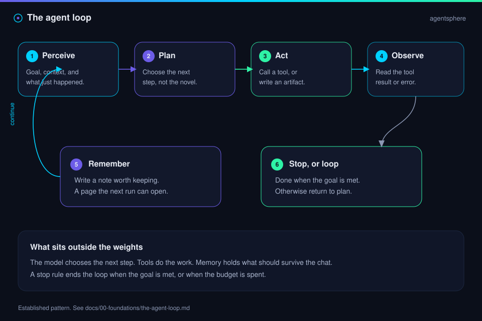
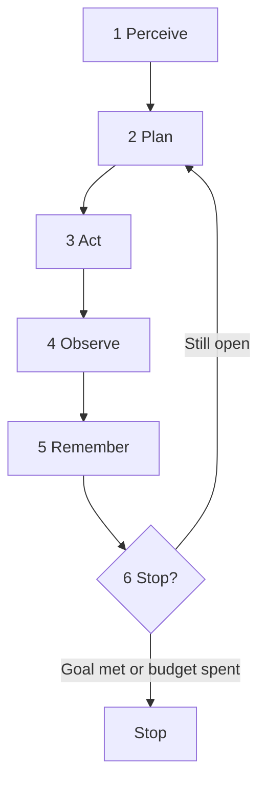

  

# The agent loop

The model chooses the next step. The loop is everything around that choice: looking, acting, reading the result, writing down what matters, and knowing when to end.

| | |
| --- | --- |
| Path | Explorer |
| Time | About 15 minutes |
| You need | [What is an agent](what-is-an-agent.md) |

## What you will be able to do

- Walk a run as six steps.
- Spot a loop that can only spend budget.
- Read a trace as a trajectory, not as a vibe.

## Six steps

| Step | The agent is | A research example |
| --- | --- | --- |
| 1. Perceive | Reading the goal and the latest context | "What does B2 claim about memory?" |
| 2. Plan | Choosing the next step, small enough to check | "Open the post before writing the page." |
| 3. Act | Calling a tool or writing an artifact | Fetch the post. Append a paragraph. |
| 4. Observe | Reading what came back, including errors | The post mentions a wiki and a schema. It does not link a repo. |
| 5. Remember | Writing what the next step, or the next run, will need | A page that says "no repo URL in the post." |
| 6. Stop, or loop | Ending, or returning to plan | Stop when the page cites the post and marks the gap. |

> [!TIP]
> **Established.** The same skeleton shows up under many names. ReAct stresses the tight cycle of reasoning and action. Plan-and-execute pulls step 2 out so a longer job has a visible plan. Both are still this loop. The patterns page compares them: [ReAct and plan-and-execute](../01-agent-patterns/react-and-plan-execute.md).

## Where loops fail

| Failure | What you see | What to add |
| --- | --- | --- |
| No stop | Steps continue after the goal is met | A written definition of done, and a budget |
| No memory | The same search happens every session | A page written in step 5 |
| Action without observation | The agent declares success it did not check | A required read of the tool result |
| Planning forever | Outlines of outlines, no tool call | A rule that a plan step must end in an action |
| One giant action | "Do the whole project" as a single tool call | Smaller acts, each with an observation |

The memory failure is the one these posts care about most. A normal research chat can answer a hundred questions and leave a hundred dead transcripts. The alternative, attributed in a post to Andrej Karpathy, is a wiki the next question searches first ([B2](https://x.com/fleyta88/status/2108619644399415565), per post). That design is [wiki memory](../01-agent-patterns/wiki-memory.md).

## Trajectory

The final answer is one artifact. The **trajectory** is the list of steps that produced it: each plan, each tool call, each observation. When an answer is right for the wrong reason, the trajectory is where you see it. Evals that only score the ending will bless that run. More on this in [evals](../06-evals/index.md).

A useful trace is short enough to read. Store the tool name, the arguments that matter, the result summary, and the decision that followed. Store secrets nowhere in that trace.

## Check yourself

1. Put these in order: observe, act, perceive, remember, plan, stop.
2. You have a run that searched the web twelve times for the same fact. Which step is thin?
3. Why keep the trajectory when the final file looks fine?

## Sources

- Established description of the agent loop, as used throughout this guide.
- [B2](https://x.com/fleyta88/status/2108619644399415565) — @fleyta88, 2026-10-09. The search-answer-forget failure, per post.

## Continue

- Next: [Memory, tools, and planning](memory-tools-planning.md)
- Previous: [What is an agent](what-is-an-agent.md)

---

[Map](../README.md) | [Paths](../learning-paths.md) | [Glossary](../glossary.md) | [References](../references.md)
