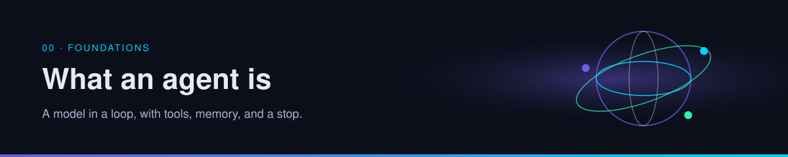

  

# What is an agent

An agent is a model in a loop, pointed at a goal, allowed to use tools, and required to stop.

| | |
| --- | --- |
| Path | Explorer |
| Time | About 15 minutes |
| You need | Nothing |

## What you will be able to do

- Point at the six parts of an agent in a product you already use.
- Tell a long chat from an agent by looking at tools, memory, and the stop rule.
- See which part each reference is actually about.

## The six parts

| Part | What it is | If it is missing |
| --- | --- | --- |
| **Model** | The component that chooses the next step from the text it can see | You have a script, which can still be the right tool |
| **Instructions** | The standing rules: role, format, what "done" means | The model invents a new job on every turn |
| **Tools** | Actions with a name and a side effect: read, search, write, call an API | The model can only talk |
| **Memory** | State that survives a step, and the state you mean to survive a session | The next run starts from zero |
| **Environment** | Where the loop runs: a laptop, a CI job, a remote machine, a browser | You cannot say who can see the files or the keys |
| **Stop** | The condition that ends the loop | The run continues until the budget does |

> [!TIP]
> **Established.** Products market "agents" for very different stacks. The six parts are a way to look past the label. A chatbot with a search button is an agent only for as long as it is looping on a goal. A nightly job that opens a repo, runs tests, and opens a pull request is an agent even if nobody called it one.

## A chat and an agent, side by side

| | A chat turn | An agent run |
| --- | --- | --- |
| Input | Your message | A goal, plus whatever the tools just returned |
| Work | One reply | Many steps |
| Side effects | The reply itself | Files, tickets, messages, pull requests |
| What remains | The transcript, until the window fills | Whatever the agent wrote to memory on purpose |
| End | You send the next message | A stop rule fires |

Both use a model. The agent adds a loop, tools, and a place for the outcome to live.

## A miniature

Goal: "Turn these three posts into one page a teammate can trust."

| Part | In this miniature |
| --- | --- |
| Model | Chooses whether to read another post or to write |
| Instructions | Cite the URL. Mark unverified claims. One page, not three essays. |
| Tools | Open a post, write a markdown file |
| Memory | The page itself, plus a line in an index |
| Environment | Your repo, on your machine or in a cloud run |
| Stop | The page has sources, and every number is marked |

That miniature is also how this repository is maintained. The long version is [wiki memory](../01-agent-patterns/wiki-memory.md).

## Where the references push

The ten posts from 8–10 October 2026 each lean on one part. The rest of the guide unpacks them. None of these one-liners are a verdict. They are a table of contents.

| Source | The part it presses on |
| --- | --- |
| [@fleyta88](https://x.com/fleyta88/status/2108619644399415565), wiki memory | Memory as files, not as a longer transcript |
| [@ClaudeDevs](https://x.com/ClaudeDevs/status/2108591328732856655), managed workflows | One plan across many models |
| [@Bober_smart](https://x.com/Bober_smart/status/2108293657552117850), OmniRoute | Tools and model access behind one local API |
| [@N01ennn](https://x.com/N01ennn/status/2108182955671580771), motion skills | Instructions packaged as skills |
| [@ryancarson](https://x.com/ryancarson/status/2108286700468191266), cloud agents | The environment: a seat on a laptop, or a remote run |
| [@oliviscusAI](https://x.com/oliviscusAI/status/2108786434991923251), [@thesupermannx](https://x.com/thesupermannx/status/2108098865073410484) | The model, made cheap enough to run nearby |
| [@antigenco](https://x.com/antigenco/status/2108334286978113634), Antigen | A loop whose side effects need a human gate |
| [@himanshubuildss](https://x.com/himanshubuildss/status/2108540618553356666) | Libraries a builder's agent can copy from |
| [@ai_explorer25](https://x.com/ai_explorer25/status/2108746842620014807) | People to read. Kept in the [community appendix](../community.md) |

## Check yourself

1. Name the six parts without looking at the table.
2. Take the last AI tool you opened. Which parts does it actually have?
3. Which reference is about memory, and which is about where the run happens?

## Sources

Established practice, organized for this guide. The rows above are signposts. Their claims are handled on the pages linked above.

## Continue

- Next: [The agent loop](the-agent-loop.md)
- Practice: [Your first agent](../09-playbooks/first-agent.md)
- Map: [Foundations](index.md)

---

[Map](../README.md) | [Paths](../learning-paths.md) | [Glossary](../glossary.md) | [References](../references.md)
