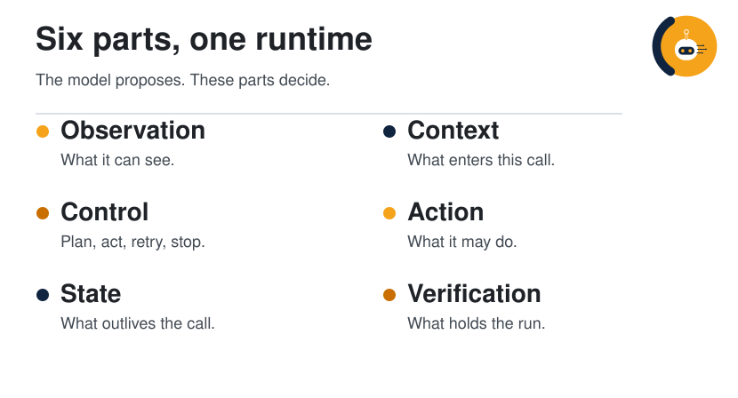
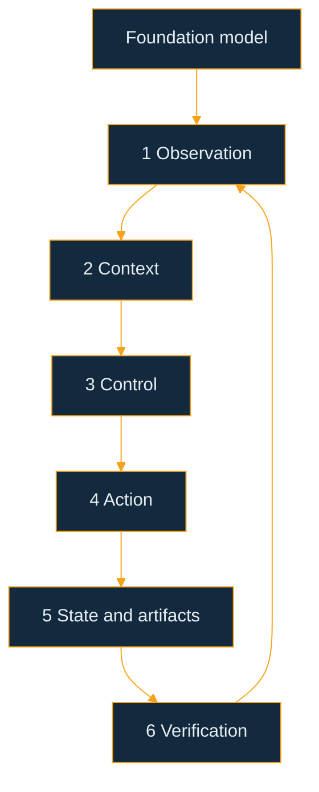
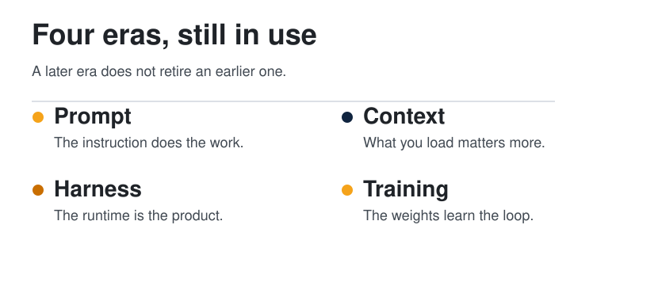

  <picture>
  <source media="(prefers-color-scheme: dark)" srcset="../../assets/diagrams/harness-hero-dark.svg">
  
</picture>

  
  &nbsp;
  

# Harness engineering

<strong>You are here:</strong> Harness engineering · <a href="../../paths/builder/README.md">Builder</a> · <a href="../../paths/operator/README.md">Operator</a> 
<strong>Next:</strong> <a href="how-agents-remember.md">How agents remember</a>

An agent is a model plus the system around it. The model suggests the next step. The system decides what the model sees, which actions are allowed, where notes live, and how a failure is caught. This guide calls that system the **harness**. [What is an agent](../00-foundations/what-is-an-agent.md) uses a different list of six: the pieces you can point at in a product. The six on this page are what that system does.

**Why it matters.** Swapping the model does not add a missing file or a missing check. The [Builder guide](../../paths/builder/README.md) builds the smallest harness you can run: a loop, one tool, a notes file, a skill, and a check. This page names the six jobs that system is doing.

| | |
| --- | --- |
| Path | Builder, then Operator |
| Time | About 25 minutes |
| You need | [The agent loop](../00-foundations/the-agent-loop.md) and [how agents remember](how-agents-remember.md) |

The source for this page is Guo, Hao, Wang, Fan, Luo, Li, Gao, Mei, Peng, Xu, Dong, Wu, Zheng, Han, Wang, Xu, and Wang, [From Question Answering to Task Completion: A Survey on Agent System and Harness Design](https://arxiv.org/abs/2606.20683) (arXiv:2606.20683, 2026). A shelf of the papers it discusses is [ggjy/Awesome-Agent-Engineering](https://github.com/ggjy/Awesome-Agent-Engineering). An X post by [@undefinedKi](https://x.com/undefinedKi/status/2109020007103332636) pointed this guide at the survey.

## What you will be able to do

- Separate the model from the harness, and name the six runtime parts.
- Place a task's pressure on the part that will actually fail.
- Read a benchmark score as a model–harness pair, including the SWE-bench Verified comparisons the survey reports.
- Write a harness checklist before you add another tool.

## The model is necessary, and it is not the whole agent

At the functional level, an agent perceives an environment, keeps state, decides, acts, and adapts from feedback. That loop is older than language models. At the implementation level, an LLM agent is the model coupled to an execution harness. The survey writes that as a model plus six runtime responsibilities: observation, context, control, action, state, and verification/governance.

The model supplies language, planning, and action proposals. It does not, by itself, define the observations, the permissions, the store, the check, or the recovery. A proposal is not yet an executed action. The harness validates, dispatches, observes, and sometimes rejects it.

> [!TIP]
> **Established.** Guo et al. treat agent performance as a property of the model–harness pairing. The same model under a different runtime is a different system. The post's wording of that claim is a pointer. The argument below follows the paper.

## Six parts, one runtime

  <picture>
  <source media="(prefers-color-scheme: dark)" srcset="../../assets/diagrams/harness-dark.svg">
  
</picture>

The figure is the implementation view. Read it as a coupled loop. Improving one part moves pressure onto another: a richer observation costs context, a wider action needs a stronger check, and a longer memory can feed the model a stale fact.

| Part | The job | The tradeoff the survey names | Where this guide already teaches it |
| --- | --- | --- | --- |
| **Observation** | Turn the environment into something the next decision can use: a diff, a log, a page, a DOM | Richer views ground the model, and they add noise and cost | The observe step of [the loop](../00-foundations/the-agent-loop.md) |
| **Context** | Choose what enters this call, and in what form | A raw history keeps detail and does not scale. A summary is cheaper and can drop the decision | [How agents remember](how-agents-remember.md) |
| **Control** | Advance the run: plan, act, retry, delegate, hand off, or stop | A freer loop adapts, and it drifts. A tighter plan is stable, and it can overconstrain | [ReAct](react-and-plan-execute.md) and [orchestration](../04-multi-agent/orchestration.md) |
| **Action** | Map a proposal onto a real operation, with a schema and a permission | Low-level tools are general and brittle. High-level tools are reliable and narrower | [Tools and MCP](../02-tools-mcp/tools-and-mcp.md) |
| **State** | Persist plans, checkpoints, diffs, logs, and artifacts past the window | Storing more helps the next step, until the store is stale or impossible to search | [Wiki memory](wiki-memory.md) |
| **Verification** | Test, constrain, and repair: assertions, sandboxes, approval, rollback, budget, audit | Looser limits explore further. Tighter limits block harm, and they can block the task | [Threat model](../07-security/threat-model.md) and [the review gate](../07-security/find-fix-retest.md) |

The mapping from the functional loop to these parts is many-to-many. Perception needs both the observation interface and the context manager. Feedback needs the check, the control decision, and a state update. Memory in the abstract becomes, in a real system, context selection plus an artifact store.

Four design principles recur in the survey's account of this phase:

| Principle | What to build |
| --- | --- |
| **Legibility** | Expose the right state, at a level the next decision can use |
| **Mechanical enforcement** | Put safety and reproducibility in the runtime. A prompt that says "be careful" is not a gate |
| **Verification in the loop** | A long run without an intermediate check is brittle |
| **Explicit artifacts** | Plans, logs, diffs, and summaries exist as objects a later step, or a person, can open |

The SVG is the designed figure. This block is the same cycle in a form you can edit.

## Four eras, all still in use

The survey organizes the literature as four paradigms. Each one answered a limit of the one before it. They are a lens, not a calendar. A prompt, a context policy, a harness, and a trained model can all be present in one system.

  <picture>
  <source media="(prefers-color-scheme: dark)" srcset="../../assets/diagrams/harness-eras-dark.svg">
  
</picture>

| Era | The question it answers | Where it stops |
| --- | --- | --- |
| **Prompt engineering** | How do I ask so the model uses a capability it already has? | It does not supply missing knowledge, hold changing state, or recover from a bad action |
| **Workflows and context engineering** | What information, tools, and artifacts should this step see? | The input can be excellent and the run can still drift, with no structural check |
| **Harness engineering** | How does the runtime keep the whole trajectory on track? | Hand-built policies still have to be designed, searched, or edited |
| **Agent-native training and co-evolution** | Which behaviors move into the model, and how do model and harness improve together? | Training does not remove the runtime. Access, state, and safety stay outside the weights |

Inside the harness era, the survey marks two further moves. A multi-model harness routes different models to plan, act, or check. A learnable harness treats those runtime policies as objects you can edit or search, with the base model held fixed. Co-evolution is the later question: when the model, the harness, and the improvement loop are updated from traces, under verification and a budget.

## Match the harness to the task

A domain label is a weak description. The survey asks which runtime part absorbs the failure budget. Horizon stresses context, state, and control. The environment stresses observation, action, and the safety boundary. Autonomy stresses verification, logging, and recovery.

The coarsest cut is how long the task is. The survey's levels:

| Level | Shape | Primary bottleneck |
| --- | --- | --- |
| L1 | One step | Context, and a local check |
| L2 | A few steps | Action, state, verification |
| L3 | Long horizon | Context, state, control |
| L4 | Open-ended | Verification, control, and a stop |

The transition the survey calls the consequential one is L2 to L3. A short task can live in one window. A long one needs plans, failed attempts, and partial results to survive that window.

Across domains, the survey's bottleneck migration is: verification in software engineering, observation and action in web and GUI work, context and state in research, verification again in medicine because the constraint is safety, and the control loop in embodied settings. The reusable rules sit under the domain names.

| If the task has | The failure you should expect | Build this |
| --- | --- | --- |
| A long horizon | State drift | Checkpoints, summaries, and artifacts. Design context and the store together |
| Partial observability | The model acts on a guess about hidden state | Structured observations, at the level of the next action |
| A strong oracle | You can tell pass from fail mechanically | A verifier loop and a repair cycle. Coding tests are the clear case |
| A weak or delayed oracle | A fluent ending that nobody can check | Provenance, intermediate review, and a person who accepts the write |
| Irreversible actions | A side effect you cannot undo | A sandbox, a permission gate, and rollback where rollback exists |
| High autonomy | No one is watching the next step | Logs, a budget, and a rule for when to stop or escalate |

Report the pressure with the score. A benchmark is informative when it stresses the same part your deployment will stress. A leaderboard that names only the model has left out the harness.

## What the SWE-bench results show

Section 7.3 of the survey reads public [SWE-bench Verified](https://arxiv.org/abs/2310.06770) results as model–harness pairs. The split is 500 human-validated GitHub issues from twelve Python repositories, filtered out of the original 2,294-instance SWE-bench. Each issue has a hidden test suite. Evaluations run in sandboxed containers with pinned dependencies. Solving one means localizing the defect, editing files, and passing the hidden tests.

The survey is explicit that its table is a synthesis of public reports, not a controlled experiment that swaps one factor at a time. Model snapshots, reasoning settings, retry budgets, and proprietary scaffolds are not aligned. Vendor rows are an upper envelope. They are not an ablation against the open scaffolds. The comparisons it treats as strongest are inside one model family or one harness.

What it reports, in those within-family comparisons:

The comparisons, with the survey's own boundaries

| Comparison | What the survey reports |
| --- | --- |
| Same harness, stronger model | SWE-agent with tools moves from 49.0% on Claude 3.5 Sonnet to 73.2% on Claude Opus 4. mini-SWE-agent moves from 52.8% on Claude 3.7 Sonnet to 76.8% on Claude Opus 4.5 |
| Same model, different harness | GPT-4o runs from 23.2% with SWE-agent to 38.8% with Agentless. Claude 3.5 Sonnet runs from 33.6% with SWE-agent to 53.6% with PatchPilot. On Claude Opus 4 / 4.5 the spread is narrower: 73.2% with SWE-agent plus tools, 76.8% with mini-SWE-agent, 77.6% with OpenHands and CodeAct 2.1 |
| Scaffold size | Under Opus 4.5, mini-SWE-agent, described as roughly 100 lines of Python, reaches 76.8%, close to the richer OpenHands and CodeAct 2.1 runtime at 77.6% |
| Vendor envelope | OpenHands with Opus 4.5 at 77.6% sits about 3 points under a vendor-reported 80.9%. Gemini 3 Pro is 74.2% against a vendor-reported 76.2%. The survey attributes that 2–4 point gap, for those same-generation Claude and Gemini comparisons, to scaffold choices |

Two cautions are in the same section, and they belong next to the numbers. Opus 4.5 with mini-SWE-agent is reported with extended thinking. The same source, the survey says, reports 74.4% under medium reasoning and 67.6% for Opus 4. A GPT-5 comparison of 72.8% against a vendor 80.0% is complicated by model version and inference settings, so this page does not treat that pair as a clean harness effect.

The practical reading is the survey's: model upgrades move the score, harness choice also moves it, and a short scaffold with a well-chosen interface can land near a much larger framework. Report the model, the harness, and the reasoning setting together. The way this guide scores a single run, without a leaderboard, is [evals](../06-evals/index.md) and [score a run](../09-playbooks/score-a-run.md).

## Patterns worth copying

| Pattern | Use it when | Leave it when |
| --- | --- | --- |
| **Name the pair** | You are comparing two agents or two scores | You only changed a prompt and you already know which runtime you held fixed |
| **Observation co-designed with action** | The model keeps missing the state it needs in order to act | The environment is already a clean API with a schema |
| **Externalize the long horizon** | The task is L3 or L4 | The whole job fits in one call |
| **Verifier loop** | A test, a build, or a checker can fail the step | The only judge is a fluent paragraph |
| **Provenance instead of a fake oracle** | The task is research, synthesis, or a weak check | You already have a mechanical pass/fail |
| **Gate the irreversible step** | The action sends, deletes, pays, or writes to a shared system | The action is a read in a sandbox |
| **Small harness, sharp interface** | You are tempted to add a framework before the observation is legible | The missing piece is a real permission or a real check, and the small loop cannot express it |

## Checklist

- [ ] The model and the harness are named separately.
- [ ] The task level is written: L1, L2, L3, or L4.
- [ ] The bottleneck part is named: observation, context, control, action, state, or verification.
- [ ] Observation shows the state the next decision needs, and it leaves the rest out.
- [ ] Context is assembled for this step. The transcript is not the only copy of the decision.
- [ ] Control has a stop, a retry limit, and a rule for delegation.
- [ ] Every action has a schema, a permission, and a result the next step can read.
- [ ] State that must outlive the window is an artifact: a page, a diff, a checkpoint, or a log.
- [ ] Checks that matter are enforced by the runtime. A sentence in the prompt is not a gate.
- [ ] A reported score names the harness and the reasoning setting, not only the model.

## Worked example

Task: the research agent this guide already runs. The job is L3. The oracle is weak, because a page can sound finished and still invent a source. The survey's configuration for that pressure is provenance, intermediate review, and artifacts. This mapping is the guide's, laid onto the six parts.

| Part | What this agent actually has |
| --- | --- |
| Observation | The raw source, left intact, plus the page the last run wrote |
| Context | The question, the skill, and the one page that matches. The corpus stays on disk |
| Control | Search notes, then sources, then write back, then stop. One retry on a failed fetch |
| Action | Read a URL. Write a page. No send, no delete |
| State | `raw/` for the source, a wiki page for the conclusion, a log line for the change |
| Verification | The page has an answer, a URL, and a gap. A person accepts a write that would leave the repo |

A fail is a confident paragraph whose repository name is in neither the notes nor the source. That failure is a verification miss, not a reason to swap the model first. Grade it with [score a run](../09-playbooks/score-a-run.md). If the same miss happens twice, [unstick the loop](../09-playbooks/unstick-a-loop.md) at the thin part.

## Check yourself

1. Which six runtime parts sit around the model?
2. Why can two runs of the same model resolve different shares of SWE-bench Verified?
3. A research task has no unit test. Which harness response does the survey recommend instead of a verifier loop?

## Sources

- [From Question Answering to Task Completion: A Survey on Agent System and Harness Design](https://arxiv.org/abs/2606.20683) — Guo et al., arXiv:2606.20683, 2026. The model-plus-harness thesis, the six components, the four paradigms, the task-to-harness mapping, and the SWE-bench Verified synthesis in Section 7.3.
- [Awesome-Agent-Engineering](https://github.com/ggjy/Awesome-Agent-Engineering) — the survey's collection of related papers and systems.
- [SWE-bench](https://arxiv.org/abs/2310.06770) — Jimenez et al., 2023. The benchmark the survey's Section 7.3 reads. The resolved rates on this page are the survey's synthesis of later public reports, not figures from the 2023 paper.
- [@undefinedKi](https://x.com/undefinedKi/status/2109020007103332636) — 2026-10-10. The post that pointed this guide at the survey. It quotes [an earlier post the same day](https://x.com/undefinedKi/status/2108911763257254302). The paper, not the post, is the source of the methodology and the numbers.

The checklist, the pattern table, and the worked example are this guide's organization of the survey.

## Continue

- Memory, as the context manager and the state store: [How agents remember](how-agents-remember.md) and [wiki memory](wiki-memory.md)
- Tools, as the action interface: [Tools and MCP](../02-tools-mcp/tools-and-mcp.md)
- Several models in one control loop: [Orchestration](../04-multi-agent/orchestration.md)
- Practice: [Research agent](../09-playbooks/research-agent.md)
- The same six parts, rented: [Hosted agents](../10-hosted-agents/index.md)

---

[Map](../README.md) | [Paths](../learning-paths.md) | [Glossary](../glossary.md) | [References](../references.md)
