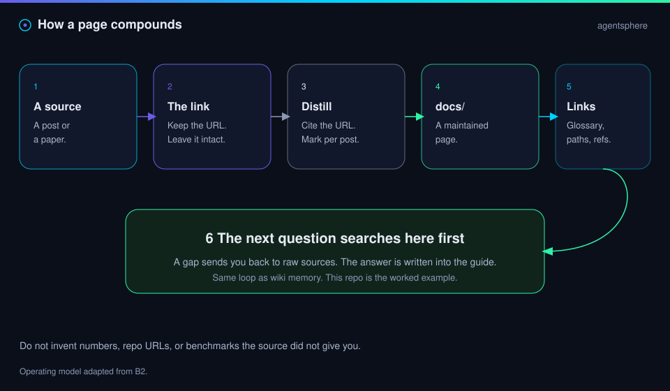
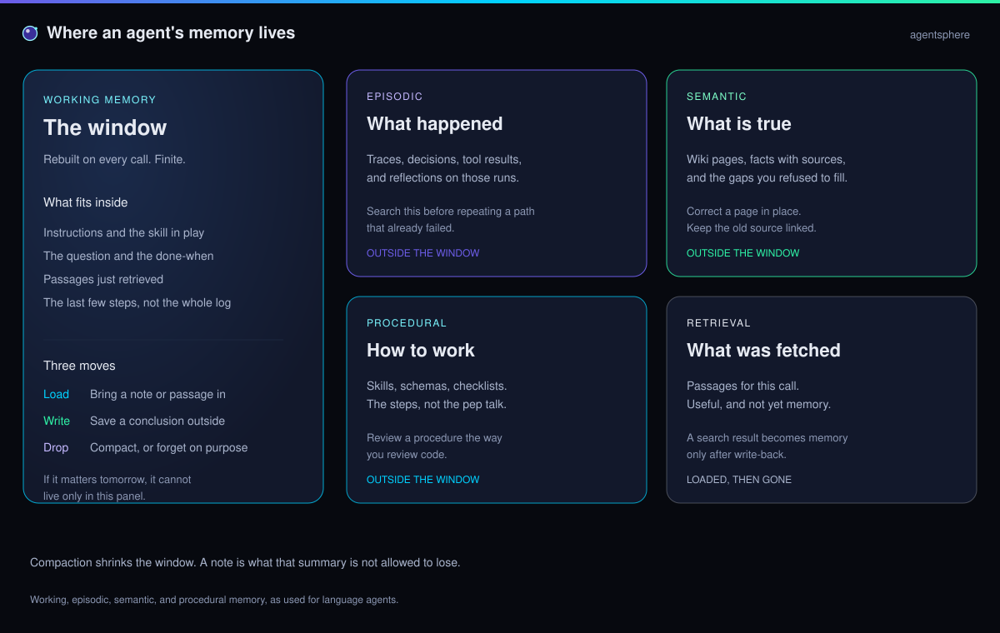
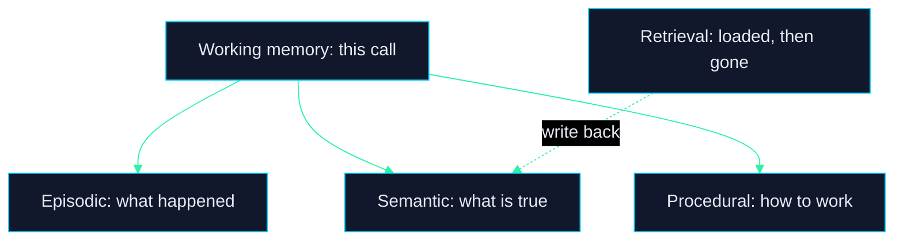
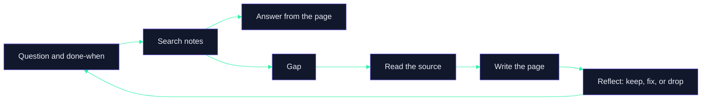

  

  

# How agents remember

An agent that only chats does not remember. It fills a window, answers, and leaves the next run to start from zero. Memory is what you deliberately keep outside that window, and the habit of writing it back.

| | |
| --- | --- |
| Path | Builder |
| Time | About 25 minutes |
| You need | [The agent loop](../00-foundations/the-agent-loop.md) and [wiki memory](wiki-memory.md) |

## What you will be able to do

- Name the four kinds of memory an agent can have, and where each one lives.
- Tell a search result from a memory the next run can trust.
- Run a research loop that writes a page, reflects, and forgets on purpose.
- Decide what a summary of the window is allowed to throw away.

## The window is not the memory

The context window is the text the model can see on one call. It holds the instructions, the question, the passages just fetched, and the recent steps. It is finite. As it grows, attention gets thinner: models use information at the start or the end of a long input more reliably than information buried in the middle ([Lost in the Middle](https://arxiv.org/abs/2307.03172)).

[CoALA](https://arxiv.org/abs/2309.02427) maps the usual split for language agents. Working memory is the window. The other three live outside it, and something has to put them there.

  

| Memory | What it holds | Where it lives | A research agent uses it for |
| --- | --- | --- | --- |
| **Working** | This call only | The context window | The question, the skill, the last few steps |
| **Episodic** | What happened | A trace, a log, a reflection | "We already searched this and the link was shortened." |
| **Semantic** | What is true, with a source | A wiki page | The answer a stranger can read tomorrow |
| **Procedural** | How to work | A skill, a schema, a checklist | The steps, reviewed like code |

Retrieval sits next to these and is easy to confuse with them. [Retrieval-augmented generation](https://arxiv.org/abs/2005.11401) fetches passages and puts them in the window so the model can use them now. That is a load. It is not a memory until a later run can open the conclusion without fetching the passage again.

The SVG is the designed figure. This block is the same split in a form you can edit.

## Write-back is the whole trick

[MemGPT](https://arxiv.org/abs/2310.08560) treats the window like main memory and external storage like disk: the agent pages information in and out, because the window cannot hold the job. The practical version of that paging, for research, is a page someone maintains.

One public account of the pattern, attributed by the poster to Andrej Karpathy, is: raw sources stay raw, the useful part becomes a linked wiki page, and the next question searches the wiki first ([the post](https://x.com/fleyta88/status/2108619644399415565)). The folder layout is the [research playbook](../09-playbooks/research-agent.md). The idea is older than the post. [Generative Agents](https://arxiv.org/abs/2304.03442) store a stream of experiences, retrieve from it, and synthesize higher-level reflections that go back into memory.

Write-back means three files, not a longer chat:

1. The source, unchanged.
2. The page: answer, claim, source URL, gap.
3. The log line: date, question, what changed.

If the page is missing, the run did not remember. It performed.

## Plan, act, observe

[ReAct](https://arxiv.org/abs/2210.03629) interleaves a bit of reasoning with an action and an observation. For memory, the observation is the part people skip. The model says the file was written. The observation is reading the file back. A plan that never becomes a tool call, or an action that is never checked, does not produce a memory. It produces a claim.

Use a tight loop when the next step depends on what the tool just returned. Write the plan down, plan-and-execute, when the job is long enough that the window would otherwise hold the outline instead of the evidence. Both are still perceive, plan, act, observe, remember, stop. The pattern page is [ReAct and plan-and-execute](react-and-plan-execute.md).

## Reflection that changes the next run

A reflection is a note about the run, stored where the next run will see it before it repeats the mistake.

[Reflexion](https://arxiv.org/abs/2303.11366) has the agent judge its own result in words and store that judgment in an episodic buffer, then try again with the judgment in view. [Generative Agents](https://arxiv.org/abs/2304.03442) periodically synthesize observations into higher-level reflections, store them in the same memory stream, and retrieve them later. One example in that paper is a reflection that a character is dedicated to his research on gentrification, with the observations cited underneath. The useful test is behavioral: the next run does something different. A diary entry that no later step reads is not a reflection. It is more window.

Write reflections as rules, not as mood.

| Weak | Strong |
| --- | --- |
| "The search was messy." | "Search notes before the web. The page already had the URL." |
| "I should be more careful." | "If the link is shortened, write the gap. Do not guess the destination." |

## Context engineering and compaction

[Context engineering](https://www.anthropic.com/engineering/effective-context-engineering-for-ai-agents), in Anthropic's phrasing, is finding the smallest possible set of high-signal tokens that still makes the outcome you want likely. The prompt is one part. The rest is everything else that lands in the window: tool results, file dumps, history, retrieved passages. Every extra token spends some of a finite attention budget.

For a long job, that essay names three techniques:

| Technique | What it does | What it must not do |
| --- | --- | --- |
| **Compaction** | Summarize a window that is about to fill, then continue from the summary | Drop the decision, the failing check, or the open question |
| **Structured notes** | A file outside the window, read again later | Become a second transcript |
| **Sub-agents** | One worker returns a short result, not its whole search | Hide a conclusion the lead cannot source |

Compaction is the first lever, and the dangerous one. Anthropic's note is that the art is what you keep. Tool output deep in the history is often safe to drop. The name of the failing test is not. Keep that name in a note, because a summary will sometimes lose the detail whose importance shows up later.

Just-in-time loading is the other half. Keep a path, a query, or a URL, and read the body when the step needs it. Do not paste the corpus into the window at the start "so the agent has context."

In the harness survey, this job is one of six runtime parts, the context manager. The frame that puts it next to observation, control, action, state, and verification is [harness engineering](harness-engineering.md).

## When to forget

Forgetting is a feature. A window that keeps every tool result, and a wiki that never deletes a stale page, both rot.

| Forget this | Keep this |
| --- | --- |
| Raw logs once the conclusion is on the page | The page, with the source URL |
| A passage that was fetched and not used | The gap, if you still do not know |
| A reflection the next run will not read | A rule you are willing to enforce |
| A fact a newer source contradicted | The old source, linked, marked as superseded |
| Duplicate instructions copied into the chat | The skill file |

Delete or mark the stale page in place. Do not leave two pages that answer the same question differently. Do not rewrite the raw source so it matches the new conclusion.

## Failure modes

| What you see | The thin part | The change |
| --- | --- | --- |
| The same search every session | No write-back | A page the next run must open |
| Fluent answers, no sources | Retrieval treated as memory | A claim table with URLs |
| A long self-critique, same mistake next time | Reflection not in the path | A rule stored where step 2 looks |
| After compaction, it forgot the task | Summary dropped the decision | A note outside the summary |
| The wiki and the window disagree | No one is allowed to correct a page | Edit the page. Link both sources. |
| The procedure lives in a chat | Procedural memory was never written | Move the steps into a skill |
| It followed a sentence inside a fetched page | Working memory trusts everything it holds | Treat retrieved text as data. A person accepts writes. |

The last row is a threat, named on the [threat model](../07-security/threat-model.md). This page does not add a procedure for it.

## Patterns worth copying

| Pattern | Use it when | Do not use it when |
| --- | --- | --- |
| **Notes first** | The question might already be answered | You have never written a page |
| **One page per question** | A stranger should be able to answer tomorrow | The "question" is a whole project |
| **Claim, source, gap** | A number or a product feature is in play | You are only renaming a file |
| **Reflection as a rule** | A run failed in a way that will recur | You want a journal |
| **Compact the trace, keep the note** | The window is mostly tool output | The only copy of the decision is in that trace |
| **Skill for the repeated job** | The steps are stable | The job is new and you do not know the steps yet |

## Checklist

- [ ] Done-when is written before the first tool call.
- [ ] Notes are searched before the open web.
- [ ] A fetched passage is not treated as a maintained fact.
- [ ] The page has an answer, a source, and an explicit gap.
- [ ] The raw source was not rewritten.
- [ ] The reflection is a rule the next run will see.
- [ ] Compaction, if you use it, cannot be the only copy of the decision.
- [ ] Something was dropped on purpose: a log, a stale sentence, or a duplicate page.
- [ ] The next run can start from the page without the transcript.

## Worked example

Task: a coding agent filled its window with test logs and then forgot which file it was migrating.

| Move | What a good run does |
| --- | --- |
| Question | "Migrate the billing client. Done when the tests in `billing/` pass and NOTES.md names the remaining failure, if any." |
| Notes | Open NOTES.md before reading the repo. It already says the client lives in `billing/client.ts`. |
| Sources | Read the latest test output and the context-engineering note on what compaction may drop. Do not edit either one. |
| Write back | NOTES.md: the decision, the failing assertion's name, the files in play, and a link to the log file. The log stays on disk. |
| Reflect | Rule: "After a test run, keep the assertion name in NOTES.md. Do not keep the log body in the window." |
| Forget | Drop the log bodies from the window. Do not delete the note. |
| Next run | Starts by reading NOTES.md. It does not re-read the morning's logs to remember the filename. |

That is a pass. A fail is a confident paragraph that names a repository or a file the notes and the test output did not contain. Grade it with [score a run](../09-playbooks/score-a-run.md). If the same miss happens twice, [unstick the loop](../09-playbooks/unstick-a-loop.md) at the thin step, which here is write-back.

The designed figures are the SVGs above. This block is the same loop in a form you can edit.

## Check yourself

1. Which of the four memories is gone when the call ends, unless you wrote it down?
2. Why is a successful retrieval not, by itself, a memory?
3. What must a compaction summary not be the only copy of?

## Sources

- [CoALA](https://arxiv.org/abs/2309.02427) — Sumers, Yao, Narasimhan, and Griffiths, 2023. Working, episodic, semantic, and procedural memory for language agents.
- [Lost in the Middle](https://arxiv.org/abs/2307.03172) — Liu et al., 2023. Long inputs are used less evenly than short ones; the middle is the weak spot.
- [Retrieval-augmented generation](https://arxiv.org/abs/2005.11401) — Lewis et al., 2020. Fetch passages into the generation step.
- [MemGPT](https://arxiv.org/abs/2310.08560) — Packer et al., 2023. Page information between the window and external storage.
- [ReAct](https://arxiv.org/abs/2210.03629) — Yao et al., 2022. Interleave reasoning, actions, and observations.
- [Reflexion](https://arxiv.org/abs/2303.11366) — Shinn et al., 2023. Verbal self-critique stored for the next attempt.
- [Generative Agents](https://arxiv.org/abs/2304.03442) — Park et al., 2023. A memory stream, retrieval, and reflection written back into memory.
- [Effective context engineering for AI agents](https://www.anthropic.com/engineering/effective-context-engineering-for-ai-agents) — Anthropic, 2025. Compaction, notes, and just-in-time loading.
- [A wiki for a research agent](https://x.com/fleyta88/status/2108619644399415565) — @fleyta88, 2026. One account of raw sources, wiki pages, and search-the-wiki-first. The attribution to Karpathy is the post's.

The checklist, the failure table, and the worked example are this guide's organization of those sources.

## Continue

- The runtime around memory: [Harness engineering](harness-engineering.md)
- Practice: [Research agent](../09-playbooks/research-agent.md) and [write a skill](../09-playbooks/write-a-skill.md)
- Previous: [Wiki memory](wiki-memory.md)
- When a run repeats a mistake: [Unstick a loop](../09-playbooks/unstick-a-loop.md)

---

[Map](../README.md) | [Paths](../learning-paths.md) | [Glossary](../glossary.md) | [References](../references.md)
