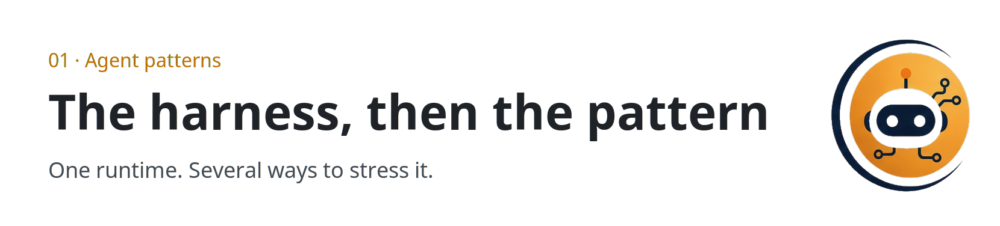

  <picture>
  <source media="(prefers-color-scheme: dark)" srcset="../../assets/sections/01-patterns-dark.png">
  
</picture>

  

# 01 · Agent patterns

<strong>You are here:</strong> Agent patterns · <a href="../../paths/builder/README.md">Builder</a> 
<strong>Next:</strong> <a href="harness-engineering.md">Harness engineering</a>

This section is how an agent chooses its next step, and what it keeps. [Harness engineering](harness-engineering.md) names the system around the model: what it can see, what it may do, and what gets checked. The other pages each press on one part of that system.

| | |
| --- | --- |
| Path | Builder |
| Time | About 95 minutes |
| You need | [The agent loop](../00-foundations/the-agent-loop.md) |

## Pages

| Page | You leave able to |
| --- | --- |
| [Harness engineering](harness-engineering.md) | Separate the model from the six-part runtime, and match that runtime to the task |
| [ReAct and plan-and-execute](react-and-plan-execute.md) | Choose a tight loop or a written plan |
| [Wiki memory](wiki-memory.md) | Design raw, wiki, and schema so the next run is smarter |
| [How agents remember](how-agents-remember.md) | Place working, episodic, semantic, and procedural memory, and write back |

If you only read one page in this section, read the harness. Wiki memory is how this repository itself remembers: search the guide, then write the answer back onto a page.

## Practice

Stand up the folders in the [research-agent playbook](../09-playbooks/research-agent.md). Reading the pattern without a page on disk is still a chat.

## Continue

- [Harness engineering](harness-engineering.md)

---

[Map](../README.md) | [Paths](../learning-paths.md) | [Glossary](../glossary.md) | [References](../references.md)
