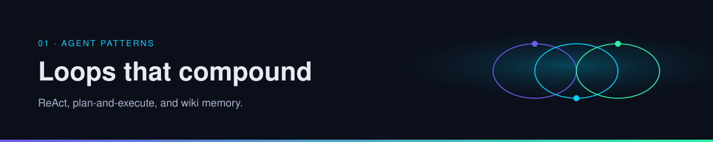
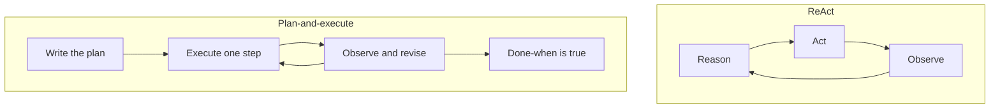

  

# ReAct and plan-and-execute

Two established ways to shape the loop. One keeps the plan inside the next action. The other writes the plan down and then works through it.

| | |
| --- | --- |
| Path | Builder |
| Time | About 15 minutes |
| You need | [The agent loop](../00-foundations/the-agent-loop.md) |

## What you will be able to do

- Describe ReAct as a short cycle of reason, act, and observe.
- Describe plan-and-execute as a plan artifact plus a worker loop.
- Notice the failure mode one post calls search, answer, forget, search again.

## ReAct

**ReAct** (reason + act) is the established pattern of interleaving a little reasoning with a tool call and then reading the observation before the next decision. The model does not write the whole project first. It decides the next concrete action, takes it, and folds the result into the following thought.

Use it when:

- The task is short enough to finish in a handful of tool calls.
- You are exploring, and the next step depends on what the last call returned.
- A separate planning document would be longer than the work.

The risk is local greed. The agent can look busy, each step sensible, and still never write down a conclusion. That is a fine debugging session. It is a poor research practice.

## Plan-and-execute

**Plan-and-execute** splits step 2 of the loop into an artifact:

1. Write the plan: goal, steps, done-when, forbidden actions.
2. Execute one step with a ReAct-sized loop.
3. Observe, and revise the plan if the world disagreed.
4. Stop when the plan's done-when is true.

Use it when:

- The run will outlast your attention.
- More than one agent will share the work.
- A person needs to approve the plan before side effects begin.

The risk is a plan that becomes fan fiction. A plan step that does not end in a tool call or a written artifact is still a wish. Require each step to name its observation.

## The failure the posts start from

[@fleyta88](https://x.com/fleyta88/status/2108619644399415565) describes a research loop as search, answer, forget, search again (per post). Both patterns above can fall into it. ReAct forgets because the transcript is the only store. Plan-and-execute forgets when the plan is thrown away with the chat.

The repair is not a more elaborate planner. It is a place the answer is written, and a rule that the next question looks there first. That repair is the next page.

A related report, from [@ClaudeDevs](https://x.com/ClaudeDevs/status/2108591328732856655), says a lead agent writes a plan that runs across many agents in phases and combines the results at the end (per post, public beta). That is plan-and-execute with extra workers. See [orchestration](../04-multi-agent/orchestration.md).

## Choosing

| Situation | Lean toward |
| --- | --- |
| One sitting, a few tool calls, you are watching | ReAct |
| A goal you can state, work you can split, a definition of done | Plan-and-execute |
| Either, if the same questions will return tomorrow | Add [wiki memory](wiki-memory.md) |

## Check yourself

1. In ReAct, when does the model commit to the entire project?
2. What has to be true of every step in a plan-and-execute run?
3. Which failure survives both patterns until you add a wiki?

## Sources

- Established descriptions of ReAct-style interleaving and of plan-and-execute.
- [B2](https://x.com/fleyta88/status/2108619644399415565) — @fleyta88, 2026-10-09. The forgetful research loop, per post.
- [B4](https://x.com/ClaudeDevs/status/2108591328732856655) — @ClaudeDevs, 2026-10-09. Phased multi-agent plans, per post.

## Continue

- Next: [Wiki memory](wiki-memory.md)
- Previous: [Memory, tools, and planning](../00-foundations/memory-tools-planning.md)

---

[Map](../README.md) | [Paths](../learning-paths.md) | [Glossary](../glossary.md) | [References](../references.md)
