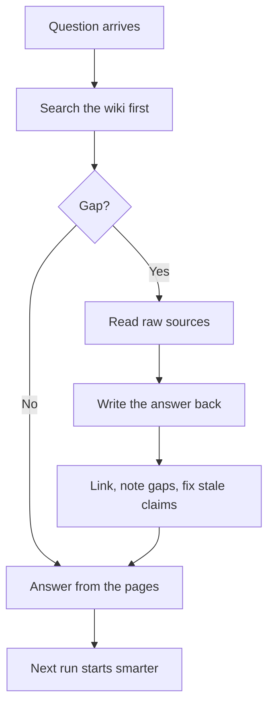

<p align="center">
  <picture>
  <source media="(prefers-color-scheme: dark)" srcset="../../assets/diagrams/wiki-memory-dark.svg">
  
</picture>
</p>

<p>
  <a href="../../paths/builder/README.md"></a>
</p>

# Wiki memory

<p><strong>You are here:</strong> Wiki memory · <a href="../../paths/builder/README.md">Builder</a><br>
<strong>Next:</strong> <a href="how-agents-remember.md">How agents remember</a></p>


Make the agent write something worth remembering. The next question searches that writing first.

A single notes file is enough to feel this. The [Builder guide](../../paths/builder/README.md) stops there on purpose. This page grows that file into raw sources, wiki pages, and rules, so a later run can search what you already decided.

| | |
| --- | --- |
| Path | Builder |
| Time | About 25 minutes |
| You need | [ReAct and plan-and-execute](react-and-plan-execute.md) |

## What you will be able to do

- Explain raw, wiki, and schema.
- Run the compounding loop on a question of your own.
- Say how this differs from fetching passages into a prompt.

## The problem, as the post tells it

[@fleyta88](https://x.com/fleyta88/status/2108619644399415565) describes a workflow the post attributes to Andrej Karpathy (per post). The loop it wants to retire is:

> search, then answer, then forget, then search again

In that loop the work product is a chat. A hundred questions leave a hundred transcripts. The alternative in the post:

- Raw sources stay raw.
- The agent reads them and turns the useful parts into linked wiki pages.
- The next question searches the wiki first.
- A gap sends the agent back to the sources.
- The answer is written into the wiki.
- The next run starts ahead of this one.

The post's architecture, in its own words, is three pieces: `raw/` as the source of truth, `wiki/` as maintained knowledge, and a schema for how updates happen. Search still matters. It stops being the whole product.

> [!NOTE]
> **Per post.** This page teaches the pattern as that post describes it. The post does not include a repository URL, a paper, or a video transcript beyond the status and a related link. This guide does not invent one. The attribution to Karpathy is the post's.

## Three pieces

| Piece | Job | Rule |
| --- | --- | --- |
| **raw/** | Evidence, kept as it arrived | Append. Do not quietly rewrite. |
| **wiki/** | Pages a later run can open, link, and correct | Every non-obvious claim points at a raw source. |
| **schema** | The rules of the edit | Written down, short enough to follow when you are tired |

A page in the wiki is allowed to hold:

- A claim, with the source.
- Links to neighbor pages.
- An explicit gap ("the post does not name a repo").
- A correction, dated, when a later source disagrees.

## The loop



The SVG at the top of this page is the same loop, drawn with the two stores on either side.

## What this is, next to RAG

**RAG** (retrieval-augmented generation) fetches passages and places them in the context window for this call. That is a strong way to ground one answer. It does not, by itself, leave a maintained conclusion.

The post argues that the wiki pattern is "bigger than just better RAG" (per post). The established distinction you can use without taking the slogan on faith:

| | RAG | Wiki memory |
| --- | --- | --- |
| Unit | A retrieved passage | A page someone, or something, maintains |
| When it is read | At question time | At question time, first |
| What the run leaves | A transcript, plus whatever the index already held | An updated page |
| Stale facts | Re-fetched if the corpus changed | Corrected in the page, with the new source |
| Search | The product | One tool inside the product |

Use retrieval to find the passage. Use the wiki so you do not have to rediscover the conclusion. The [research-agent playbook](../09-playbooks/research-agent.md) turns this table into folders and rules.

## How agentsphere follows it

| Karpathy-style piece, per the post | This repository |
| --- | --- |
| raw/ | The original post, linked from the page and listed in [references](../references.md) |
| wiki/ | [`docs/`](../README.md) |
| schema | [CONTRIBUTING](../../CONTRIBUTING.md) |

The picture of that flow is [knowledge-flow-light.svg](../../assets/diagrams/knowledge-flow-light.svg), with a dark twin beside it. The four kinds of memory, retrieval, reflection, and compaction are [how agents remember](how-agents-remember.md). In the harness frame, this wiki is the state and artifact store, and the decision of what to load is the context manager: [harness engineering](harness-engineering.md). Saving a source without updating a page is the forgetful loop, wearing a git commit.

## A page worth writing

After a run, the wiki page should let a stranger answer the same question without the transcript. A reliable shape:

1. The question, in one sentence.
2. The answer, in a few sentences.
3. A claim table: claim, status, source URL.
4. Open gaps.
5. Links to the pages next door.

If you cannot fill the claim table, you are still in the chat.

## A page that passes

This is the shape, filled for a question the guide already answers. Copy the headings, not the conclusion, when the question is yours.

```markdown
# Does the OmniRoute post name a repository?

## Answer
Not on this page. The post's project link is shortened. This page does not guess the destination.

## Claims
| Claim | Status | Source |
| --- | --- | --- |
| OmniRoute is described as a local gateway that pools provider limits | per post | https://x.com/Bober_smart/status/2108293657552117850 |
| A confirmed git URL was in the post | gap | the same post; the project link is shortened |

## Gaps
The repository URL. Do not replace this heading with a search result that merely shares the name.

## See also
Gateways and routing.
```

A stranger can answer the question from the page. The next run should search this page and stop. That is the whole pattern.

## Check yourself

1. What are the three pieces, and which one is append-only?
2. A later post contradicts a wiki page. What do you change, and what do you leave?
3. Why can a perfect retrieval index still leave you with a hundred dead chats?

## Sources

- [@fleyta88](https://x.com/fleyta88/status/2108619644399415565) — 2026-10-09. The full pattern above, per post. Related post: [a status by @gippp69](https://twitter.com/gippp69/status/2106744347836153989).
- Established distinction between retrieving passages and maintaining a conclusion. The "bigger than better RAG" phrasing is the post's.

## Continue

- Next: [How agents remember](how-agents-remember.md)
- Then: [Tools and MCP](../02-tools-mcp/tools-and-mcp.md)
- Practice: [Research-agent playbook](../09-playbooks/research-agent.md)
- Case study: [Compounding wiki](../08-case-studies/compounding-wiki.md)

---

[Map](../README.md) | [Paths](../learning-paths.md) | [Glossary](../glossary.md) | [References](../references.md)
