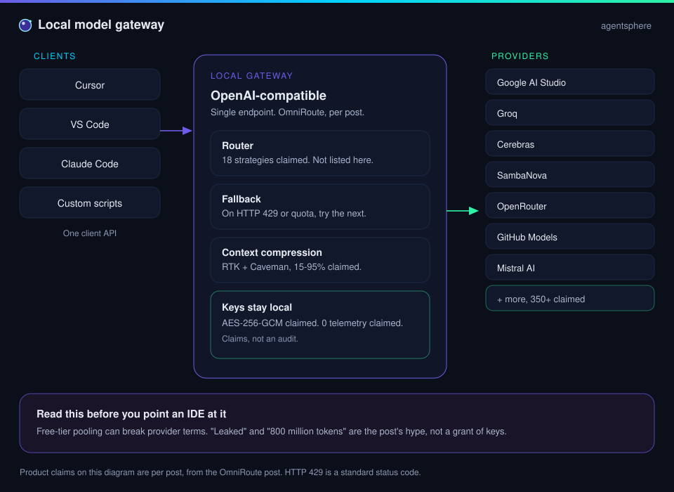
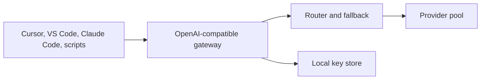

  

# Gateways and routing

One client API in front. Many models behind it. A gateway is a routing layer, and it is also a place keys, logs, and provider terms collect.

| | |
| --- | --- |
| Path | Builder, then Operator |
| Time | About 20 minutes |
| You need | [Tools and MCP](tools-and-mcp.md) |

## What you will be able to do

- Explain an OpenAI-compatible gateway in one diagram.
- Read the OmniRoute post as a claim sheet.
- Decide what you would verify before pointing an IDE at any such proxy.

## Why a gateway exists

Agent hosts already know how to call a chat API. Many of them let you set a base URL. A **gateway** listens on that URL and forwards the request to a provider you chose, or to the next provider in a chain. The host stays put. The model supply can move.

That idea is established. Which software does it well, under which terms, is a separate question. The post in this section is about one project.

## What the OmniRoute post claims

[@Bober_smart](https://x.com/Bober_smart/status/2108293657552117850) describes OmniRoute as a local, high-performance AI gateway that pools free limits from many providers into one stream (per post). The post also points at a video on the status and [an earlier status by the same author](https://twitter.com/bober_smart/status/2103462864870686848). The project URL in the post is shortened. This guide does not guess the repository.

| Claim in the post | Status in this guide |
| --- | --- |
| A single OpenAI-compatible endpoint | Per post |
| Clients named: Cursor, VS Code via Copilot / Cline / Aider, Claude Code, custom scripts | Per post |
| 350+ providers and 90+ services with free limits | Per post. Examples named: Google AI Studio, Groq, Cerebras, SambaNova, OpenRouter, GitHub Models, Mistral AI |
| 18 routing strategies and automatic fallback | Per post. The 18 strategies are not listed |
| On HTTP 429 or quota depletion, redirect to the next model "within milliseconds" | Per post. HTTP 429 itself is the standard Too Many Requests status |
| Dual context compression, engines named RTK and Caveman, cutting logs, syntax, and history by 15–95% | Per post. This guide does not define RTK or Caveman beyond those words |
| API keys encrypted locally with AES-256-GCM | Per post. AES-256-GCM is a real mode; use here is the post's claim |
| "0 telemetry," data goes to providers and bypasses third-party clouds | Per post. A claim of no telemetry is not an audit |
| MCP and agent-to-agent support for model-pool management | Per post |
| Launch via npm CLI, Docker, Electron, and a PWA | Per post |
| "800 million tokens" for free, and the post's "leaked" framing | Per post, and treated as hype below |

## Read the hype as hype

The post opens by saying a leak means everyone can get a very large number of free tokens. Two cautions, and then a place to go deeper:

- A gateway you run should be source you can read, keys you issued, and terms you accept. "Leaked" is the poster's framing. It is not a feature to chase.
- Pooling free tiers can violate a provider's terms even when the software is clever. A terms problem does not become a technical achievement.

> [!WARNING]
> **Check this before you route traffic.** Confirm the real repository yourself, read how keys are stored, see where requests go, and read the provider terms for the accounts you attach. The review checklist is the [gateway playbook](../09-playbooks/review-a-gateway.md). Threats specific to proxies and installable skills are in [gateways and supply chain](../07-security/gateway-and-supply-chain.md).

## What compression is doing, without the brand names

Shortening a prompt before it is sent is an established idea: drop repeated logs, fold boilerplate, keep the decision and the error. The post claims two named engines and a wide percentage band. Until you measure a before-and-after on your own traces, the band is a claim. Compression that drops the one line the model needed is a silent bug. If you turn it on, put it in the trajectory so you can see what was removed.

## Check yourself

1. What does "OpenAI-compatible" let a client avoid rewriting?
2. Which cells in the claim table have been audited by this guide?
3. Why is a shortened project link left as a shortened link?

## Sources

- [@Bober_smart](https://x.com/Bober_smart/status/2108293657552117850) — 2026-10-08. All product rows in the table, per post.
- Established background: HTTP 429, the idea of an OpenAI-compatible base URL, and AES-256-GCM as a cipher mode. None of that confirms the product.

## Continue

- Practice: [Review a gateway](../09-playbooks/review-a-gateway.md)
- Case study: [Local gateway](../08-case-studies/local-gateway.md)
- Previous: [Tools and MCP](tools-and-mcp.md)

---

[Map](../README.md) | [Paths](../learning-paths.md) | [Glossary](../glossary.md) | [References](../references.md)
