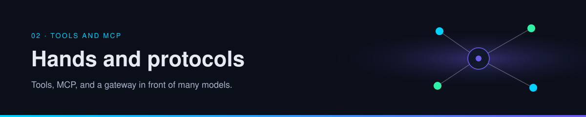

  

  

# 02 · Tools and MCP

Tools are how the loop touches anything besides its own reply. This section covers the contract for a tool, the protocol many hosts now use to attach them, and a local gateway that sits in front of model providers.

| | |
| --- | --- |
| Path | Builder |
| Time | About 40 minutes |
| You need | [Memory, tools, and planning](../00-foundations/memory-tools-planning.md) |

## Pages

| Page | You leave able to |
| --- | --- |
| [Tools and MCP](tools-and-mcp.md) | Sketch a host, a model API, tool servers, and an agent-to-agent handoff |
| [Gateways and routing](gateways-and-routing.md) | Read a gateway claim sheet, including OmniRoute, without treating hype as a spec |

## Practice

Run [review a gateway](../09-playbooks/review-a-gateway.md) against the next proxy someone sends you, or against the OmniRoute claims if you have no other candidate. A decision of "not yet" counts.

## Continue

- [Tools and MCP](tools-and-mcp.md)

---

[Map](../README.md) | [Paths](../learning-paths.md) | [Glossary](../glossary.md) | [References](../references.md)
