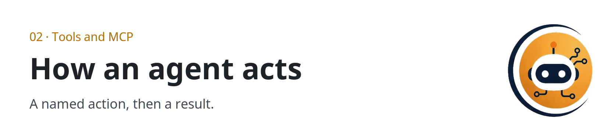

  <picture>
  <source media="(prefers-color-scheme: dark)" srcset="../../assets/sections/02-tools-dark.png">
  
</picture>

  

# 02 · Tools and MCP

<strong>You are here:</strong> Tools and MCP · <a href="../../paths/builder/README.md">Builder</a> 
<strong>Next:</strong> <a href="tools-and-mcp.md">Tools and MCP</a>

Tools are how an agent does more than talk: search, read a file, send a draft. **MCP** (Model Context Protocol) is a common plug so the same tool can work in more than one app. A gateway is a middleman in front of the model. This section covers all three.

| | |
| --- | --- |
| Path | Builder |
| Time | About 40 minutes |
| You need | [Memory, tools, and planning](../00-foundations/memory-tools-planning.md) |

## Pages

| Page | You leave able to |
| --- | --- |
| [Tools and MCP](tools-and-mcp.md) | Sketch a host, a model API, tool servers, and an agent-to-agent handoff |
| [Gateways and routing](gateways-and-routing.md) | Read a gateway claim sheet, including OmniRoute, without treating hype as a spec |

## Practice

Run [review a gateway](../09-playbooks/review-a-gateway.md) against the next proxy someone sends you, or against the OmniRoute claims if you have no other candidate. A decision of "not yet" counts.

## Continue

- [Tools and MCP](tools-and-mcp.md)

---

[Map](../README.md) | [Paths](../learning-paths.md) | [Glossary](../glossary.md) | [References](../references.md)
