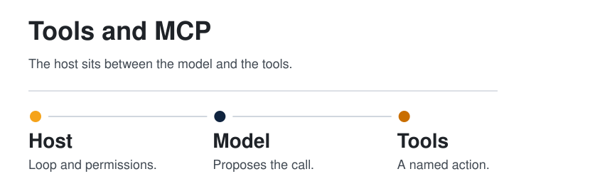
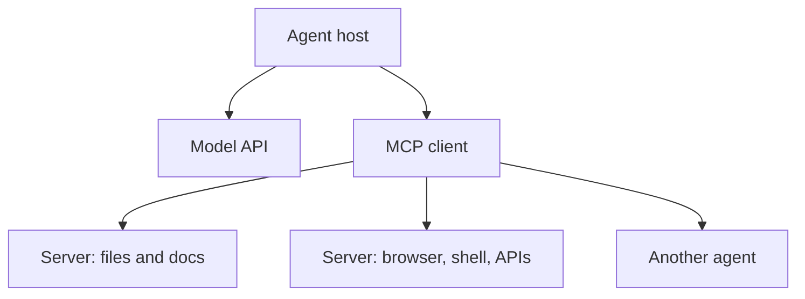

  <picture>
  <source media="(prefers-color-scheme: dark)" srcset="../../assets/diagrams/mcp-dark.svg">
  
</picture>

  

# Tools and MCP

The model decides. A tool does. A protocol is the agreement that lets many tools plug into many hosts without a custom integration each time.

| | |
| --- | --- |
| Path | Builder |
| Time | About 20 minutes |
| You need | [Memory, tools, and planning](../00-foundations/memory-tools-planning.md) |

## What you will be able to do

- Write a tool contract a teammate can review.
- Explain MCP as the connection between a host and tool servers.
- Place agent-to-agent handoff next to tool calls, and mark what is only a post's claim.

## The contract, again, with teeth

From foundations, a tool has a name, a schema, a side effect, a permission, and a result. A few rules make that contract survivable:

| Rule | Why it is here |
| --- | --- |
| One side effect per tool | "Search and also email the result" hides the email inside a read |
| The result includes failure | The observe step needs the error, not a cheerful summary |
| Arguments are data | File paths and URLs are inputs. Instructions hiding in those inputs are a threat, covered in [security](../07-security/threat-model.md) |
| The smallest permission | A docs agent that can rewrite production is a bug you have not met yet |
| A person sees writes | Reads can be wide. Writes, sends, and deletes get a review or a very small allow-list |

## MCP

**MCP** (Model Context Protocol) is an open protocol for connecting an agent host to external tools and data. The host embeds an MCP client. Each external capability is an MCP server: a file tree, a browser, a ticket system, a database. The model sees a list of tools with schemas. Calling one is an ordinary tool call. The protocol is what makes that list portable across hosts.

In the harness survey, a tool schema is the action interface, and the description that lands in the window is also context. MCP is one way to draw that boundary. The six-part frame is [harness engineering](../01-agent-patterns/harness-engineering.md).

The SVG at the top is the same picture, with the other-agent box marked as the piece a post claims rather than the piece the protocol itself requires.

> [!TIP]
> **Established.** MCP is the protocol. It is not a particular vendor's agent, and it is not a model. A host can speak MCP and still be a poor agent if the loop, the memory, or the stop rule is weak.

> [!NOTE]
> **Per post.** [@Bober_smart](https://x.com/Bober_smart/status/2108293657552117850) says the OmniRoute gateway has "full support" for MCP and for an agent-to-agent architecture, used for automated model-pool management. That is a product claim. It is not a statement that every MCP host routes models, and it does not name a protocol version. The gateway's other claims are on the [next page](gateways-and-routing.md).

## Agent-to-agent, beside tools

A tool returns data or a side effect. An **agent-to-agent** handoff gives another agent a goal and a boundary, and takes back a result. Use a handoff when the subtask needs its own loop. Use a tool when you want one action and one observation.

The orchestration page is what a handoff looks like when a lead agent plans the phases: [orchestration](../04-multi-agent/orchestration.md).

## A gateway is not the protocol

MCP attaches tools and data to the host. A **gateway** attaches the host's model calls to providers, often through one OpenAI-compatible endpoint. They sit on different arrows in the diagram. Products may bundle them. The bundle is a product choice. OmniRoute's post claims both.

## Check yourself

1. Which five clauses belong on a tool you would let an agent call unattended?
2. In the diagram, what sits between the host and a file server?
3. Which OmniRoute capability is per post, and which idea (MCP as a protocol) is established?

## Sources

- Established account of tool contracts and of MCP as an open protocol for tools and data.
- [@Bober_smart](https://x.com/Bober_smart/status/2108293657552117850) — 2026-10-08. MCP and agent-to-agent claims, per post.

## Continue

- Next: [Gateways and routing](gateways-and-routing.md)
- Previous: [Wiki memory](../01-agent-patterns/wiki-memory.md)
- The runtime these tools sit in: [Harness engineering](../01-agent-patterns/harness-engineering.md)

---

[Map](../README.md) | [Paths](../learning-paths.md) | [Glossary](../glossary.md) | [References](../references.md)
