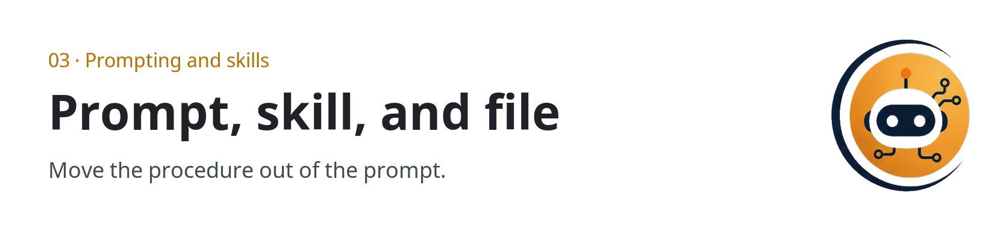

  <picture>
  <source media="(prefers-color-scheme: dark)" srcset="../../assets/sections/03-skills-dark.png">
  
</picture>

  

# 03 · Prompting and skills

<strong>You are here:</strong> Prompting and skills · <a href="../../paths/builder/README.md">Builder</a> 
<strong>Next:</strong> <a href="prompts-and-skills.md">Prompts and skills</a>

A prompt is what you tell the model for this job. A skill is the procedure you save, so the next job does not start from a giant paste. Two of the references are catalogs: skills for motion design, and libraries for building websites with an agent.

| | |
| --- | --- |
| Path | Builder |
| Time | About 35 minutes |
| You need | [The agent loop](../00-foundations/the-agent-loop.md) |

## Pages

| Page | You leave able to |
| --- | --- |
| [Prompts and skills](prompts-and-skills.md) | Split a giant instruction into prompt, skill, file, and secret |
| [Creative toolkits](creative-toolkits.md) | Use the two catalogs without installing a pile of unseen code |

## Practice

Write one skill with [write a skill](../09-playbooks/write-a-skill.md). If you would rather review a pack than write one, use [skills and craft](../09-playbooks/skills-and-craft.md).

## Continue

- [Prompts and skills](prompts-and-skills.md)

---

[Map](../README.md) | [Paths](../learning-paths.md) | [Glossary](../glossary.md) | [References](../references.md)
