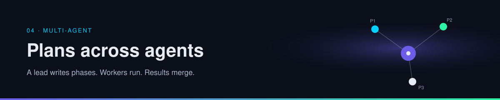

  

# 04 · Multi-agent

Several agents help when the work splits cleanly and someone, or some lead agent, is responsible for the merge. They cost extra tokens, extra contradictions, and extra debugging.

| | |
| --- | --- |
| Path | Operator |
| Time | About 20 minutes |
| You need | [Plan-and-execute](../01-agent-patterns/react-and-plan-execute.md) |

## Pages

| Page | You leave able to |
| --- | --- |
| [Orchestration](orchestration.md) | Draw a lead, phases, workers, and a merge, and say what a product must show you |

## Continue

- [Orchestration](orchestration.md)

---

[Map](../README.md) | [Paths](../learning-paths.md) | [Glossary](../glossary.md) | [Sources](../../sources/bookmarks.md)
