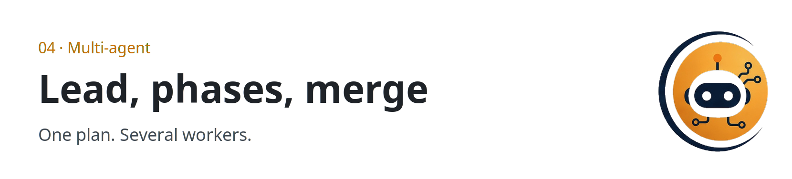

  <picture>
  <source media="(prefers-color-scheme: dark)" srcset="../../assets/sections/04-multi-agent-dark.png">
  
</picture>

  

# 04 · Multi-agent

<strong>You are here:</strong> Multi-agent · <a href="../../paths/operator/README.md">Operator</a> 
<strong>Next:</strong> <a href="orchestration.md">Orchestration</a>

Use several agents when the job splits cleanly and one of them is in charge of combining the results. The cost is more calls, more disagreements, and more to debug. One agent is the right answer until the split is obvious.

| | |
| --- | --- |
| Path | Operator |
| Time | About 20 minutes |
| You need | [Plan-and-execute](../01-agent-patterns/react-and-plan-execute.md) |

## Pages

| Page | You leave able to |
| --- | --- |
| [Orchestration](orchestration.md) | Draw a lead, phases, workers, and a merge, and say what a product must show you |

## Practice

The handoff in [operate agents](../09-playbooks/operate-agents.md) is the drawing, filled in for a task you actually have. Name phases before you name extra agents.

## Continue

- [Orchestration](orchestration.md)

---

[Map](../README.md) | [Paths](../learning-paths.md) | [Glossary](../glossary.md) | [References](../references.md)
