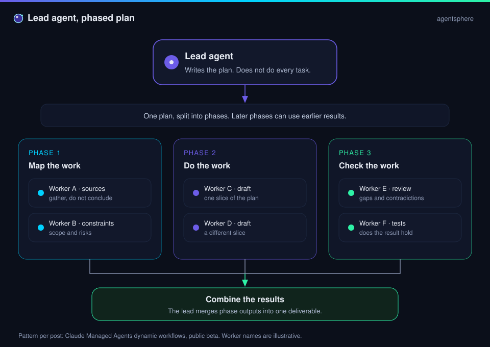
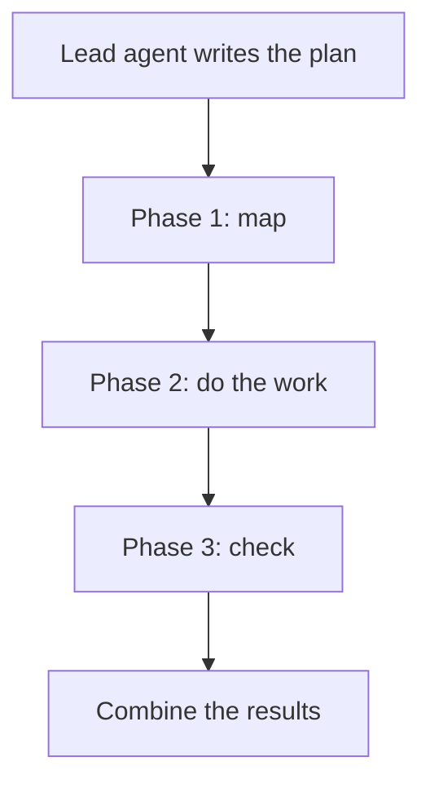

  

# Orchestration

One agent writes the plan. Other agents do slices of it. Something combines the slices into one result. That is the whole pattern. The rest is discipline.

| | |
| --- | --- |
| Path | Operator |
| Time | About 20 minutes |
| You need | [ReAct and plan-and-execute](../01-agent-patterns/react-and-plan-execute.md) |

## What you will be able to do

- Compare a pipeline, a fan-out, and a lead/worker plan.
- Restate the Claude Managed Agents claim without adding features the post did not state.
- List what you need to see in the logs before you trust a multi-agent run.

## Three shapes

| Shape | How work moves | Use it when |
| --- | --- | --- |
| **Pipeline** | A, then B, then C. Each reads the previous artifact. | The steps are different jobs: research, then draft, then review |
| **Fan-out** | Several agents take independent slices, then a merge | The slices do not need each other |
| **Lead / worker** | A lead writes a phased plan. Workers run inside phases. The lead merges. | The plan itself is a decision, and later phases depend on earlier ones |

Fan-out inside a phase, and a pipeline across phases, is the picture in the diagram. Worker names on that diagram are illustrative. They are not a product's roster.

## What the post actually says

[@ClaudeDevs](https://x.com/ClaudeDevs/status/2108591328732856655) announced that Claude Managed Agents dynamic workflows were available in public beta (per post, 2026-10-09). The post's description of the mechanism is one sentence: a lead agent writes a plan that runs across many agents in phases, combining the results at the end.

The export links a video on the status and a shortened URL. This guide does not reconstruct a docs page from that short link, and it does not invent phase types, pricing, limits, or a model name beyond the words above.

> [!NOTE]
> **Per post.** "Public beta" is the post's maturity label. Treat the feature as something to read in current product docs before you depend on it. The pattern (lead, phases, merge) is what this page teaches. The product is one reported implementation.

## What has to be true for the pattern to work

| Requirement | If it is missing |
| --- | --- |
| The plan is visible | You cannot tell a thoughtful phase from a swarm |
| Each phase has an input and an output artifact | Workers overwrite each other in prose |
| Later phases can read earlier artifacts | The check phase argues from memory of a chat it did not see |
| The merge is a step with an owner | Two drafts remain two drafts |
| Contradictions are in the merge notes | The final voice averages them into a confident error |
| Each worker has a narrow tool set | A "research" worker can still delete the repo |
| The trajectory is kept per worker | A wrong final answer has no author |

Multi-agent runs spend more. They also fail in more places. Reach for them when a single loop is dropping details because the task is wide, not because a diagram with more boxes looks more serious.

## What to ask of a hosted version

If a vendor offers this shape, the questions are about visibility:

- Can you read the plan the lead wrote, before the workers run?
- Can you see each phase boundary and each worker's artifact?
- Can you stop between phases?
- Is the merge a diff you can review?
- What is the budget, and which agent spent it?

A product that only shows the final answer has hidden the only part you can debug.

## Check yourself

1. What does the lead do, and what does it hand off?
2. Which sentence in the seed post is the entire mechanism?
3. Why keep a trajectory per worker?

## Sources

- [B4](https://x.com/ClaudeDevs/status/2108591328732856655) — @ClaudeDevs, 2026-10-09. Public beta, lead agent, phases, combined results. Per post.
- Synthesis: the pipeline / fan-out / lead table, and the visibility questions. They are this guide's reading of the pattern, not extra product claims.

## Continue

- Case study: [Managed workflows](../08-case-studies/managed-workflows.md)
- Next: [Cloud and local](../05-runtime-infra/cloud-and-local.md)
- Previous: [Creative toolkits](../03-prompting-skills/creative-toolkits.md)

---

[Map](../README.md) | [Paths](../learning-paths.md) | [Glossary](../glossary.md) | [Sources](../../sources/bookmarks.md)
