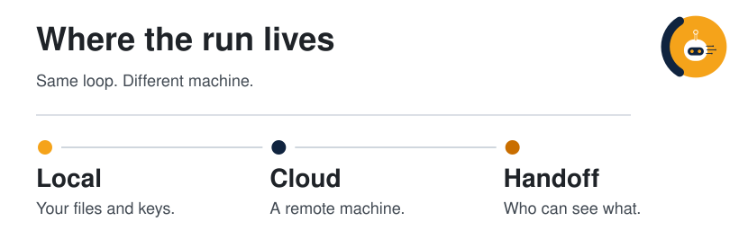
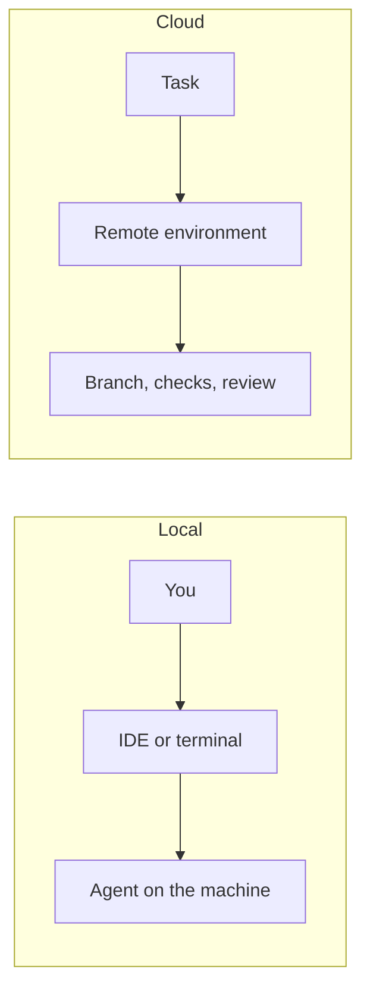

  <picture>
  <source media="(prefers-color-scheme: dark)" srcset="../../assets/diagrams/cloud-vs-local-dark.svg">
  
</picture>

  

# Cloud and local

A local agent shares your machine. A cloud agent takes a task and runs it somewhere else, then hands you an artifact. One post is a strong argument for the second, aimed at teams still buying a license per seat.

| | |
| --- | --- |
| Path | Operator |
| Time | About 20 minutes |
| You need | [The agent loop](../00-foundations/the-agent-loop.md) |

## What you will be able to do

- Draw both topologies.
- Restate Ryan Carson's argument as an argument.
- Place a task using a small decision table this guide owns, separate from the post.

## Two topologies

| | Local | Cloud |
| --- | --- | --- |
| Where the loop is | Your process, IDE, or terminal | A remote environment |
| Who is present | You, in the loop | You hand off a task |
| Session length | Tends to end when you do | Can outlast the workday |
| Secrets | Stay in your environment if you keep them there | Live in the remote run's scope |
| Review | You watch the steps | You need an audit trail and a diff |
| How teams buy it | Often a license per person | Often a task, a seat on a platform, or both |

The SVG at the top names examples. Codex and Claude Code appear as the local licenses the post is arguing against. Devin, Amp, and Factory appear as the cloud products the post names.

## The argument in the post

[@ryancarson](https://x.com/ryancarson/status/2108286700468191266) writes that a company where everyone has their own Codex or Claude Code license will fall behind teams using cloud-based agents (per post). The post tells the reader to pay for something like Devin, Amp, or Factory, and not to build their own "code factory." It credits Dale Spoonemore and HelloUntangle as an example of a team doing this. The comparison in the post is vivid and insulting toward local development. This page keeps the claim and drops the insult.

What the post is asserting, stripped to propositions:

| Proposition | Status |
| --- | --- |
| Per-seat local coding agents leave a team behind cloud-agent teams | Per post. An argument, not a measurement in the post |
| Named cloud options include Devin, Amp, and Factory | Per post, as examples |
| Building your own "code factory" is the wrong project | Per post, as advice |
| A named team is offered as a sighting | Per post |

> [!NOTE]
> **Per post.** There is no benchmark, cost table, or definition of "code factory" in the post. Quote the post as a position. Do not quote it as an outcome study.

## A decision this guide will own

**Synthesis.** Use the post as a prompt to choose on purpose. These questions are the guide's, not the post's:

| Question | Lean local | Lean cloud |
| --- | --- | --- |
| How long is the task? | Minutes, you are pairing | Long enough that you will context-switch away |
| How secret is the repo? | Keys, unpublished data, a machine that must stay offline | A repo the platform is allowed to see |
| What do you review? | The steps, live | A branch and a log |
| Who else needs the same agent? | Just you, learning | A team that should share one way of working |
| Are you building infrastructure? | You are studying how a loop works | You want the product, not the queue, sandbox, and auth project |

"Do not build your own code factory" is compatible with still understanding the pieces. A factory, in the ordinary sense of the phrase, is a queue of tasks, an isolated environment, credentials, logs, and a way to merge results. Buying that is a reasonable default when your business is the product, not the agent platform. Building a small local loop is still how you learn the rest of this guide.

The [operate playbook](../09-playbooks/operate-agents.md) walks three concrete tasks through the table.

## Check yourself

1. Name one thing that is true of the topology diagram even if you reject the post's advice.
2. Which product names are in the post, and which features did the post not list?
3. When is a local loop the point, even on a team that otherwise buys cloud agents?

## Sources

- [@ryancarson](https://x.com/ryancarson/status/2108286700468191266) — 2026-10-08. The argument and the product names, per post.
- Established distinction between an agent on the developer machine and an agent in a remote environment. The decision table is synthesis.

## Continue

- Next: [Efficient inference](efficient-inference.md)
- Products that already chose a computer: [Hosted agents](../10-hosted-agents/index.md)
- Practice: [Operate agents](../09-playbooks/operate-agents.md)
- Previous: [Orchestration](../04-multi-agent/orchestration.md)

---

[Map](../README.md) | [Paths](../learning-paths.md) | [Glossary](../glossary.md) | [References](../references.md)
