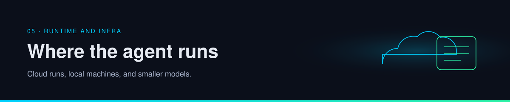

  

# 05 · Runtime and infra

Where the loop runs, and how heavy the model is. Those are separate decisions. A cloud agent can call a huge model. A laptop agent can call an API. The posts argue both ends: buy cloud agents, and also run compressed models locally.

| | |
| --- | --- |
| Path | Operator |
| Time | About 40 minutes |
| You need | [What is an agent](../00-foundations/what-is-an-agent.md) |

## Pages

| Page | You leave able to |
| --- | --- |
| [Cloud and local](cloud-and-local.md) | Place a task, and hear one operator's argument without treating it as a law |
| [Efficient inference](efficient-inference.md) | Read bitnet.cpp and LittleBit with the paper and the post in separate columns |

## Practice

Place three tasks with [operate agents](../09-playbooks/operate-agents.md). The inference page is how you read a speedup claim after you know where the loop runs.

## Continue

- [Cloud and local](cloud-and-local.md)

---

[Map](../README.md) | [Paths](../learning-paths.md) | [Glossary](../glossary.md) | [References](../references.md)
