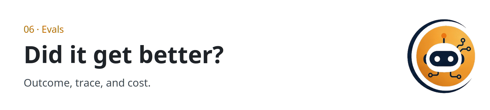

  <picture>
  <source media="(prefers-color-scheme: dark)" srcset="../../assets/sections/06-evals-dark.png">
  
</picture>

  

# 06 · Evals

<strong>You are here:</strong> Evals · <a href="../../paths/operator/README.md">Operator</a> 
<strong>Next:</strong> <a href="../09-playbooks/score-a-run.md">Score a run</a>

An agent got better when a repeatable check says so. This section is a primer: outcome, trajectory, and cost, applied to the agents this guide already describes. A survey-level reading of public SWE-bench Verified scores, as model–harness pairs, lives on [harness engineering](../01-agent-patterns/harness-engineering.md). Those numbers stay on that page, with the survey's caveats.

| | |
| --- | --- |
| Path | Operator |
| Time | About 20 minutes |
| You need | [The agent loop](../00-foundations/the-agent-loop.md) and [wiki memory](../01-agent-patterns/wiki-memory.md) |
| Status | Primer. The methods here are established, not per post. |

## What you will be able to do

- Score a run on outcome, trajectory, and cost.
- Write a small regression set for a research agent.
- Notice when a wiki edit made the system worse.

## Three numbers

| Measure | Question | A pass looks like |
| --- | --- | --- |
| **Task success** | Did the artifact meet the definition of done? | A rubric you can apply twice and get the same grade |
| **Trajectory** | Were the steps the ones you wanted? | The trace shows the required tool, and it shows the absence of forbidden ones |
| **Cost per success** | What did a passing run cost? | Tokens, time, and dollars, divided by passes, not by attempts you liked |

A final answer can be right after a reckless trajectory. A beautiful trajectory can still miss the goal. Cost without success is a hobby. Report the three together.

## A rubric you can reuse

For a page-writing agent, grade the artifact:

| Check | Pass |
| --- | --- |
| The question is answered in the first screen | Yes / no |
| Every non-obvious claim has a URL | Yes / no |
| Per-post claims are marked | Yes / no |
| Gaps are explicit | Yes / no |
| The raw source was not rewritten | Yes / no |

Five checks, binary, beat a single "quality" score from another model. A model judge can help you rank prose. It should not be the only signal, because it shares the failure modes of the agent you are grading.

## Trajectories worth keeping

Store, for each step: the plan line, the tool name, a redacted argument summary, a result summary, and the next decision. Redact secrets before the trace is saved. When success drops, read ten failing trajectories before you rewrite the prompt. The prompt is rarely the first broken part. A tool result the observe step ignored is a common one.

## A regression set for wiki memory

Keep a handful of questions whose correct behavior you already know.

| Case | What "pass" is |
| --- | --- |
| A fact that is already on a wiki page | The trace searches the wiki and does not re-fetch the raw post |
| A fact that is only in raw | The trace opens the raw source, then updates the wiki |
| A stale page, with a newer raw note | The page is corrected and both sources remain cited |
| A question with no source | The answer says the gap. It does not invent a URL |
| A repeated question | The second run is cheaper or shorter than the first, because the page exists |

That last row is the compounding claim, made measurable. [@fleyta88](https://x.com/fleyta88/status/2108619644399415565) describes the feeling of a system that gets smarter. An eval is how you notice the day it stops.

## Cost, compression, and faster models

A gateway that claims to cut context by 15–95%, or a runtime that claims a large speedup, changes cost per step. It does not automatically change cost per success. Put the same regression set on both sides of the change. If compression drops the line the rubric needed, task success falls and the savings were not savings.

The inference page tells you to cite ranges and papers. This page tells you the only benchmark that matches your agent is the one you run on your tasks.

## What the next source should add

When you distill an eval post, add:

- The metric, in their words, marked per post.
- Whether they grade the artifact, the trajectory, or both.
- The size of the set, if they gave it.
- A row in the regression table above if the idea survives contact with wiki memory.

Leave vendor leaderboards in the case study unless you can say what was measured.

## Check yourself

1. Why is task success alone a weak report?
2. Write one regression case for "do not invent a URL."
3. What would you compare before and after turning on context compression?

## Sources

- Established evaluation practice: outcome, process, and cost.
- [Guo et al. 2026](https://arxiv.org/abs/2606.20683) is the eval synthesis for harness effects. The numbers and the caveats are on [harness engineering](../01-agent-patterns/harness-engineering.md).
- [@fleyta88](https://x.com/fleyta88/status/2108619644399415565) supplies the compounding behavior these cases try to detect. The cases themselves are synthesis.

## Continue

- Practice: [Score a run](../09-playbooks/score-a-run.md) grades a trace with the rubric above
- A leaderboard is a model–harness pair: [Harness engineering](../01-agent-patterns/harness-engineering.md)
- Next: [Threat model](../07-security/threat-model.md)
- Previous: [Efficient inference](../05-runtime-infra/efficient-inference.md)

---

[Map](../README.md) | [Paths](../learning-paths.md) | [Glossary](../glossary.md) | [References](../references.md)
