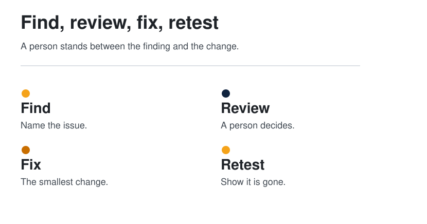
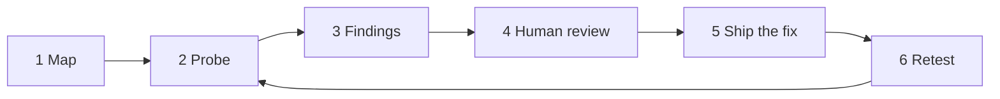

  <picture>
  <source media="(prefers-color-scheme: dark)" srcset="../../assets/diagrams/security-loop-dark.svg">
  
</picture>

  

# Find, review, fix, retest

<strong>You are here:</strong> Find, review, fix, retest · <a href="../../paths/operator/README.md">Operator</a> 
<strong>Next:</strong> <a href="gateway-and-supply-chain.md">Gateways and supply chain</a>

A security agent is still the agent loop, pointed at risk, with a person standing on the step that changes the system.

| | |
| --- | --- |
| Path | Operator |
| Time | About 12 minutes |
| You need | [Threat model](threat-model.md) |

## What you will be able to do

- Restate the Antigen post as a six-step review loop.
- Point at the step a person owns.
- Say what this page will not teach.

## What the post says

[@antigenco](https://x.com/antigenco/status/2108334286978113634) introduced Antigen as an offensive security agent that maps, exploits, and secures an attack surface (per post). The mechanism in the post is: it probes the system the way a hostile tester would, ships fixes for the team's review, and tests again to check that the issues were patched. The post contains the status and a video URL. It does not contain a resolved product or documentation link. This guide does not invent one.

| The post's verb | How this guide draws it |
| --- | --- |
| Maps | 1. Map the surface you are allowed to look at |
| Probes / exploits | 2. Probe, inside an authorization you already have |
| (implied) | 3. Record findings as evidence |
| Ships fixes for review | 4. A person accepts the fix. 5. Then it can land |
| Tests again | 6. Retest. A miss returns to probe |

The SVG makes step 4 larger on purpose. An agent that "secures" a system by patching it unseen has skipped the only step that makes the rest safe to automate.

> [!WARNING]
> **Authorization and altitude.** Run this kind of agent only against systems you are explicitly allowed to test. This page does not explain how to probe, how to exploit, or how to confirm a vulnerability. Those procedures stay out of the guide. The lesson that belongs in a field guide is the gate and the retest.

## What "done" means

A finding is done when:

- The evidence is written down for a reviewer.
- A person has accepted the change.
- A retest, by the agent or by the reviewer, agrees the finding is gone.
- The wiki or the ticket records what changed, so the next run does not rediscover a ghost.

That last bullet is [wiki memory](../01-agent-patterns/wiki-memory.md) applied to security work. A hundred scan transcripts are the forgetful loop. A page per finding, with status, is the compounding one.

## What to demand if you buy this

**Synthesis**, a buying list, not a feature list from the post:

| You can see | You cannot see |
| --- | --- |
| The authorization the run was given | A promise that "offensive" implies permission |
| Findings as evidence, not only a score | A silent patch to the default branch |
| The diff before it merges | A retest that only re-reads the agent's own summary |
| A person on the merge | |

## Check yourself

1. Which step is the human's, in the diagram?
2. What did the post claim that this page refuses to expand?
3. How does a finding page keep the next run from starting at zero?

## Sources

- [@antigenco](https://x.com/antigenco/status/2108334286978113634) — 2026-10-08. Map, probe, fix for review, retest. Per post.
- Synthesis: the six-step drawing and the buying list. The exploit itself is intentionally absent.

## Continue

- Next: [Gateways and supply chain](gateway-and-supply-chain.md)
- Case study: [Offensive security agent](../08-case-studies/offensive-security-agent.md)
- Previous: [Threat model](threat-model.md)

---

[Map](../README.md) | [Paths](../learning-paths.md) | [Glossary](../glossary.md) | [References](../references.md)
