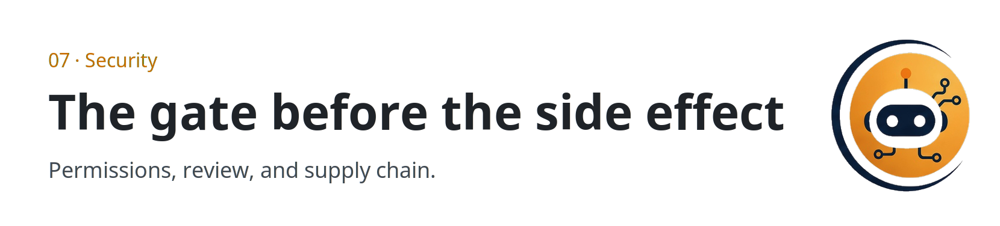

  <picture>
  <source media="(prefers-color-scheme: dark)" srcset="../../assets/sections/07-security-dark.png">
  
</picture>

  

# 07 · Security

<strong>You are here:</strong> Security · <a href="../../paths/operator/README.md">Operator</a> 
<strong>Next:</strong> <a href="threat-model.md">Threat model</a>

Agents act, and that is the risk. This section is what to allow, and what a person should check before a message is sent, money is spent, or a file is deleted. It also covers the tools and middlemen you install. It does not include instructions for attacking a system.

| | |
| --- | --- |
| Path | Operator |
| Time | About 40 minutes |
| You need | [Tools and MCP](../02-tools-mcp/tools-and-mcp.md) |

## Pages

| Page | You leave able to |
| --- | --- |
| [Threat model](threat-model.md) | Name what you are protecting and four ways it gets steered |
| [Find, review, fix, retest](find-fix-retest.md) | Describe a security agent as a review loop, including the Antigen post |
| [Gateways and supply chain](gateway-and-supply-chain.md) | Review a proxy or a skill pack before it touches keys or a repo |

## A boundary

> [!WARNING]
> These pages stay at the level of assets, permissions, and review. They are not a guide to probing, exploiting, or bypassing controls. If a future source is an exploit write-up, distill the defensive lesson and leave the procedure out of the repo.

## Practice

[Review a gateway](../09-playbooks/review-a-gateway.md) for a proxy, and [unstick a loop](../09-playbooks/unstick-a-loop.md) when a run obeys text it fetched. Both stay at the level of checks and gates.

## Continue

- [Threat model](threat-model.md)

---

[Map](../README.md) | [Paths](../learning-paths.md) | [Glossary](../glossary.md) | [References](../references.md)
