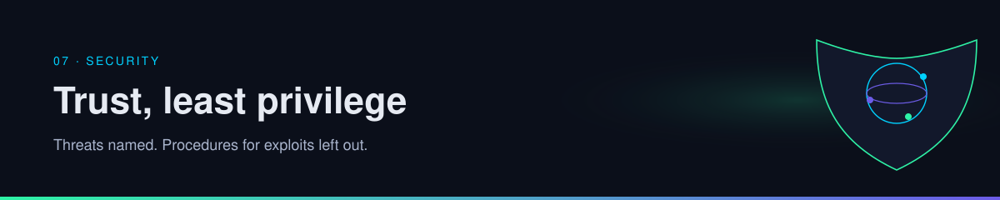
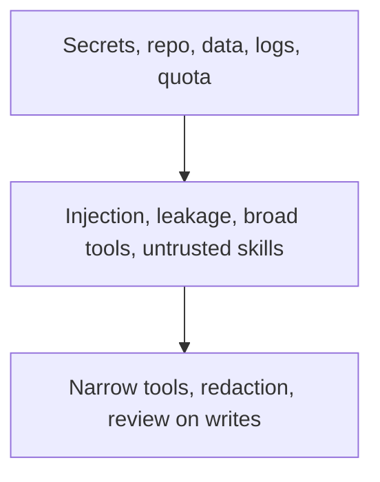

  

# Threat model

Write down what the agent can touch, who can put words in front of it, and which actions are allowed to stick. That is a threat model at the altitude this guide uses.

| | |
| --- | --- |
| Path | Operator |
| Time | About 15 minutes |
| You need | [Tools and MCP](../02-tools-mcp/tools-and-mcp.md) |

## What you will be able to do

- List the assets in an agent you run.
- Explain four threat classes without needing a procedure.
- Point each class at a habit.

## Assets

| Asset | Examples | Why an agent makes it sharper |
| --- | --- | --- |
| Secrets | API keys, session cookies, deploy tokens | They often sit in the same environment the tools can read |
| The repo | Source, history, CI config | A write tool can change it, and a read tool can exfiltrate it |
| Other people's data | Tickets, mail, documents the tools can open | The model will summarize whatever the tool returns |
| The trail | Logs, traces, prompts | A trace that includes the secret has published the secret |
| Money and quota | Provider accounts behind a gateway | A loop is a fast way to spend |

## Four ways it goes wrong

These are names and impacts. They are not instructions.

### Prompt injection

The model treats text as instructions. A web page, a README, an issue, or a bookmark can contain a line aimed at the agent rather than at you. If that text is fetched by a tool and placed in the window, the model may follow it: send the notes somewhere, widen a search, overwrite a file.

**Habit:** treat retrieved text as data. Keep the standing rules in a layer the page cannot edit. Prefer tools that cannot send or delete. Show writes to a person.

### Secrets in the prompt

Keys pasted into a system prompt, a skill, or a trace will be copied into the next log. Local encryption at rest, which the OmniRoute post claims for its key store, does not cover a key the model just printed.

**Habit:** secrets live in a store tools can use without returning the value. Redact traces. Do not ask the model to repeat a key to "confirm it loaded."

### Over-broad tools

A general shell, a general browser with the user's cookies, or a repo role that can push to the default branch gives every untrusted paragraph the same power you have.

**Habit:** one side effect per tool, least permission, a separate credential for the agent, no production push without review.

### Untrusted skills and servers

An MCP server or a skill pack is code plus instructions from someone else. The motion-catalog post tells readers to check each repo before installing ([B9](https://x.com/N01ennn/status/2108182955671580771), per post). That is the right instinct, whatever you think of the catalog.

**Habit:** read the skill, pin a commit, run install in a place that does not hold production keys. Details: [supply chain](gateway-and-supply-chain.md).

## A one-page model you can copy

Answer these for the agent in front of you. **Synthesis**, a worksheet, not a standard from a bookmark.

| Question | Your answer |
| --- | --- |
| What can it read? | |
| What can it change? | |
| What can it send, and to whom? | |
| Which text in the window came from outside the team? | |
| Who reviews a write before it lands? | |
| Where would a leaked key show up first? | |

If the write-review row is empty, you do not have a stop condition. You have a hope. The next page makes that gate the center of a loop a bookmark described.

## Check yourself

1. Name the four threat classes.
2. Why is a trace an asset?
3. Which habit addresses a README that contains instructions aimed at the agent?

## Sources

- Established threat classes for tool-using models: injection, secret leakage, excess permission, and untrusted extensions. Described here at name-and-impact level.
- [B6](https://x.com/Bober_smart/status/2108293657552117850) — local key encryption, per post, not an audit.
- [B9](https://x.com/N01ennn/status/2108182955671580771) — check repositories before install, per post.

## Continue

- Next: [Find, review, fix, retest](find-fix-retest.md)
- Previous: [Evals](../06-evals/index.md)

---

[Map](../README.md) | [Paths](../learning-paths.md) | [Glossary](../glossary.md) | [Sources](../../sources/bookmarks.md)
