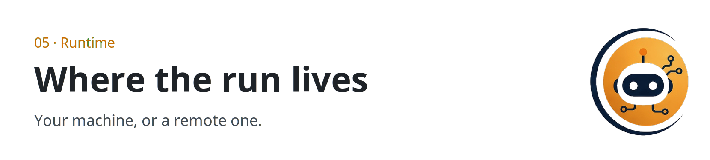

  <picture>
  <source media="(prefers-color-scheme: dark)" srcset="../../assets/sections/05-runtime-dark.png">
  
</picture>

  

# Case study · Local inference

Two posts about running models cheaper and closer: Microsoft's bitnet.cpp, and Samsung's LittleBit. Both point at real projects. Both also say things the primary sources do not.

| | |
| --- | --- |
| Path | Power user |
| Sources | [@oliviscusAI](https://x.com/oliviscusAI/status/2108786434991923251), [@thesupermannx](https://x.com/thesupermannx/status/2108098865073410484) |
| Posted | 2026-10-10 and 2026-10-08 |
| Concept | [Efficient inference](../05-runtime-infra/efficient-inference.md) |

## The situation

Agents multiply forward passes, so inference efficiency is an agent topic. The posts arrived as "you can run a huge model on a CPU" and "you can shrink 13B parameters under a gigabyte." The projects behind the names are public. The posts compress the caveats.

## Side by side

| | bitnet.cpp | LittleBit |
| --- | --- | --- |
| Primary source | [microsoft/BitNet](https://github.com/microsoft/BitNet), [paper](https://arxiv.org/abs/2410.16144) | [paper](https://arxiv.org/abs/2506.13771), [code](https://github.com/SamsungLabs/LittleBit), [Samsung write-up](https://research.samsung.com/blog/LittleBit-Ultra-Low-Bit-Quantization-via-Latent-Factorization) |
| What is solid | Official 1-bit inference stack. Paper reports 2.37x–6.17x on x86 CPUs | Sub-1-bit latent factorization. Abstract: ~0.1 bits/weight, Llama 2 13B under ~0.9 GB, potential 11.6x at kernel level versus FP16 |
| What stays per post | 82.2% less energy. 100B on a CPU with no GPU. 6.17x as a single figure | XOR as the core operation. "Stop doing math." "Less than 1 GB" as the post's rounding |
| Project link in the post? | Shortened. The repo above is the official project | The links above are the public project |

## What to steal

Cite the paper's range and its qualifiers. Measure cost per successful agent task if you adopt either stack. See [evals](../06-evals/index.md).

## What to leave

The XOR story. A 100B CPU claim used as a planning number. Any speedup you have not tied to a hardware line and a baseline.

## Sources

- [@oliviscusAI](https://x.com/oliviscusAI/status/2108786434991923251)
- [@thesupermannx](https://x.com/thesupermannx/status/2108098865073410484)
- Primary links in the table.

## Continue

- Next study: [Offensive security agent](offensive-security-agent.md)

---

[Map](../README.md) | [Paths](../learning-paths.md) | [Glossary](../glossary.md) | [References](../references.md)
