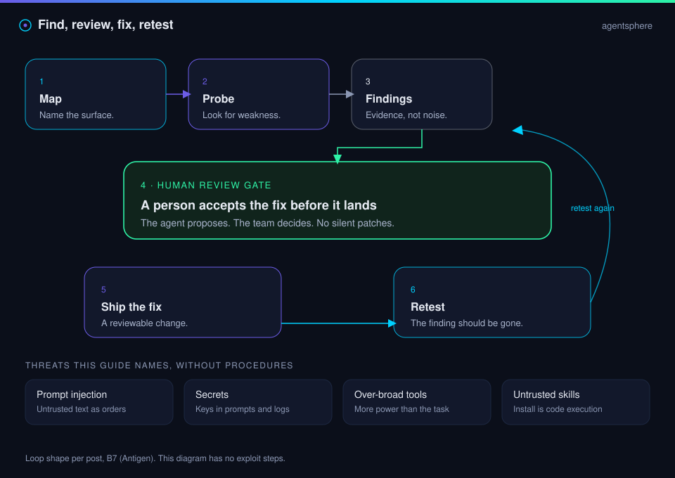

  

  

# Case study · Offensive security agent

Antigen, as announced: an agent that maps a surface, probes it, ships fixes for review, and tests again.

| | |
| --- | --- |
| Path | Power user |
| Source | [@antigenco](https://x.com/antigenco/status/2108334286978113634) |
| Posted | 2026-10-08, @antigenco |
| Concept | [Find, review, fix, retest](../07-security/find-fix-retest.md) |

## The situation

The post is a product introduction. The verbs are map, exploit, secure, probe, ship fixes for the team's review, and test again. The post does not include a resolved documentation URL.

## Claims

| Claim | Status |
| --- | --- |
| Antigen is an offensive security agent | Per post |
| It maps and probes an attack surface, then proposes fixes | Per post |
| Fixes are shipped for a team's review | Per post. This is the part the concept page treats as the gate |
| A retest checks that the issues were patched | Per post |
| How probing or exploitation is done | Not taught. Out of scope for this guide |

## What to steal

The loop with a person on the merge, and a retest that does not trust the agent's summary of itself. Record findings as pages so the next run sees status, not a fresh scan with no memory.

## What to leave

Any request to expand "exploit" into steps. Any use against a system you are not allowed to test. The [security index](../07-security/index.md) states that boundary for later sources too.

## Sources

- [@antigenco](https://x.com/antigenco/status/2108334286978113634)

## Continue

- [Playbooks](../09-playbooks/index.md)
- Previous: [Local inference](local-inference.md)

---

[Map](../README.md) | [Paths](../learning-paths.md) | [Glossary](../glossary.md) | [References](../references.md)
