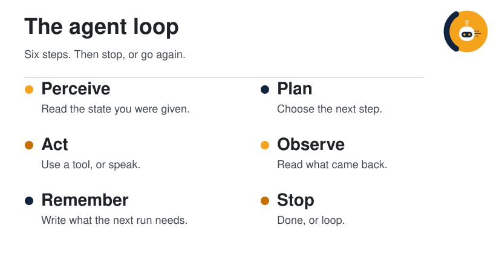

<p align="center">
  <picture>
  <source media="(prefers-color-scheme: dark)" srcset="../../assets/diagrams/agent-loop-dark.svg">
  
</picture>
</p>

<p>
  
</p>

# Playbook · Your first agent

Sketch one agent on a single page, then walk one task through the loop. You do not need a model, an API key, or a repository.

| | |
| --- | --- |
| Path | Explorer |
| Time | About 40 minutes |
| You need | [What is an agent](../00-foundations/what-is-an-agent.md) and [the loop](../00-foundations/the-agent-loop.md) |
| Produces | `agent-card.md`: six parts, a stop rule, and one trace |

This is synthesis. The card is a way to see an agent before you buy one.

## 1. Pick a task you already do

One sitting, one outcome. Good first tasks are small and checkable:

- Turn three links into a page a teammate can trust.
- File the bugs in a changelog as tickets.
- Summarize a meeting into decisions and open questions.

Write the task as a sentence with a done-when. "Look into our agents" is not a task. "A page that lists the six parts of the bot we already run, with a gap where you are unsure" is a task.

## 2. Fill the card

Copy this into `agent-card.md` and replace the brackets.

```markdown
# Agent card

Task:
Done when:

| Part | This agent |
| --- | --- |
| Model | [who chooses the next step] |
| Instructions | [the rules that do not change mid-run] |
| Tools | [named actions: read, search, write, and what each may touch] |
| Memory | [what must still exist tomorrow] |
| Environment | [laptop, remote runner, or CI, and who can see the files] |
| Stop | [the condition, plus a budget] |
```

If a row is "the chat window," say so. An empty memory row is a finding, not a failure of the exercise.

## 3. Trace one pass

Under the card, add six lines for a single pass. Use a real input. Here is a filled trace for the task "say whether a post names a repository":

| Step | What happened |
| --- | --- |
| Perceive | The goal is one page. The input is the post URL. |
| Plan | Open the post before writing any sentence about a repo. |
| Act | Open the post. |
| Observe | The post names a product. The project link is shortened. |
| Remember | Write: "no confirmed repository URL," and link the post. |
| Stop | The page has the link, the gap, and no guessed URL. |

Your trace should be this specific. "The agent does research" is the step you still owe.

## 4. Mark the thin step

Circle the step that would fail first if you ran this tomorrow with a model in the loop. The usual ones:

| If you notice | The thin step | The smallest fix |
| --- | --- | --- |
| It would search again next week | Remember | Name the file that must exist |
| It would keep going after the page exists | Stop | Write done-when, and a maximum number of steps |
| It would claim the file was written | Observe | Require a read of the file after the write |
| It would plan and never open the post | Act | The next step after a plan is a tool call |

## 5. Check the card

- [ ] The task names an artifact, not a mood.
- [ ] Done-when is something a second person could grade.
- [ ] Every tool has a name and a thing it is allowed to touch.
- [ ] Memory is a file or a record, not "it will remember."
- [ ] The environment says where the files live.
- [ ] Stop includes both the goal and a budget.
- [ ] The trace has six rows, and one of them is an observation of a real result.
- [ ] No row invents a URL, a benchmark, or a product feature.

## Check yourself

1. Which row of the card is not a tool, even though people often stuff it into the prompt?
2. What makes a trace different from the final page?
3. What will you add to the card before you let a model call a write tool?

## Sources

The six parts and the six steps are the guide's established frame. The card and the checklist are synthesis.

## Continue

- [Harness engineering](../01-agent-patterns/harness-engineering.md), to name the runtime around the card
- [Research agent](research-agent.md), when you want the card to become folders
- [Unstick a loop](unstick-a-loop.md), when a run misbehaves
- [What is an agent](../00-foundations/what-is-an-agent.md)

---

[Map](../README.md) | [Paths](../learning-paths.md) | [Glossary](../glossary.md) | [References](../references.md)
