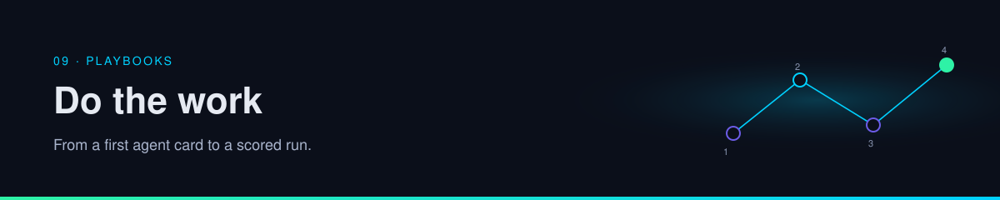

  

# 09 · Playbooks

Recipes. Each one assumes you have read the concept page it names. They are synthesis: a way to do the work, not a claim that a source prescribed these exact steps.

| | |
| --- | --- |
| Path | Power user |
| Time | One sitting each |
| You need | The concept page linked from the recipe |

| Playbook | You produce | Read first |
| --- | --- | --- |
| [Research agent](research-agent.md) | A raw/wiki/schema layout and five rules | [Wiki memory](../01-agent-patterns/wiki-memory.md) |
| [Skills and craft](skills-and-craft.md) | One chosen stack, reviewed before install | [Creative toolkits](../03-prompting-skills/creative-toolkits.md) |
| [Operate agents](operate-agents.md) | A placement for three real tasks | [Cloud and local](../05-runtime-infra/cloud-and-local.md) |
| [Review a gateway](review-a-gateway.md) | A yes, a no, or a not-yet for a proxy | [Gateways](../02-tools-mcp/gateways-and-routing.md) |

## Continue

- [Research agent](research-agent.md)

---

[Map](../README.md) | [Paths](../learning-paths.md) | [Glossary](../glossary.md) | [References](../references.md)
