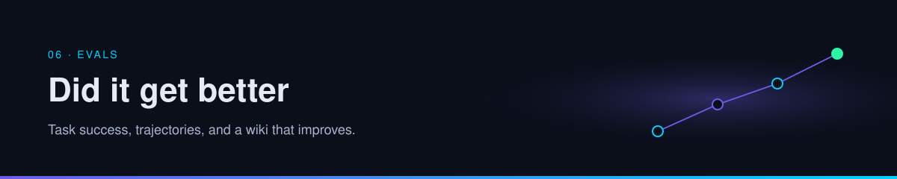

<p align="center">
  
</p>

# Playbook · Score a run

Grade one trajectory with a rubric you can apply twice and get the same answers. The point is a written pass or fail, not a feeling that the agent was impressive.

| | |
| --- | --- |
| Path | Operator |
| Time | About 40 minutes |
| You need | [Evals](../06-evals/index.md) |
| Produces | A scored sheet for one real run, or for the sample below if you have no trace yet |

The measures are established practice. The sample traces and the sheet are synthesis.

## 1. Copy the sheet

```markdown
# Run score

Task:
Done when:
Run id or date:

## Outcome
| Check | Pass? | Note |
| --- | --- | --- |
| The artifact meets done-when | | |
| Every non-obvious claim has a URL | | |
| Per-post claims are marked | | |
| Gaps are explicit | | |
| The raw source was not rewritten | | |

## Trajectory
| Required | Happened? |
| --- | --- |
| Wiki or notes searched before the open web | |
| Tool result read before the next claim | |
| No forbidden tool (send, delete, push) | |

## Cost
Tokens, time, or dollars:
Passes / attempts:

## Grade
Pass only if every outcome check is yes and every required trajectory row is yes.
```

Five binary checks beat one "quality" score from another model. A model can help you rank prose. It should not be the only grader.

## 2. Score a failing trace

Task: "Does the OmniRoute post name a repository we can clone?" Done-when: the page links the post and does not invent a repo URL.

| Step | Recorded |
| --- | --- |
| Perceive | Goal read. |
| Plan | "Find the official repo." |
| Act | Web search for the product name. |
| Observe | Several similarly named repositories. |
| Act | Page written: "The repository is `example/omniroute`." |
| Stop | The model said the task was complete. |

| Check | Pass? | Why |
| --- | --- | --- |
| Artifact meets done-when | No | It names a repo the post did not confirm |
| Claims have URLs | No | The repo name has no source line |
| Per-post claims marked | No | |
| Gaps explicit | No | The shortened link should have been the gap |
| Raw source untouched | Yes | It did not edit the post |
| Searched notes first | No | It searched the web immediately |
| Read the tool result before claiming | No | It treated a list of names as the answer |

Grade: fail. The prose can be fluent and the grade is still fail. Fix the skill check "do not guess shortened links" before you change models. The concept page for that claim is [gateways](../02-tools-mcp/gateways-and-routing.md).

## 3. Score a passing trace

Same task.

| Step | Recorded |
| --- | --- |
| Perceive | Goal and done-when read. |
| Act | Wiki search for OmniRoute. |
| Observe | A page says the project link is shortened and unresolved. |
| Remember | Log line: "answered from the wiki, no new fetch." |
| Stop | No second search. |

Every outcome check passes because the existing page already told the truth. Trajectory passes because it searched notes first and did not invent a URL. Cost should be lower than the failing run. That difference is the compounding claim, made countable. [B2](https://x.com/fleyta88/status/2108619644399415565) describes the feeling. This sheet is how you notice the day it stops.

## 4. Score one run of yours

Use a trace you already have. If the trace does not record tool names, that is the first failing check: you cannot grade a trajectory you did not keep. Store the plan line, the tool name, a redacted argument summary, and the result summary. Leave secrets out of the sheet.

Write the grade in the same place as the page the agent edited. A score that lives only in a chat will be re-argued next week.

## 5. Turn one failure into a regression

Add a row you can re-run after the next prompt or skill edit:

| Case | Pass |
| --- | --- |
| The question you just failed | The new trace does the thing the old one skipped |

Re-run that row before and after any change that claims to make the agent smarter, including a cheaper model or a compression toggle. If task success drops, the savings were not savings. More cases live on the [evals](../06-evals/index.md) page.

## Check yourself

1. Why did the fluent failing trace still fail?
2. What do you store so the next person can grade the trajectory?
3. Which single row will you re-run after the next change?

## Sources

- Established evaluation practice: outcome, trajectory, and cost. The [evals primer](../06-evals/index.md) is the concept page.
- [B2](https://x.com/fleyta88/status/2108619644399415565) — compounding across runs, per post. The sheet is synthesis.

## Continue

- [Unstick a loop](unstick-a-loop.md)
- [Research agent](research-agent.md)

---

[Map](../README.md) | [Paths](../learning-paths.md) | [Glossary](../glossary.md) | [References](../references.md)
