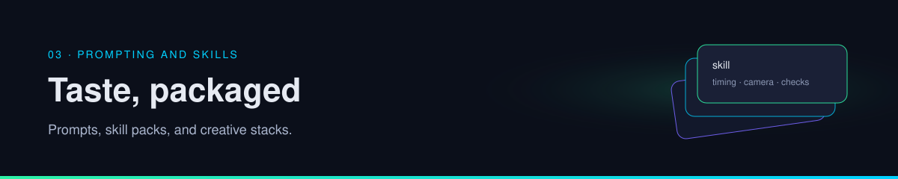

<p align="center">
  
</p>

# Playbook · Write a skill

Take one job your agent repeats and move the procedure out of the system prompt. You finish with a skill file short enough to review.

| | |
| --- | --- |
| Path | Builder |
| Time | About 45 minutes |
| You need | [Prompts and skills](../03-prompting-skills/prompts-and-skills.md) |
| Produces | `SKILL.md` for one job, and a note of what you removed from the prompt |

A skill is a procedure. This file is synthesis: a shape you can copy, not a format required by any one product.

## 1. Name one repeated job

Pick a job you would otherwise paste into every task. Good candidates:

- Update one wiki page from one post.
- Open a pull request only after tests pass.
- Turn a meeting note into decisions and owners.

If the job is "be a senior engineer," it is still a prompt, not a skill. Narrow it until the output is one artifact.

## 2. Copy this shape

Save it as `SKILL.md`. The example is the wiki-update job. Replace it with yours, but keep the five headings.

```markdown
# Skill: update one wiki page from one post

Use when: you have a post URL and a wiki page that should absorb it.
Do not use when: you have no URL, or the task is to invent a survey.

## Inputs
- The post URL.
- The path of the wiki page, or a statement that the page does not exist yet.

## Steps
1. Search the wiki for the question before opening the post.
2. If the page already answers it, write a log line and stop.
3. Open the post. Copy claims. Do not guess shortened links.
4. Update one page: answer, claim table, gaps, links.
5. Mark post-only claims as per post. Link the URL.

## Checks
- Every non-obvious claim has a URL.
- Gaps are a heading, not a missing sentence.
- The raw post was not rewritten.
- The run stopped after one page.

## Tools
- Read wiki pages and the post.
- Write the one wiki page and a log line.
- Do not send messages, delete files, or print secrets.
```

## 3. Take those lines out of the system prompt

The system prompt should still say who the agent is and what "done" means. It should point at the skill. It should not repeat the five steps. If both copies exist, they will drift, and the model will follow whichever copy it sees last.

A prompt that is still right after the move:

```text
You maintain the wiki. Follow SKILL.md for page updates.
Cite sources. Mark claims you cannot verify as per post.
Do not invent URLs, numbers, or repository names.
Stop when one page and one log line exist.
```

## 4. Run it once on a real post

Give the task in one or two lines: the URL, the page path, and nothing else. Then read the trajectory against the skill's checks.

| Pass | Fail |
| --- | --- |
| It searched the wiki first | It opened the post and answered in chat |
| The page has a claim table | The page is a paraphrase with no URLs |
| A shortened link stayed a gap | A search result was pasted as the destination |
| It stopped | It started a second, unrequested page |

If it fails, change the skill's step or check. Do not add adjectives to the prompt.

## 5. Review before anyone else installs it

- [ ] When to use it, and when not to, are both written.
- [ ] Each step ends in something you can see.
- [ ] Checks are yes/no.
- [ ] Tools are an allow-list, not "use tools as needed."
- [ ] No line tells the agent to ignore its other instructions.
- [ ] No secret is in the file.
- [ ] The system prompt no longer duplicates the steps.

If you install someone else's pack instead of writing this file, use the same list. The [craft playbook](skills-and-craft.md) adds the install and commit checks.

## Check yourself

1. What did you delete from the system prompt, and where does it live now?
2. Which heading would catch an invented URL?
3. Why is "be helpful and thorough" a bad step?

## Sources

The four layers are established practice, taught on [prompts and skills](../03-prompting-skills/prompts-and-skills.md). This file's headings and the example skill are synthesis. The habit of checking a skill repository before install is [per post](https://x.com/N01ennn/status/2108182955671580771).

## Continue

- [Research agent](research-agent.md)
- [Skills and craft](skills-and-craft.md)
- [Score a run](score-a-run.md)

---

[Map](../README.md) | [Paths](../learning-paths.md) | [Glossary](../glossary.md) | [References](../references.md)
