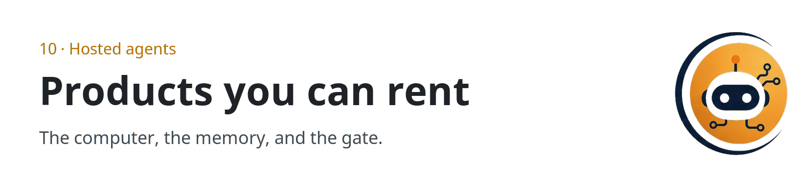
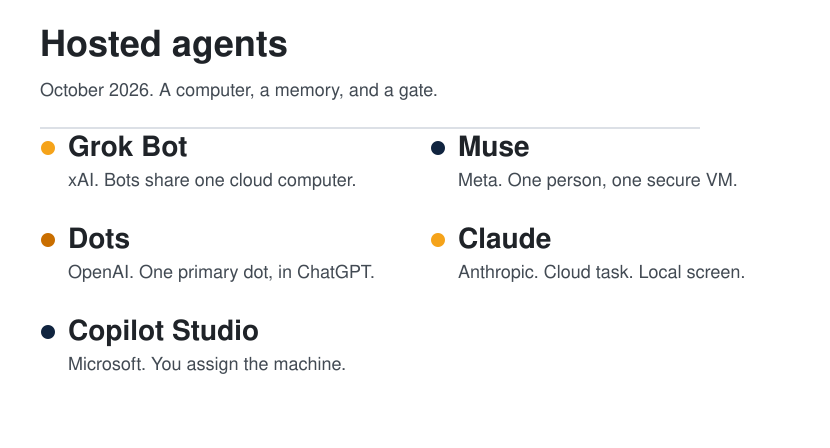
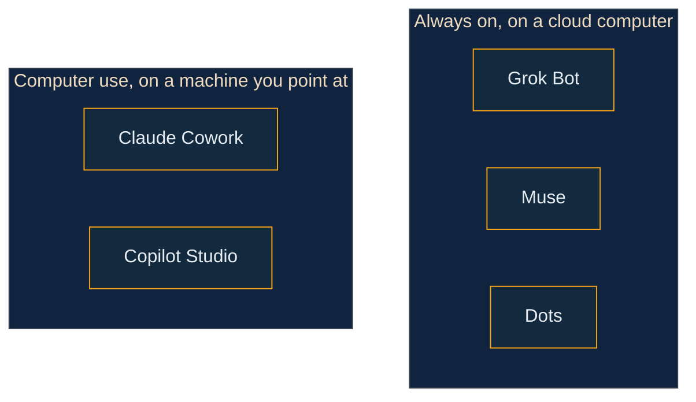

  <picture>
    <source media="(prefers-color-scheme: dark)" srcset="../../assets/sections/10-hosted-agents-dark.png">
    
  </picture>

  
  &nbsp;
  

# Hosted agents

<strong>You are here:</strong> Hosted agents · <a href="../../paths/operator/README.md">Operator</a> · <a href="../../paths/power-user/README.md">Power user</a> 
<strong>Next:</strong> <a href="../01-agent-patterns/harness-engineering.md">Harness engineering</a>

A hosted agent is a closed product that runs the harness for you. The model still only proposes. The product decides what it can see, what it may change, what it keeps, and what must stop for you.

| | |
| --- | --- |
| Path | Operator, then Power user |
| Time | About 25 minutes |
| You need | [Harness engineering](../01-agent-patterns/harness-engineering.md) |

This page is a reading of official pages opened on 11 October 2026. A feature that was not on those pages is not listed. Where two official pages disagree, both are linked and the disagreement is named. Prices in dollars are left out, because none of the product pages opened here stated one, except the Copilot credit rates below.

  <picture>
    <source media="(prefers-color-scheme: dark)" srcset="../../assets/diagrams/hosted-agents-dark.svg">
    
  </picture>

## What you will be able to do

- Name the maker, the computer, and the approval gate for each product on this page.
- Place a task on the harness part that product actually stresses.
- Refuse a claim that is not on the official page.

## At a glance

| Product | Maker | The computer | If you close the laptop | The check |
| --- | --- | --- | --- | --- |
| **Grok Bot** | xAI | One cloud computer, shared by every bot on the account | The work continues | Approval, and Auto Review |
| **Muse** | Meta | A Secure VM, one per person | It keeps working after you close the app | Sentinel on the network. Ask before a send or a purchase |
| **Dots** | OpenAI | Its own cloud computer. Your computer is optional | Cloud work continues. Local work needs the ChatGPT app open | Auto-review, custom rules, and steps that stay with you |
| **Claude Cowork** | Anthropic | A cloud session. Your screen only through the desktop app | The cloud session continues. The screen does not | Manual, Auto, or Skip. A delete needs an explicit allow |
| **Computer use** | Microsoft, inside Copilot Studio | A Windows machine you configure | The docs describe that machine, not your laptop lid | A reviewer can be asked to pause the run |

## Grok Bot

[Grok Bot](https://docs.x.ai/grok-bot/overview) is a team of named bots. You message one. It works across apps and sites on a persistent cloud computer with a browser, a filesystem, and a terminal, and it comes back when something needs approval. The docs say the computers run in Cursor's cloud, and that access is included with paid individual Cursor plans, the Cursor Teams plan, or a linked SuperGrok, SuperGrok Plus, or SuperGrok Heavy subscription.

The [launch announcement](https://x.ai/news/introducing-grok-bot) describes a beta on desktop and iOS, with enterprise on a waitlist, and says bot usage is separate from Grok and Cursor plan usage. The [FAQ](https://docs.x.ai/grok-bot/faq), read for this page, says desktop plus Linux and Android, weekly usage with an on-demand add-on, and enterprise access rolling out. Where those pages disagree, follow the docs and re-open both before you quote a plan.

| Part | In Grok Bot |
| --- | --- |
| Observation | The browser, files, and connectors on the shared computer |
| Context | Per-bot preferences, role, and summaries. Files and sessions are shared |
| Control | You message it. Bots can message each other and pass a task. A routine says when |
| Action | A connector when one exists. Computer use otherwise. One computer-use task per bot screen |
| State | One computer per account. Deleting a bot does not clear files and logins on it |
| Verification | Approval prompts, Auto Review, and a takeover for passwords, two-factor codes, and CAPTCHAs |

**Use it for** a job that spans a few tools and has a finish line. The overview's own example is a pipeline review: pull the list, skip people already in a sequence, research accounts, and leave drafts to approve. The launch post describes internal uses — sales follow-ups, invoice handling, reproducing a bug — as how SpaceXSI used it, not as a guarantee for your account.

**Limits.** Every bot on the account shares the computer, so a second bot is not a security boundary. A site can block automation, expire a session, or demand a person. The bot is supposed to hand those steps to you. Teaching a task by recording is limited to ten minutes and may still be rolling out. Tagging @bot on X needs a connected X account and is not available in every region. Legacy Privacy Mode is not supported, because the product requires cloud data storage.

## Muse

[Muse](https://about.fb.com/news/2026/09/introducing-muse-personal-ai-agent/) is Meta's personal agent, announced 8 September 2026. It runs on Muse Secure VM, a dedicated virtual machine with its own browser, and it is powered by Muse Spark. You talk to it like a message, in the Muse app or in WhatsApp. The announcement says it was rolling out in the US on iOS, Android, and muse.ai, with AI glasses coming later, and that it is free for most of what people need, with subscription plans for people who want to do more. This page does not name a price.

| Part | In Muse |
| --- | --- |
| Observation | The browser on the VM, plus connectors. Email search is not a full inbox download unless you ask |
| Context | What it has learned. You can tell it to forget a topic |
| Control | You give a task or a goal. It can keep a reminder or a scheduled task |
| Action | Connectors, forms, and, for checkout, Link by Stripe. Custom connectors are possible |
| State | The VM holds the data and the credentials. The model is not supposed to see the password |
| Verification | A separate Sentinel must approve anything that reaches the network. Send and purchase ask you. There is an audit trail |

**Use it for** a personal errand with a stop for anything that sends or spends: email, a reservation, a trip, a goal that becomes a plan. Those are the announcement's examples.

**Limits.** You choose connectors and can set them to read without write. By default, Muse will not take many important actions, such as sending an email, without approval. Facebook, Instagram, and Threads connect automatically if those accounts share an Accounts Center. Meta does not review custom connectors. The training setting is on when you first use Muse, and you can turn it off. The announcement says conversations and VM data are not shared with Meta's ad systems. Muse Confidential VM, encrypted with a key only you hold, was announced for later in 2026. The pages opened here do not say it has shipped. Shop Pay and 1Password were described as coming soon.

## Dots

[Dots](https://openai.com/index/introducing-dots/) are OpenAI's always-on agents in ChatGPT, announced 29 September 2026. A dot is powered by GPT-6 Astra, has its own cloud computer and browser, and can keep working when your computer is off. You start with one primary dot. The announcement says teams of dots are the later idea, not the thing you get on day one. Plugins are how it reaches other apps. OpenAI's figure is over 4,000 apps. The [Learn page](https://learn.chatgpt.com/docs/dots) names Gmail, Google Drive, and GitHub as examples.

| Part | In a dot |
| --- | --- |
| Observation | Its cloud computer and browser, the apps you connect, and your computer only if you allow it |
| Context | ChatGPT memory, plus notes the dot saves, including from connected apps |
| Control | You give it a responsibility. It can schedule a check, and it can hand work to ChatGPT Work or Codex |
| Action | Plugins, within their permissions. Proactive research, when you are not in the conversation, is read-only |
| State | The cloud computer, which you can open and take over. Local access starts off |
| Verification | Auto-review against your instructions, custom rules, and safety requirements. Changing a password stays with you |

**Use it for** an ongoing responsibility that should move between conversations: a launch whose scope changed, a deck that needs new numbers, a fix prepared for review. Those are the shapes in the announcement and the Learn page. A dot can also keep you posted in Slack or Teams.

**Limits.** Custom rules do not override built-in safeguards, and asking for a draft does not authorize sending it. The Help Center says you can connect a personal email account, and that a dot does not get its own email address at launch. You can call your dot. It cannot initiate calls to you at launch. Texting is a limited beta for some Pro users in the US, and not for Business or Enterprise workspaces. Local computer access needs the ChatGPT desktop app open on that computer, and only one personal computer is connected at a time. Reset deletes the dot's conversations, saved memories, and scheduled tasks.

Two official pages disagree, so this page does not collapse them:

- The [Help Center](https://help.openai.com/en/articles/20001530-getting-started-with-your-dot) says you create a dot on desktop, and that you cannot currently create one on mobile. The Learn page says you can create one in the mobile app.
- The Help Center says Pro, excluding the European Economic Area, Switzerland, and the UK, plus Business Premium across supported ChatGPT regions. The Learn page names Pro 100, Pro 200, and Pro 500 for users over 18 outside those same places, and says Business Premium is rolling out worldwide.
- Both say Enterprise, including Edu and Healthcare, is off until a workspace admin enables it.

Conversations with the dot do not count toward ChatGPT usage limits. Tasks it starts in Work or Codex count toward those products' limits.

## Claude Cowork

[Claude Cowork](https://support.claude.com/en/articles/13345190-get-started-with-claude-cowork) is Anthropic's agent for multi-step knowledge work. It uses the same architecture as Claude Code, without a terminal. Sessions run in the cloud, so a cloud task keeps going when you close the laptop, and the session follows your account across desktop, web, and mobile. The help page says that cloud runtime is in beta on Team and Enterprise plans.

Computer use is a separate switch. The [product article](https://claude.com/resources/articles/dispatch-and-computer-use) says it is a research preview for Claude Pro and Max, on macOS and Windows. Claude tries a connector first, such as Slack or Google Calendar. When there is no connector, it can use the screen, and it asks before it opens a new app. The desktop app has to be awake. Scheduled tasks are different again: they run in the cloud on paid plans and do not need the computer awake, unless the task itself needs local files or the screen.

| Part | In Claude Cowork |
| --- | --- |
| Observation | Connectors, a browser, and the screen only while the desktop app is open |
| Context | Memory shared with chat, unless you turn memory off before the task starts. Projects keep their own files and instructions |
| Control | It plans, can split work across sub-agents, and can run a scheduled task |
| Action | Connector tools, files you grant, shell in an isolated cloud environment, and computer use on Pro and Max |
| State | The cloud session on your account. Local MCP plugins work through the desktop app only |
| Verification | Manual, Auto, or Skip. Auto still blocks actions it judges unsafe. A permanent delete needs an explicit allow |

**Use it for** a finished file: a spreadsheet, a deck, a synthesis of notes, a folder put in order. Those are the help page's examples. Dispatch, in the computer-use article, is how you assign that work from your phone.

**Limits.** Computer use is slower than a connector, and a complex task may need a second try. Some apps are off-limits by default. Anthropic's advice is to start with apps you trust and not with sensitive data. You choose which MCPs to connect. Sessions cannot be shared. Auto mode uses more of the usage limit because it checks each action. No mode replaces your judgment on money, messages sent as you, or important files.

## Computer use in Copilot Studio

This one is not a personal teammate you message. [Computer use](https://learn.microsoft.com/en-us/microsoft-copilot-studio/computer-use) is a tool you add to an agent in Microsoft Copilot Studio. You describe the task. The tool drives a Windows machine with a virtual mouse and keyboard, including sites and desktop apps that have no API. The agent needs generative orchestration turned on.

The page lists these models: OpenAI's Computer-Using Agent and Anthropic's Claude Sonnet 4.5, both generally available; Claude Sonnet 4.6, experimental; Claude Opus 4.6, premium and experimental. A standard step costs 5 Copilot Credits. A premium step costs 15.

| Part | In this tool |
| --- | --- |
| Observation | The screen of the machine you assigned |
| Context | The instructions and inputs you wrote for the tool. The page does not describe a personal memory |
| Control | The agent decides when to call the tool. You write the steps |
| Action | Clicks, typing, and navigation. Stored credentials can sign in |
| State | The machine, plus credentials in Power Platform storage or a key vault you provide |
| Verification | Human supervision can email a reviewer and pause the run until they answer |

**Use it for** a repeatable screen task: move invoice fields from a PDF into a form, enter inventory rows, copy two values off a page. Those are the page's own samples.

**Limits.** If you share an agent that uses the maker's credentials, anyone who uses it can act with the maker's access on that machine. Access control stops interaction with sites that are not on the list. It does not stop the model from opening them. Microsoft's own advice is a dedicated machine, a least-privilege account, and an allow list. The tool is for agents you build, not a consumer app with a name and a memory.

## How to become a power user

> [!NOTE]
> **Synthesis.** The moves below are this guide's, drawn from the limits on the official pages. They are not a vendor's feature list.

1. Before the task, write three lines: what it may see, what it may change, and what must stop for you.
2. Use a connector when the product has one. Claude's own article says the screen is slower and less reliable.
3. On Grok Bot, assume every bot can see the shared computer. Sign out of a service when the work is done.
4. On Muse, start with read access. Leave send and purchase on ask.
5. On a dot, treat a draft as a draft. A custom rule does not override a built-in stop, and a password change stays with you.
6. On Claude, do not schedule a task that needs your screen and then close the laptop. The cloud task continues. The screen does not.
7. In Copilot Studio, do not share an agent that still holds the maker's credentials.
8. Re-open the official page before you quote a plan, a region, or a price. These products moved in September and October 2026.

## Check yourself

1. Which products keep working after you close the laptop, and which of them still need a desktop app for the screen?
2. Why is a second Grok Bot not a security boundary?
3. Which official pages disagree about creating a dot on mobile?

## Sources

**Established.** Opened 11 October 2026.

| Product | Pages |
| --- | --- |
| Grok Bot | [Overview](https://docs.x.ai/grok-bot/overview), [FAQ](https://docs.x.ai/grok-bot/faq), [launch announcement](https://x.ai/news/introducing-grok-bot), [skills and routines](https://docs.x.ai/grok-bot/skills-routines-and-automations), [approvals](https://docs.x.ai/grok-bot/approvals-security-and-privacy) |
| Muse | [Announcement](https://about.fb.com/news/2026/09/introducing-muse-personal-ai-agent/), [connectors](https://www.meta.com/help/artificial-intelligence/1687253048996149/), [approvals](https://www.meta.com/help/artificial-intelligence/1385290430137537/), [privacy, safety, and security](https://www.meta.com/help/artificial-intelligence/1047255454427887/), [Muse privacy policy](https://muse.ai/privacy) |
| Dots | [Announcement](https://openai.com/index/introducing-dots/), [product page](https://chatgpt.com/features/dots/), [Help Center](https://help.openai.com/en/articles/20001530-getting-started-with-your-dot), [Learn](https://learn.chatgpt.com/docs/dots) |
| Claude | [Cowork](https://support.claude.com/en/articles/13345190-get-started-with-claude-cowork), [computer use](https://claude.com/resources/articles/dispatch-and-computer-use) |
| Copilot Studio | [Computer use](https://learn.microsoft.com/en-us/microsoft-copilot-studio/computer-use) |

## Continue

- The six parts, without a vendor: [Harness engineering](../01-agent-patterns/harness-engineering.md)
- Where a run should live: [Cloud and local](../05-runtime-infra/cloud-and-local.md)
- Map: [Guide](../README.md)

---

[Map](../README.md) | [Paths](../learning-paths.md) | [Glossary](../glossary.md) | [References](../references.md)
