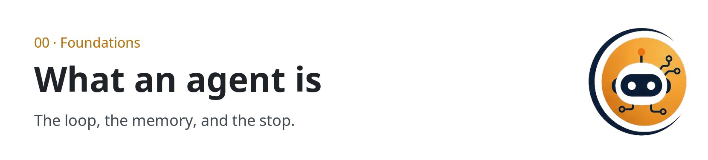
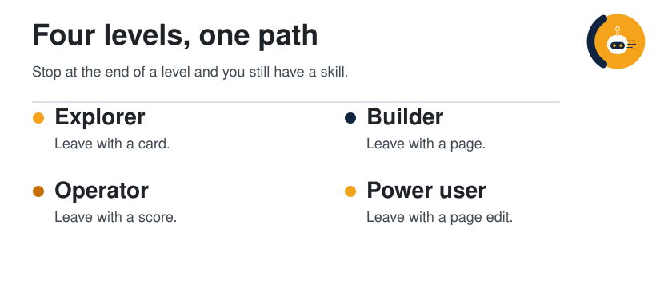

  <picture>
  <source media="(prefers-color-scheme: dark)" srcset="../assets/sections/00-foundations-dark.png">
  
</picture>

  
  &nbsp;
  
  &nbsp;
  
  &nbsp;
  

# Learning paths

<strong>You are here:</strong> Learning paths · <a href="learning-paths.md">Every level</a> 
<strong>Next:</strong> <a href="README.md">Map of the guide</a>

Four paths, one guide. Each pill opens a persona guide with its own route, exercises, and diagram: [Explorer](../paths/explorer/README.md), [Builder](../paths/builder/README.md), [Operator](../paths/operator/README.md), [Power user](../paths/power-user/README.md). You can stop at the end of a path and still have a complete skill. Later paths assume the earlier ones. Each path ends with an artifact you can show someone. Every path meets the harness.

  <picture>
  <source media="(prefers-color-scheme: dark)" srcset="../assets/diagrams/journey-map-dark.svg">
  
</picture>

| | |
| --- | --- |
| Path | All four |
| Time | Explorer about 2 hours. The full set is a few sittings. |
| You need | Nothing to begin |

## Explorer

New to agents? Start with the plain-language guide: [Explorer](../paths/explorer/README.md). The table below is the same path, inside the rest of the docs.

You can explain what an agent is, walk the loop, and name the difference between a chat log and a page. When you want the products people rent, open [Hosted agents](10-hosted-agents/index.md) and name the model inside one of them.

| Order | Page | Stay with it until |
| --- | --- | --- |
| 1 | [How to read a claim](how-to-read.md) | You can label a sentence established, per post, or synthesis |
| 2 | [What is an agent](00-foundations/what-is-an-agent.md) | You can list the six parts without looking |
| 3 | [The agent loop](00-foundations/the-agent-loop.md) | You can draw perceive, plan, act, observe, remember, stop |
| 4 | [Harness engineering](01-agent-patterns/harness-engineering.md) | You can point at the model and name the six parts. The SWE-bench section can wait |
| 5 | [Memory, tools, planning](00-foundations/memory-tools-planning.md) | You can say where a fact should live |
| 6 | [Glossary](glossary.md) | You have looked up every term that snagged |
| 7 | [Your first agent](09-playbooks/first-agent.md) | `agent-card.md` exists, with six parts and one trace |

**You are ready to build** when that card names a real task, a file that counts as memory, and a stop rule a second person could grade.

## Builder

The full guide is a hands-on build of one small agent: [Builder](../paths/builder/README.md). Start there. You finish with a loop, one tool, a notes file, a skill file, and a check that can reject an answer.

The pages below are the longer version of those same pieces. Open one when the small agent is too small for the job.

| Order | Page | Stay with it until |
| --- | --- | --- |
| 1 | [Builder](../paths/builder/README.md) | A notes file, a skill file, and a check exist, in code or with the no-code messages |
| 2 | [ReAct and plan-and-execute](01-agent-patterns/react-and-plan-execute.md) | You can pick one pattern for a task and say why |
| 3 | [Wiki memory](01-agent-patterns/wiki-memory.md) | You can describe raw, wiki, and schema |
| 4 | [How agents remember](01-agent-patterns/how-agents-remember.md) | You can place the four memories and say what write-back is |
| 5 | [Tools and MCP](02-tools-mcp/tools-and-mcp.md) | You can sketch a host, a model API, and a tool server |
| 6 | [Harness engineering](01-agent-patterns/harness-engineering.md) | You can name the model and the six runtime parts, and match them to the task |
| 7 | [Hosted agents](10-hosted-agents/index.md) | You can point at one product and name which harness part it stresses |
| 8 | [Prompts and skills](03-prompting-skills/prompts-and-skills.md) | You can split a giant prompt into prompt, skill, and file |
| 9 | [Write a skill](09-playbooks/write-a-skill.md) | One repeated job lives in `SKILL.md`, not in a longer prompt |
| 10 | [Research-agent playbook](09-playbooks/research-agent.md) | You have folders, rules, and one page written from a real source |

Optional depth: [creative toolkits](03-prompting-skills/creative-toolkits.md) and the [craft playbook](09-playbooks/skills-and-craft.md) if you build visual work with agents.

**You are ready to operate** when a second person can run your small agent from the skill file and the notes file, and the check can reject an answer that names nothing it opened.

## Operator

The full guide, with placement, evals, cost, and the security gate: [Operator](../paths/operator/README.md).

You can choose where an agent runs, how several agents share a plan, how you would notice a regression, and what you refuse to let it do. Start from the harness, so a score is never only a model name.

| Order | Page | Stay with it until |
| --- | --- | --- |
| 1 | [Harness engineering](01-agent-patterns/harness-engineering.md) | You can say which harness part a task will stress, and read a SWE-bench line as a pair |
| 2 | [Cloud and local](05-runtime-infra/cloud-and-local.md) | You can place a task on one side and defend it |
| 3 | [Hosted agents](10-hosted-agents/index.md) | You can place one real task on a named product and say which part it will stress |
| 4 | [Orchestration](04-multi-agent/orchestration.md) | You can draw a lead, three phases, and a merge |
| 5 | [Efficient inference](05-runtime-infra/efficient-inference.md) | You can separate a paper's claim from a post's retelling |
| 6 | [Evals](06-evals/index.md) | You can name the score, the trajectory, the cost, and the harness |
| 7 | [Threat model](07-security/threat-model.md) | You can name four threats in your own stack |
| 8 | [Find, review, fix, retest](07-security/find-fix-retest.md) | You can point at the human gate |
| 9 | [Gateways and supply chain](07-security/gateway-and-supply-chain.md) | You have a review list for a new proxy or skill |
| 10 | [Operate agents](09-playbooks/operate-agents.md) | Three real tasks have a placement |
| 11 | [Score a run](09-playbooks/score-a-run.md) | One trajectory has a written pass or fail |

**You are ready for power-user work** when the score sheet and the placement note would survive a teammate who was not in the room.

## Power user

The full guide, with harness tuning, multi-agent workflows, and stuck loops: [Power user](../paths/power-user/README.md).

You can do the work, retell a source without inflating it, and extend a page so the guide compounds.

| Order | Page | Stay with it until |
| --- | --- | --- |
| 1 | [Unstick a loop](09-playbooks/unstick-a-loop.md) | A real failure has one diagnosis and one change |
| 2 | [Harness engineering](01-agent-patterns/harness-engineering.md) | You can add a note to that page without inventing a benchmark number |
| 3 | [Hosted agents](10-hosted-agents/index.md) | You can run the power-user checklist against one product you actually use |
| 4 | [Case studies](08-case-studies/index.md) | You have opened at least three of the source posts |
| 5 | [Diagram atlas](diagrams.md) | You know which SVG pairs with which Mermaid block |
| 6 | [Style guide](style-guide.md) | A new page you draft matches the anatomy |
| 7 | [Contributing](../CONTRIBUTING.md) | You could update a page tonight, with the source linked |

**You are practicing the system** when the last thing you do, after answering a question, is update a page.

## What you should be holding

| After | The artifact |
| --- | --- |
| Explorer | [Agent card](09-playbooks/first-agent.md) |
| Builder | A notes file, a [skill file](09-playbooks/write-a-skill.md), and a check |
| Operator | A placement note and a [scored run](09-playbooks/score-a-run.md) |
| Power user | A diagnosis written where the next person will find it |

## If you only have an hour

1. [What is an agent](00-foundations/what-is-an-agent.md)
2. The [harness picture](01-agent-patterns/harness-engineering.md) — name the model and one other part
3. [The agent loop](00-foundations/the-agent-loop.md)
4. [Your first agent](09-playbooks/first-agent.md) — fill the card, even roughly

## Check yourself

1. Which path includes evals and the threat model?
2. What is the readiness test at the end of the Builder path?
3. Which single page should you read before quoting a number from a case study?

## Continue

- [Map of the guide](README.md)
- [Glossary](glossary.md)

---

[Map](README.md) | [Paths](learning-paths.md) | [Glossary](glossary.md) | [References](references.md)
