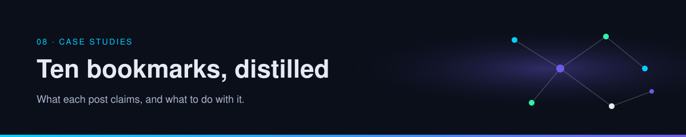

  

# Social references & inspirations

Posts, articles, and repositories that shaped this guide. Pages cite them inline. This list is the shelf: open a source next to the page that uses it.

| | |
| --- | --- |
| Path | Any path, when you want the original |
| Time | Browse |
| You need | Nothing |

Reference IDs (`B1`, `B2`, …) match the citations on the pages. **Per post** means the page is reporting the source, not confirming it. **Established** means a paper or an official project page was opened.

## Posts

| Ref | Date | Author | What it opened | Where it shows up |
| --- | --- | --- | --- | --- |
| B1 | 2026-10-10 | [@oliviscusAI](https://x.com/oliviscusAI/status/2108786434991923251) | bitnet.cpp and 1-bit inference | [Efficient inference](05-runtime-infra/efficient-inference.md), [case study](08-case-studies/local-inference.md) |
| B2 | 2026-10-09 | [@fleyta88](https://x.com/fleyta88/status/2108619644399415565) | A research agent that writes a wiki | [Wiki memory](01-agent-patterns/wiki-memory.md), [how agents remember](01-agent-patterns/how-agents-remember.md), [patterns](01-agent-patterns/react-and-plan-execute.md), [research playbook](09-playbooks/research-agent.md), [case study](08-case-studies/compounding-wiki.md) |
| B3 | 2026-10-10 | [@ai_explorer25](https://x.com/ai_explorer25/status/2108746842620014807) | Accounts to follow | [Community](community.md) |
| B4 | 2026-10-09 | [@ClaudeDevs](https://x.com/ClaudeDevs/status/2108591328732856655) | Managed multi-agent workflows | [Orchestration](04-multi-agent/orchestration.md), [case study](08-case-studies/managed-workflows.md) |
| B5 | 2026-10-09 | [@himanshubuildss](https://x.com/himanshubuildss/status/2108540618553356666) | Libraries for building sites with an agent | [Creative toolkits](03-prompting-skills/creative-toolkits.md), [case study](08-case-studies/motion-and-web-stacks.md) |
| B6 | 2026-10-08 | [@Bober_smart](https://x.com/Bober_smart/status/2108293657552117850) | OmniRoute, a local model gateway | [Gateways](02-tools-mcp/gateways-and-routing.md), [MCP](02-tools-mcp/tools-and-mcp.md), [supply chain](07-security/gateway-and-supply-chain.md), [review playbook](09-playbooks/review-a-gateway.md), [case study](08-case-studies/local-gateway.md) |
| B7 | 2026-10-08 | [@antigenco](https://x.com/antigenco/status/2108334286978113634) | Antigen, a security agent | [Find, review, fix, retest](07-security/find-fix-retest.md), [case study](08-case-studies/offensive-security-agent.md) |
| B8 | 2026-10-08 | [@thesupermannx](https://x.com/thesupermannx/status/2108098865073410484) | LittleBit, sub-1-bit compression | [Efficient inference](05-runtime-infra/efficient-inference.md), [case study](08-case-studies/local-inference.md) |
| B9 | 2026-10-08 | [@N01ennn](https://x.com/N01ennn/status/2108182955671580771) | Motion-design skill repositories | [Creative toolkits](03-prompting-skills/creative-toolkits.md), [skills](03-prompting-skills/prompts-and-skills.md), [supply chain](07-security/gateway-and-supply-chain.md), [case study](08-case-studies/motion-and-web-stacks.md) |
| B10 | 2026-10-08 | [@ryancarson](https://x.com/ryancarson/status/2108286700468191266) | Cloud agents and local licenses | [Cloud and local](05-runtime-infra/cloud-and-local.md), [operate playbook](09-playbooks/operate-agents.md) |

## Papers and repositories

| Work | Link | Cited from |
| --- | --- | --- |
| bitnet.cpp | [microsoft/BitNet](https://github.com/microsoft/BitNet), [paper](https://arxiv.org/abs/2410.16144) | [Efficient inference](05-runtime-infra/efficient-inference.md) |
| LittleBit | [paper](https://arxiv.org/abs/2506.13771), [SamsungLabs/LittleBit](https://github.com/SamsungLabs/LittleBit), [Samsung Research](https://research.samsung.com/blog/LittleBit-Ultra-Low-Bit-Quantization-via-Latent-Factorization) | [Efficient inference](05-runtime-infra/efficient-inference.md) |
| claude-motion | [whaleyxbt/claude-motion](https://github.com/whaleyxbt/claude-motion) | [Creative toolkits](03-prompting-skills/creative-toolkits.md) |
| Scrolltide | [scrolltide.co](https://scrolltide.co) | [Creative toolkits](03-prompting-skills/creative-toolkits.md) |
| CoALA | [paper](https://arxiv.org/abs/2309.02427) | [How agents remember](01-agent-patterns/how-agents-remember.md) |
| Lost in the Middle | [paper](https://arxiv.org/abs/2307.03172) | [How agents remember](01-agent-patterns/how-agents-remember.md) |
| Retrieval-augmented generation | [paper](https://arxiv.org/abs/2005.11401) | [How agents remember](01-agent-patterns/how-agents-remember.md) |
| MemGPT | [paper](https://arxiv.org/abs/2310.08560) | [How agents remember](01-agent-patterns/how-agents-remember.md) |
| ReAct | [paper](https://arxiv.org/abs/2210.03629) | [How agents remember](01-agent-patterns/how-agents-remember.md), [patterns](01-agent-patterns/react-and-plan-execute.md) |
| Reflexion | [paper](https://arxiv.org/abs/2303.11366) | [How agents remember](01-agent-patterns/how-agents-remember.md) |
| Generative Agents | [paper](https://arxiv.org/abs/2304.03442) | [How agents remember](01-agent-patterns/how-agents-remember.md) |
| Context engineering | [Anthropic, 2025](https://www.anthropic.com/engineering/effective-context-engineering-for-ai-agents) | [How agents remember](01-agent-patterns/how-agents-remember.md) |

## By theme

| Theme | References |
| --- | --- |
| Memory and knowledge | B2, and the papers above on memory, retrieval, and context |
| Orchestration | B4 |
| Tools, MCP, routing | B6 |
| Skills and creative stacks | B9, B5 |
| Runtime, cloud, local | B10 |
| Efficient inference | B1, B8, and the papers above |
| Security | B7, and the gateway cautions on B6 |
| People | B3 |

## Also used across the guide

These pages draw on more than one reference: [what is an agent](00-foundations/what-is-an-agent.md), [the loop](00-foundations/the-agent-loop.md), [evals](06-evals/index.md), [threat model](07-security/threat-model.md).

## Continue

- [How to read a claim](how-to-read.md)
- [Guide map](README.md)

---

[Map](README.md) | [Paths](learning-paths.md) | [Glossary](glossary.md) | [References](references.md)
