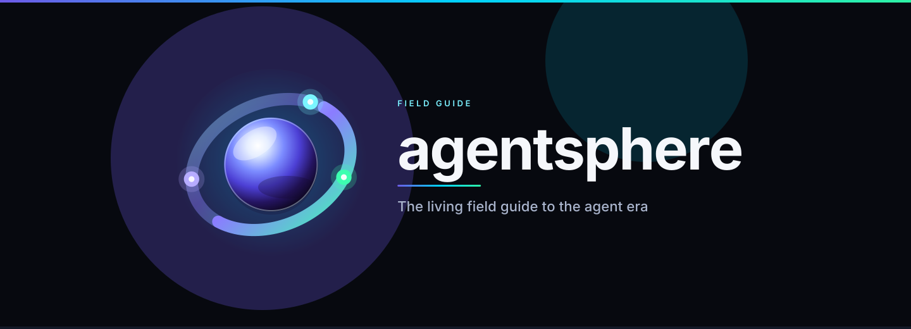

<p align="center">
  
</p>

# Style guide

One visual system, so a page added in six months still looks like it belongs.

| | |
| --- | --- |
| Path | Power user |
| Time | About 10 minutes |
| You need | [Contributing](../CONTRIBUTING.md) |

## Name and mark

The name is lowercase `agentsphere`. The mark is a wireframe sphere with three nodes, linked by arcs: three agents on one orbit. Files:

| File | Role |
| --- | --- |
| [assets/logo.svg](../assets/logo.svg) | App-icon mark, 256×256, own dark background |
| [assets/banner.svg](../assets/banner.svg) | README hero, 1440×640 |
| [assets/sections/](../assets/sections/) | Section openers, 1200×240 |
| [assets/diagrams/](../assets/diagrams/) | Architecture figures |

On the banner, the sphere glyph is set between the words `agent` and `sphere`. The accessible title of that image is the one-word name. `agentsphere` has no letter o; the orbit is the brand's circular form, drawn in the gap where the two roots meet.

## Palette

| Token | Hex | Role |
| --- | --- | --- |
| Space | `#0B0F1A` | Canvas |
| Night | `#101628` | Panels |
| Card | `#12182B` | Cards |
| Line | `#1C2740` | Quiet borders |
| Indigo | `#6C5CE7` | Planning, lead agent, structure |
| Cyan | `#00D1FF` | Input, tools, focus |
| Mint | `#2EF2A6` | Write-back, completion, review gate |
| White | `#E6EAF2` | Primary text on art |
| Mist | `#A9B4CC` | Body text on art |
| Slate | `#8B97B3` | Captions |

Art carries its own background. It has to read on GitHub's light theme and GitHub's dark theme without relying on either one.

## Diagram anatomy

Every architecture SVG shares:

- A 4px gradient bar at the top (indigo, cyan, mint)
- A small ring mark and a title
- The word `agentsphere` at the right of the header
- Rounded cards, 16px radius
- Numbered steps when the figure is a sequence
- A footer line that says whether the figure is established, per post, or both

Pairs live in the [diagram atlas](diagrams.md). If you change the words in the SVG, change the Mermaid block on the same day.

## Page anatomy

1. Section or diagram image, centered, `width="100%"`, with alt text.
2. One H1.
3. A three-row meta table: path, time, prerequisites.
4. "What you will be able to do."
5. The teaching, with claim callouts.
6. "Check yourself."
7. "Sources."
8. "Continue," then the footer links.

Callouts use GitHub alerts:

```markdown
> [!NOTE]
> **Per post.** …

> [!TIP]
> **Established.** …

> [!WARNING]
> **Check this before you route traffic or install it.** …
```

## Voice

Plain sentences. Define a term the first time a page uses it, even if the glossary also defines it. Put numbers in tables with a status column. Leave the original post's jokes and profanity in `sources/`, and write the page as a field guide.

## GitHub rendering

- Mermaid fences are not indented.
- Node labels with `/`, `:`, or `()` are quoted.
- SVG uses presentation attributes, system sans-serif, and no scripts or external images.
- Internal links are relative. From `docs/00-foundations/a-page.md`, assets are `../../assets/...` and sources are `../../sources/...`.

## Check yourself

1. Which file is the hero, and which file is the mark?
2. What has to be updated together when a routing diagram changes?
3. Why do the SVGs paint their own background?

## Continue

- [Contributing](../CONTRIBUTING.md)
- [Diagram atlas](diagrams.md)

---

[Map](README.md) | [Paths](learning-paths.md) | [Glossary](glossary.md) | [Sources](../sources/bookmarks.md)
