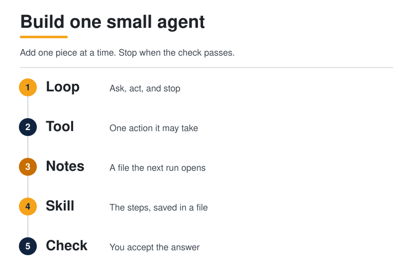
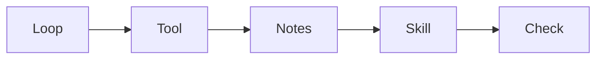

<p align="center">
  <picture>
    <source media="(prefers-color-scheme: dark)" srcset="../../assets/diagrams/builder-route-dark.svg">
    
  </picture>
</p>

<p>
  <a href="README.md"></a>
</p>

# Builder

<p><strong>You are here:</strong> Builder · <a href="README.md">Builder</a><br>
<strong>Next:</strong> <a href="../operator/README.md">Operator</a></p>


You have used an agent. This page is how you make a small one yourself. Building an agent means deciding the loop around a model: what it may do, what it writes down, which steps you save, and what must be true before you accept the answer. The model proposes the next step. You decide the rest.

By the end you will have one working notes helper. It can take a job, call one tool, read and write a notes file, follow a skill file, and reject an answer that does not say what it checked. You can do that with no code, in a product you already use, or with the short programs below.

| | |
| --- | --- |
| Path | Builder |
| Time | One sitting for the small agent. The deeper pages are extra |
| You need | The [Explorer guide](../explorer/README.md), or you already know what an agent is |



## What you are building

A notes helper, on purpose small:

1. You give it one job.
2. It may call one kind of action: read a file, or append one line.
3. The notes live in a file the next run opens.
4. The repeated steps live in a skill file, so the prompt for this run stays short.
5. A check rejects the answer unless it says what it actually opened.

That is a whole agent. It is not a product, and it is not ready for a team. [Operator](../operator/README.md) is the guide for that.

## No code

Use any agent you can already open. The same five steps, as messages. Paste one block, wait, then paste the next.

1. The loop. Paste this:

```
Help me keep a short note about one meeting.
Ask me one question, then write a one-paragraph summary.
Do not email anyone. Do not book anything.
```

2. The tool. Paste this:

```
You may look at my calendar only if I have already connected it.
You may not send messages, spend money, or change the event.
If you cannot look, say so.
```

3. The notes. Paste this:

```
Write the summary into a note titled "Meeting".
Next time I ask, open that note before you answer.
If this product has no files, paste the note back to me so I can keep it.
```

4. The skill. Paste this:

```
Save these steps as a reusable instruction named "Meeting note":
open the old note, ask one question if something is missing,
write one paragraph, and stop before you send anything.
```

5. The check. Paste this:

```
Before you show me the note, add a last line that starts with "Checked:".
Name what you actually opened.
If you did not open it, write "not sure" instead of guessing.
```

You are done when you have a short note, a last line that names what was opened, and nothing was sent or booked. If the product cannot save a file, you are the memory: keep the note and paste it at the start of the next chat.

## With code

The programs use the OpenAI Agents SDK, because that SDK's own quickstart shows these calls. Python package `openai-agents`. JavaScript package `@openai/agents`. Checked against the official pages on 11 October 2026, linked in [Sources](#sources).

Leave `model` unset. The SDK quickstart does that, and the SDK uses its default. The OpenAI API quickstart also shows a `model` string. If you set one, copy it from the page you open that day. Model names change.

The samples below were parsed. They were not run against a live model from this guide. You need an API key in `OPENAI_API_KEY` before `Runner.run` or `run` will succeed.

```bash
pip install openai-agents
export OPENAI_API_KEY=sk-...
```

```bash
npm install @openai/agents zod
```

On the Python side, `@tool` is imported from `agents.decorators`. The same function is also named `@function_tool` and can be imported from `agents`. The SDK docs recommend `@tool` for new code. Both names are in the current package. Use one.

### 1. A loop

A loop is: send the job, let the model answer, print the result, stop. You do not write the `while` yourself. `Runner.run` in Python, and `run` in JavaScript, do that. They call the model, and they will call tools in the later steps, until the model stops or the SDK's own limit hits.

```python
import asyncio

from agents import Agent, Runner

agent = Agent(
    name="Notes helper",
    instructions="Answer in one short paragraph. Do not send messages or spend money.",
)


async def main():
    result = await Runner.run(
        agent,
        "Summarize a Tuesday meeting in one sentence.",
    )
    print(result.final_output)


if __name__ == "__main__":
    asyncio.run(main())
```

```typescript
import { Agent, run } from "@openai/agents";

const agent = new Agent({
  name: "Notes helper",
  instructions:
    "Answer in one short paragraph. Do not send messages or spend money.",
});

const result = await run(
  agent,
  "Summarize a Tuesday meeting in one sentence.",
);
console.log(result.finalOutput);
```

The JavaScript snippet is the shape of the current quickstart, including top-level `await`. Put it in an ES module, or wrap it in `async function main()` the way the later quickstart example does.

### 2. A tool

A tool is one action your code performs when the model asks. The model decides to call it. Your function does the work and returns text. This tool has no side effect yet. It only returns a line, so you can see the call happen.

```python
import asyncio

from agents import Agent, Runner
from agents.decorators import tool


@tool
def meeting_hint() -> str:
    """Return the one fact this helper is allowed to know."""
    return "The meeting is on Tuesday. No location is on file."


agent = Agent(
    name="Notes helper",
    instructions="Use meeting_hint before you answer. One short paragraph.",
    tools=[meeting_hint],
)


async def main():
    result = await Runner.run(agent, "When is the meeting?")
    print(result.final_output)


if __name__ == "__main__":
    asyncio.run(main())
```

```typescript
import { Agent, run, tool } from "@openai/agents";
import { z } from "zod";

const meetingHint = tool({
  name: "meeting_hint",
  description: "Return the one fact this helper is allowed to know.",
  parameters: z.object({}),
  async execute() {
    return "The meeting is on Tuesday. No location is on file.";
  },
});

const agent = new Agent({
  name: "Notes helper",
  instructions: "Use meeting_hint before you answer. One short paragraph.",
  tools: [meetingHint],
});

const result = await run(agent, "When is the meeting?");
console.log(result.finalOutput);
```

### 3. Notes

The chat is not memory. Close it, and the next run starts empty. A notes file is memory you can point at. Two tools: one reads the file, one appends a single line. Keep them separate. A tool that both reads and sends hides the send.

```python
import asyncio
from pathlib import Path

from agents import Agent, Runner
from agents.decorators import tool

NOTES = Path("notes.md")


@tool
def read_notes() -> str:
    """Read the notes file from earlier runs."""
    if not NOTES.exists():
        return "No notes yet."
    return NOTES.read_text(encoding="utf-8")


@tool
def write_note(line: str) -> str:
    """Append one line to the notes file."""
    with NOTES.open("a", encoding="utf-8") as handle:
        handle.write(line.strip() + "\n")
    return "Saved."


agent = Agent(
    name="Notes helper",
    instructions=(
        "Read the notes before you answer. "
        "If the user asks you to remember a fact, append one short line. "
        "Do not send messages or spend money."
    ),
    tools=[read_notes, write_note],
)


async def main():
    result = await Runner.run(
        agent,
        "Remember that the meeting is on Tuesday, then read the notes back.",
    )
    print(result.final_output)


if __name__ == "__main__":
    asyncio.run(main())
```

Run it twice. The second run should see the line the first run wrote. That is the whole point of the file.

The SDK can also keep the chat itself. In Python that is a session object you pass into `Runner.run`. A session remembers the conversation. It does not replace the notes file. The file is the page you can open, edit, and review.

```python
import asyncio

from agents import Agent, Runner, SQLiteSession

agent = Agent(
    name="Notes helper",
    instructions="Answer in one short paragraph.",
)


async def main():
    session = SQLiteSession("notes_helper")
    result = await Runner.run(
        agent,
        "What did I ask you to remember?",
        session=session,
    )
    print(result.final_output)


if __name__ == "__main__":
    asyncio.run(main())
```

`SQLiteSession("notes_helper")` matches the sessions guide. A second argument, as in `SQLiteSession("notes_helper", "conversations.db")`, is the database file. The JavaScript quickstart's matching idea for the next turn is to pass `result.history` back into `run`. This page does not show a JavaScript session class, because the notes file is the memory the example is teaching.

### 4. A skill

A skill is the procedure, saved, so you do not paste it into every task. The prompt for this run keeps the goal. The file keeps the steps. Save this as `SKILL.md` next to the program:

```markdown
# Notes helper

Use this when the user asks you to remember a fact.

1. Read the notes before you answer.
2. If they asked you to save something, append one short line with write_note.
3. Answer in one short paragraph.
4. End with a line that starts with "Checked:" and name what you actually read.
5. If you did not read the notes, write "not sure" and do not invent the fact.
6. Do not send messages or spend money.
```

Load that file into `instructions`. If the file is missing, say so in the instructions. Do not pretend a skill is loaded.

```python
from pathlib import Path

from agents import Agent

SKILL = Path("SKILL.md")


def load_skill() -> str:
    if not SKILL.exists():
        return "No skill file yet. Answer in one short paragraph."
    return SKILL.read_text(encoding="utf-8")


agent = Agent(
    name="Notes helper",
    instructions=load_skill(),
    tools=[read_notes, write_note],
)
```

If the skill and the task instructions disagree, edit the skill. That is the file you will still have next month.

### 5. A check

A finished sentence is not a finished job. Before you accept the answer, require a line that says what was opened. This check is ordinary code around `result.final_output`. It is yours, so you can see it.

```python
def accept(answer: str) -> str:
    """Reject an answer that does not say what was checked."""
    text = answer.lower()
    if "checked:" in text or "not sure" in text:
        return answer
    return "Rejected. Ask for a line that starts with Checked: or says not sure."
```

Print `accept(result.final_output)` instead of the raw answer. In JavaScript the field is `result.finalOutput`.

The SDK can also reject an answer inside the run, with an output guardrail on the agent. The decorator is `@output_guardrail` from `agents.decorators`, passed as `output_guardrails=[...]` on `Agent`. The guardrails guide shows the full shape, including `GuardrailFunctionOutput` and `OutputGuardrailTripwireTriggered`. Use that when you want the runner to refuse the answer. Use `accept` while you are learning, because the check stays in the file you are reading.

### The whole agent

Python, steps 3 through 5 together. Put `SKILL.md` beside it.

```python
import asyncio
from pathlib import Path

from agents import Agent, Runner
from agents.decorators import tool

NOTES = Path("notes.md")
SKILL = Path("SKILL.md")


@tool
def read_notes() -> str:
    """Read the notes file from earlier runs."""
    if not NOTES.exists():
        return "No notes yet."
    return NOTES.read_text(encoding="utf-8")


@tool
def write_note(line: str) -> str:
    """Append one line to the notes file."""
    with NOTES.open("a", encoding="utf-8") as handle:
        handle.write(line.strip() + "\n")
    return "Saved."


def load_skill() -> str:
    if not SKILL.exists():
        return "No skill file yet. Answer in one short paragraph."
    return SKILL.read_text(encoding="utf-8")


def accept(answer: str) -> str:
    """Reject an answer that does not say what was checked."""
    text = answer.lower()
    if "checked:" in text or "not sure" in text:
        return answer
    return "Rejected. Ask for a line that starts with Checked: or says not sure."


async def main():
    agent = Agent(
        name="Notes helper",
        instructions=load_skill(),
        tools=[read_notes, write_note],
    )
    result = await Runner.run(
        agent,
        "Remember that the meeting is on Tuesday, then read the notes back.",
    )
    print(accept(result.final_output))


if __name__ == "__main__":
    asyncio.run(main())
```

The same agent in TypeScript:

```typescript
import { readFileSync, appendFileSync, existsSync } from "node:fs";
import { Agent, run, tool } from "@openai/agents";
import { z } from "zod";

const notesPath = "notes.md";
const skillPath = "SKILL.md";

const readNotes = tool({
  name: "read_notes",
  description: "Read the notes file from earlier runs.",
  parameters: z.object({}),
  async execute() {
    if (!existsSync(notesPath)) return "No notes yet.";
    return readFileSync(notesPath, "utf8");
  },
});

const writeNote = tool({
  name: "write_note",
  description: "Append one line to the notes file.",
  parameters: z.object({ line: z.string() }),
  async execute({ line }) {
    appendFileSync(notesPath, `${line.trim()}\n`);
    return "Saved.";
  },
});

function loadSkill(): string {
  if (!existsSync(skillPath)) {
    return "No skill file yet. Answer in one short paragraph.";
  }
  return readFileSync(skillPath, "utf8");
}

function accept(answer: string): string {
  const text = answer.toLowerCase();
  if (text.includes("checked:") || text.includes("not sure")) return answer;
  return "Rejected. Ask for a line that starts with Checked: or says not sure.";
}

const agent = new Agent({
  name: "Notes helper",
  instructions: loadSkill(),
  tools: [readNotes, writeNote],
});

const result = await run(
  agent,
  "Remember that the meeting is on Tuesday, then read the notes back.",
);
console.log(accept(result.finalOutput));
```

## Why each piece matters

### The harness

The harness is everything around the model. It decides what the model can see, which actions are allowed, where notes live, and how a bad answer is caught. In this small agent the harness is the instructions, the two tools, the notes file, the skill file, and `accept`.

**Why it matters.** A better model does not invent a missing check or a missing file. When a run fails, name the piece that failed before you swap the model.

The longer list, six jobs the runtime does, is [Harness engineering](../../docs/01-agent-patterns/harness-engineering.md). That list is observation, context, control, action, state, and verification. It is a different list from the six product pieces on [What is an agent](../../docs/00-foundations/what-is-an-agent.md).

### Tools and MCP

A tool is one action with a name, inputs, and a result. The model chooses it. Your code runs it. **MCP** (Model Context Protocol) is a common plug: a host talks to a tool server, and the model still just sees tools. You do not need MCP for the two functions above. You need it when the tool lives in another program and more than one host should be able to attach it.

**Why it matters.** Without a tool, the helper can only talk. A tool with two effects, such as "search and also email," hides the email inside a lookup. One action per tool. Reads can be wide. Sends, payments, and deletes wait for a person.

The picture of host, model API, and tool server is [Tools and MCP](../../docs/02-tools-mcp/tools-and-mcp.md).

### Memory

Memory is what you keep on purpose outside the chat window. Here it is `notes.md`. The next run calls `read_notes` and sees the line. A session, such as `SQLiteSession`, keeps the conversation. That is useful, and it is still not a page you can hand to someone.

**Why it matters.** If the only memory is the chat, the next run searches again for a fact you already wrote down. Write the fact. Open the file first.

How that file grows into sources, wiki pages, and rules is [How agents remember](../../docs/01-agent-patterns/how-agents-remember.md) and [Wiki memory](../../docs/01-agent-patterns/wiki-memory.md).

### Skills

A skill is a procedure you saved. `SKILL.md` holds the steps. The message you pass to `Runner.run` holds today's job. A system prompt that tries to be both becomes a page nobody reviews.

**Why it matters.** The file is the thing you will edit when the steps change. A paragraph buried in a chat is not.

The four layers, and what belongs in each, are [Prompts and skills](../../docs/03-prompting-skills/prompts-and-skills.md). The blank you can copy for a real job is [Write a skill](../../docs/09-playbooks/write-a-skill.md).

### The check

Verification is the rule for what counts as done. `accept` is a small one: the answer must say what it opened, or it must say it is not sure. A guardrail is the same idea inside the SDK run.

**Why it matters.** The model will sound finished before it is. A check you can read is how you notice.

## Common mistakes

| What goes wrong | What to do |
| --- | --- |
| The answer sounds sure, and it names nothing it opened | Reject it until it has a `Checked:` line, or it says `not sure` |
| One tool can read and also send | Split them. A read stays a read |
| The only memory is the chat window | Write `notes.md`, and open it on the next run |
| The skill and the prompt disagree | Edit the skill. Keep today's goal in the message |
| You change the model and the tool on the same day | Change one. Run the check again |
| A draft is treated as permission to send | Sends, payments, and deletes wait until a person says so |

The loop that searches, answers, forgets, and searches again is the failure [ReAct and plan-and-execute](../../docs/01-agent-patterns/react-and-plan-execute.md) is about. The notes file is the first fix.

## Quick wins

1. Paste the five no-code messages into an agent you already use. Stop if it asks to send, pay, or delete.
2. Take one paragraph you paste into every task. Save it as `SKILL.md`. That paragraph is a skill.
3. Name the file the next run must open. If you cannot name it, there is no memory yet.

## Checklist

- [ ] I can say what the loop does: the model proposes, a tool may run, I see a result.
- [ ] One tool has one action, and it does not send, pay, or delete.
- [ ] A notes file exists, and a second run can open it.
- [ ] `SKILL.md` holds the repeated steps, and today's job is a short message.
- [ ] A check rejects an answer that does not say what it opened.
- [ ] Nothing was sent or booked while I tried this.
- [ ] I could hand the skill file and the notes file to someone else and they could run the helper.

## Common questions

**Do I have to write code?**
No. The five messages above are the same agent. Code is how you own the tool, the file, and the check.

**Do I have to use this SDK?**
No. The five steps are the same in other products. These samples use the OpenAI Agents SDK because its current docs show `Agent`, `Runner.run`, `@tool`, and `run`. Copy the calls from the pages in [Sources](#sources) if those pages have moved.

**Which Python decorator is the real one?**
Both. `@tool` from `agents.decorators` is the name the SDK quickstart uses for new code. `@function_tool` from `agents` is the same function. The API-site quickstart still shows `@function_tool`.

**What if I have no API key?**
Do the no-code steps. The programs will not complete a model call without `OPENAI_API_KEY`.

**Is the check the same as a test suite?**
No. `accept` is one rule on one answer. Scoring a run for a team, including cost, is [Operator](../operator/README.md).

**Where does MCP come in?**
When the tool should live outside this file and plug into more than one host. Until then, a function in the same file is the tool.

## Deeper pages

Stay on those pages when the small agent is too small for the job. Order is a suggestion.

| Order | Open | You can leave when |
| --- | --- | --- |
| 1 | [Harness engineering](../../docs/01-agent-patterns/harness-engineering.md) | You can name the model and the six runtime parts |
| 2 | [ReAct and plan-and-execute](../../docs/01-agent-patterns/react-and-plan-execute.md) | You can pick one pattern and say why |
| 3 | [Wiki memory](../../docs/01-agent-patterns/wiki-memory.md) | You can describe raw, wiki, and schema |
| 4 | [How agents remember](../../docs/01-agent-patterns/how-agents-remember.md) | You can place working, episodic, semantic, and procedural memory |
| 5 | [Tools and MCP](../../docs/02-tools-mcp/tools-and-mcp.md) | You can sketch a host, a model API, and a tool server |
| 6 | [Prompts and skills](../../docs/03-prompting-skills/prompts-and-skills.md) | You can split a giant prompt into prompt, skill, and file |
| 7 | [Research-agent playbook](../../docs/09-playbooks/research-agent.md) | Folders, rules, and one page exist |
| 8 | [Write a skill](../../docs/09-playbooks/write-a-skill.md) | One repeated job lives in `SKILL.md` |

Two optional pages: [creative toolkits](../../docs/03-prompting-skills/creative-toolkits.md) for visual jobs, and [gateways and routing](../../docs/02-tools-mcp/gateways-and-routing.md) once you want one API in front of more than one model. [Hosted agents](../../docs/10-hosted-agents/index.md) is one pass if you want to point at a product and name which piece it stresses.

The SWE-bench Verified reading on the harness page is a source with the survey's caveats. Quote it from that page. Do not carry a number into a new page from memory.

## Next: Operator

Go to [Operator](../operator/README.md) when someone else could run what you built. You will leave a note about where the job runs, a score that is more than a feeling, and a list of actions you refuse to let the agent take alone.

You are ready when a second person can run this helper from `SKILL.md` and `notes.md`, and the check can reject an answer that names nothing it opened.

## Sources

Calls and install lines were taken from these pages, opened 11 October 2026. Where two pages name the Python decorator differently, both names are kept, because the package defines them as one function.

- [OpenAI Agents SDK for Python, quickstart](https://openai.github.io/openai-agents-python/quickstart/) — `Agent`, `Runner.run`, `result.final_output`, and `@tool` from `agents.decorators`.
- [OpenAI Agents quickstart](https://developers.openai.com/api/docs/guides/agents/quickstart) — the same loop in Python and JavaScript. The Python sample there uses `@function_tool`.
- [OpenAI Agents SDK for JavaScript, quickstart](https://openai.github.io/openai-agents-js/guides/quickstart/) — `Agent`, `run`, `result.finalOutput`, and `tool()`.
- [OpenAI Agents SDK for JavaScript, tools](https://openai.github.io/openai-agents-js/guides/tools/) — `tool({ parameters: z.object({ ... }), execute })`.
- [Sessions](https://openai.github.io/openai-agents-python/sessions/) — `SQLiteSession` and `session=` on `Runner.run`.
- [Guardrails](https://openai.github.io/openai-agents-python/guardrails/) — `@output_guardrail` and `output_guardrails`.
- Guo, Hao, Wang, and colleagues, [From Question Answering to Task Completion](https://arxiv.org/abs/2606.20683), read on [Harness engineering](../../docs/01-agent-patterns/harness-engineering.md).

## Continue

- [Harness engineering](../../docs/01-agent-patterns/harness-engineering.md)
- [Tools and MCP](../../docs/02-tools-mcp/tools-and-mcp.md)
- [Write a skill](../../docs/09-playbooks/write-a-skill.md)
- [Operator](../operator/README.md)

---

[Map](../../docs/README.md) | [Paths](../../docs/learning-paths.md) | [Glossary](../../docs/glossary.md) | [References](../../docs/references.md)
