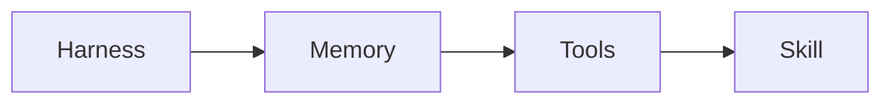

  <picture>
    <source media="(prefers-color-scheme: dark)" srcset="../../assets/diagrams/builder-route-dark.svg">
    
  </picture>

  

# Builder

You are ready to make an agent, not only to rent one. This path is the harness you design: what the model sees, the page that survives, the tools it may call, and the skill that holds a repeated job.

| | |
| --- | --- |
| Path | Builder |
| Time | A few sittings. The two playbooks are the long part |
| You need | The [Explorer guide](../explorer/README.md), or you already know what an agent is |

The model still only proposes. You decide the six runtime parts. A longer prompt is the last place to put a rule you expect to reuse.

## Who this is for

People who want to build. You can already say what an agent is. You want a knowledge base a later run can open, a tool boundary you can draw, and one procedure that lives in a file. Production scores, on-call, and supply-chain review wait for [Operator](../operator/README.md).

## What you will be able to do

- Name the model and the six harness parts, and match a task to the part it will stress.
- Choose ReAct or plan-and-execute for a task, and say why.
- Lay out raw, wiki, and schema, and say what write-back is.
- Sketch a host, a model API, and a tool server.
- Leave a wiki page written from a real source, and a `SKILL.md` for one repeated job.

## The route

| Order | Open | You can leave when |
| --- | --- | --- |
| 1 | [Harness engineering](../../docs/01-agent-patterns/harness-engineering.md) | You can name the model and the six parts, and match them to a task |
| 2 | [ReAct and plan-and-execute](../../docs/01-agent-patterns/react-and-plan-execute.md) | You can pick one pattern and say why |
| 3 | [Wiki memory](../../docs/01-agent-patterns/wiki-memory.md) | You can describe raw, wiki, and schema |
| 4 | [How agents remember](../../docs/01-agent-patterns/how-agents-remember.md) | You can place working, episodic, semantic, and procedural memory |
| 5 | [Tools and MCP](../../docs/02-tools-mcp/tools-and-mcp.md) | You can sketch a host, a model API, and a tool server |
| 6 | [Prompts and skills](../../docs/03-prompting-skills/prompts-and-skills.md) | You can split a giant prompt into prompt, skill, and file |
| 7 | [Research-agent playbook](../../docs/09-playbooks/research-agent.md) | Folders, rules, and one page exist |
| 8 | [Write a skill](../../docs/09-playbooks/write-a-skill.md) | One repeated job lives in `SKILL.md` |

Two optional pages, if they match the work: [creative toolkits](../../docs/03-prompting-skills/creative-toolkits.md) for visual jobs, and [gateways and routing](../../docs/02-tools-mcp/gateways-and-routing.md) once you want one API in front of more than one model. [Hosted agents](../../docs/10-hosted-agents/index.md) is worth one pass here too: pick one product and name the harness part it stresses. That is a design reading, not a buying guide.

The SWE-bench Verified reading on the harness page is a Builder-level source, with the survey's caveats. Quote it from that page. Do not carry a number into a new page from memory.

## Quick wins

1. Draw six boxes. Label them observation, context, control, action, state, verification. Put the model in the middle and write "proposes" on the arrow out.
2. Take a prompt you already use. Mark one paragraph that is a procedure. That paragraph is a skill candidate.
3. Name the file a second run must open before it searches again. If you cannot name it, the agent has no memory yet.

## Hands on

### 1. A page the next run can search

Do the [research-agent playbook](../../docs/09-playbooks/research-agent.md). You finish with a raw / wiki / schema layout and one page written from a real source. The raw source stays intact. The wiki page says what you decided, what you cited, and what you still do not know.

### 2. One skill file

Do [Write a skill](../../docs/09-playbooks/write-a-skill.md). One repeated job. The prompt keeps the goal for this run. The skill keeps the steps that should survive the next run. If the skill and the prompt say different things, the file you will edit next month is the one that wins. Make that the skill.

### 3. A tool boundary, on paper if you are not ready to serve one

From [Tools and MCP](../../docs/02-tools-mcp/tools-and-mcp.md), sketch three boxes: the host, the model API, and one tool server. Name one action that server exposes, and what it may touch. A sketch counts. A server you cannot explain is not the next step.

## Checklist

- [ ] The six harness parts are named, and the model is not one of them.
- [ ] A task I care about is matched to the part that will fail first.
- [ ] I picked ReAct or plan-and-execute on purpose.
- [ ] Raw, wiki, and schema are three different places.
- [ ] One wiki page was written from a source I opened.
- [ ] One tool action has a name and a boundary.
- [ ] `SKILL.md` holds one repeated job, and the prompt got shorter.
- [ ] A second person could run the research agent from the schema and the skill file.

## Check yourself

1. Which harness part fails when the next run searches for a fact that is already on a page?
2. What is the difference between the raw folder and the wiki page?
3. What belongs in the skill, and what stays in the prompt for this run?

## Next level

[Operator](../operator/README.md). Go there when someone else could run what you built. Operator is where that agent meets a team: where it runs, how you score it, what it costs, and what you refuse to let it do.

## Sources

This page is a route. The harness frame is Guo, Hao, Wang, and colleagues, [From Question Answering to Task Completion](https://arxiv.org/abs/2606.20683), read on [Harness engineering](../../docs/01-agent-patterns/harness-engineering.md). Pattern and tool claims stay on the pages linked above.

## Continue

- [Harness engineering](../../docs/01-agent-patterns/harness-engineering.md)
- [Wiki memory](../../docs/01-agent-patterns/wiki-memory.md)
- [Write a skill](../../docs/09-playbooks/write-a-skill.md)

---

[Map](../../docs/README.md) | [Paths](../../docs/learning-paths.md) | [Glossary](../../docs/glossary.md) | [References](../../docs/references.md)
