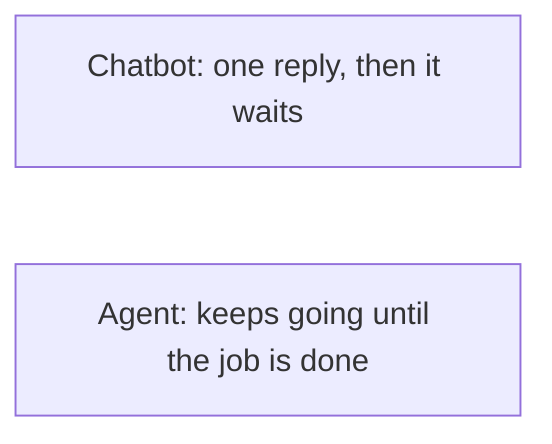

<p align="center">
  <picture>
    <source media="(prefers-color-scheme: dark)" srcset="../../assets/diagrams/explorer-route-dark.svg">
    
  </picture>
</p>

<p>
  <a href="README.md"></a>
</p>

# Explorer

You have never used an AI agent, or you have only used a chatbot. This page starts there. No coding. No install. About fifteen minutes.

| | |
| --- | --- |
| Path | Explorer |
| Time | About 15 minutes |
| You need | Nothing |



## What is an AI agent?

An AI agent is a helper that can do a job, not only answer a question. You say what finished looks like. It takes the steps. It can look things up, draft a file, and come back when it needs a decision from you.

A chatbot is the person behind a counter. You ask. They answer. They wait for the next question. An agent is the assistant you send on an errand. You describe the errand and the limits. They go do the pieces. You look at the result before anything important happens, such as sending a message or spending money.

| | A chatbot | An agent |
| --- | --- | --- |
| You say | A question | A job, and what finished looks like |
| It does | Answers, then waits | Takes the steps, and can keep going |
| You do | Ask the next question | Read the result, and stop it before it sends or pays |

## What agents can do for you today

These are ordinary jobs people already hand to an agent:

- Turn a messy pile of notes into a page you can read in one minute.
- Plan a Saturday, and leave the booking to you.
- Draft an email, and wait while you press send yourself.
- Pull the dates out of a long document into a list.
- Tell you what changed in a project since last week.

A finished file, a draft, or a plan. That is the shape of the work. No product does every job on this list.

## Popular agents you can try

Four you can open in a browser or an app. One line each. The longer reading, including the limits, is [Hosted agents](../../docs/10-hosted-agents/index.md). The lines below follow the official pages linked here, opened 11 October 2026.

- [Grok Bot](https://docs.x.ai/grok-bot/overview) (xAI). You message a bot. It works on a cloud computer, and it asks you when it needs a yes.
- [Dots](https://openai.com/index/introducing-dots/) (OpenAI). An always-on helper inside ChatGPT, with its own cloud computer. Cloud work can continue when your computer is off.
- [Muse](https://about.fb.com/news/2026/09/introducing-muse-personal-ai-agent/) (Meta). A personal agent you message in the Muse app or in WhatsApp. It asks before it sends or buys.
- [Claude Cowork](https://support.claude.com/en/articles/13345190-get-started-with-claude-cowork) (Anthropic). An agent for work that takes more than one step, such as turning notes into a file. A cloud task can keep going after you close the laptop.

## Your first 10 minutes

Open any one of the four. If you do not have an account yet, still read the steps. They are the same idea everywhere. Paste each block as one message.

1. Start a new task and paste this:

```
Help me plan a quiet Saturday in a city I can reach by train.
Ask me two questions before you look anything up.
Do not book anything. Do not message anyone.
```

2. Answer the two questions in a short reply.

3. Let it work. If it asks to send, pay, delete, or sign in, stop. Read [Staying safe](#staying-safe) before you say yes.

4. Paste this:

```
Give me the plan as a short list I can read in one minute.
If you are not sure about a time, a price, or a place, write "not sure" instead of guessing.
Do not email anyone.
```

5. Read the list. If a line sounds too sure, paste this:

```
Mark every line you did not actually check.
Leave those lines in the list so I can see them.
```

6. You are done when you have a short plan, a few honest gaps, and nothing was sent or booked.

## How to give good instructions

Say three things: the job, what finished looks like, and what it must not do.

| | Example |
| --- | --- |
| Too vague | Help me with my trip. |
| Clear | Make a one-page Saturday plan for a city I can reach by train. Finished means a morning idea, a lunch idea, and a way home. Do not book anything. |
| Too open | Write the email and send it. |
| Clear | Draft the email here in the chat. Do not send it. I will send it myself. |
| Too hopeful | Research this and be accurate. |
| Clear | List five facts. Put the page you got each fact from next to it. If you cannot find a source, write "not sure". |

## Staying safe

Let an agent read, search, and draft.

Say no, or read it yourself first, when it wants to:

- Send a message as you
- Spend money
- Delete a file
- Change a password, or type a login code

A few limits from the official pages, in everyday words:

- On Grok Bot, the bots on your account share one computer. When you are finished, sign out of any account you opened there.
- On Muse, sending and buying ask you first. You can let a connected app be read without letting it change anything.
- On a dot, a draft is only a draft. It is not permission to send. Changing a password stays with you.
- On Claude Cowork, a task that needs your screen needs the desktop app open. A cloud task that does not need your screen can continue after you close the laptop.

Before you repeat a detail about price, country, or plan, open that product's own page again. Those details moved in 2026.

## Common questions

**Do I need to know how to code?**
No.

**Is an agent the same thing as ChatGPT?**
ChatGPT can be a chatbot: you type, it answers, it waits. A dot is an agent inside ChatGPT. It can keep working on a job. The difference is the job, not the logo.

**What if it invents something?**
Ask it to mark every line it did not check. A confident sentence with nowhere to look it up is unfinished.

**Which one should I try first?**
The one you can open today. The four links above are enough to start. The fuller comparison is [Hosted agents](../../docs/10-hosted-agents/index.md).

**Can it read my email?**
Only if you connect that account. Skip any account you would not want a helper to open.

## What's next

You are ready for the next guide when you can say how a chatbot and an agent differ, and you have given one a job that includes a "do not send" line.

[Builder](../builder/README.md) is that next guide. It is for making an agent yourself: what it remembers, which tools it may use, and how you save a repeated job.

## Continue

- [Hosted agents](../../docs/10-hosted-agents/index.md)
- [Builder](../builder/README.md)

---

[Map](../../docs/README.md) | [Paths](../../docs/learning-paths.md) | [Glossary](../../docs/glossary.md) | [References](../../docs/references.md)
