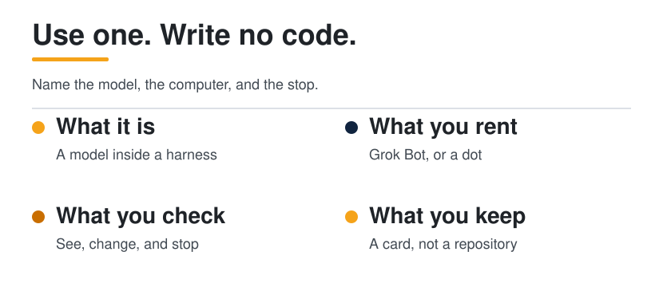
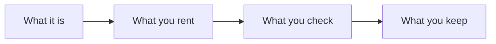

<p align="center">
  <picture>
    <source media="(prefers-color-scheme: dark)" srcset="../../assets/diagrams/explorer-route-dark.svg">
    
  </picture>
</p>

<p>
  <a href="README.md"></a>
</p>

# Explorer

You are new to agents, and you want to use one well before you build one. This path stays in language, products, and a page you can write by hand. No repository, no API key, no install.

| | |
| --- | --- |
| Path | Explorer |
| Time | About 2 hours, or one sitting if you already use a chatbot |
| You need | Nothing. A hosted agent you can open is useful, and optional |

An agent is a model plus the harness around it. The model proposes the next step. The harness decides what the model sees, what it may change, what survives the call, and what must stop for you. Hosted products such as [Grok Bot](../../docs/10-hosted-agents/index.md) and [Dots](../../docs/10-hosted-agents/index.md) already run that harness. Your job here is to see it, and to give it a task with a finish line.



## Who this is for

Curious newcomers. You can explain a tool to a friend, and you have used a chat product. You have not written an agent, and this path does not ask you to. If you already keep a skill file or a tool server, start at [Builder](../builder/README.md).

## What you will be able to do

- Explain an agent as a model inside a harness, and point at the model.
- Name the computer a Grok Bot runs on, and the computer a dot runs on.
- Give either product a task that says what it may see, what it may change, and where it must stop.
- Leave `agent-card.md`: six parts, a stop rule, and one trace. Still no code.

## The route

Stay on a page until the "you can" line is true. The SWE-bench numbers on the harness page can wait.

| Order | Open | You can leave when |
| --- | --- | --- |
| 1 | [How to read a claim](../../docs/how-to-read.md) | You can label a sentence established, per post, or synthesis |
| 2 | [What is an agent](../../docs/00-foundations/what-is-an-agent.md) | You can list the six parts without looking |
| 3 | [The agent loop](../../docs/00-foundations/the-agent-loop.md) | You can walk perceive, plan, act, observe, remember, stop |
| 4 | [Harness engineering](../../docs/01-agent-patterns/harness-engineering.md) | You can point at the model and name one other part |
| 5 | [Memory, tools, planning](../../docs/00-foundations/memory-tools-planning.md) | You can say where a fact should live tomorrow |
| 6 | [Hosted agents](../../docs/10-hosted-agents/index.md) | You can fill the two rows below from that page |
| 7 | [Your first agent](../../docs/09-playbooks/first-agent.md) | `agent-card.md` exists |

Look up a word in the [glossary](../../docs/glossary.md) the moment it snags. Do not save the glossary for the end.

### Grok Bot and Dots, from the page

Read those two sections on [Hosted agents](../../docs/10-hosted-agents/index.md) before the others. The facts below are the ones that change how you talk to the product. The page, and the official links on it, stay the source. Opened 11 October 2026.

| | Grok Bot | A dot |
| --- | --- | --- |
| Maker | xAI | OpenAI |
| The computer | One cloud computer, shared by every bot on the account | Its own cloud computer. Your computer is optional |
| If you close the laptop | The work continues | Cloud work continues. Local work needs the ChatGPT app open |
| What you check | Approval prompts, and Auto Review. A second bot is not a private room | Auto-review and your rules. A password change stays with you. Proactive research is read-only |

Muse, Claude Cowork, and Copilot Studio computer use are on the same page. Read them after you can describe these two. Where two official pages disagree, the guide keeps both. Follow that habit: re-open the official page before you quote a plan, a region, or a price.

## Quick wins

Fifteen minutes, no install.

1. Open the [harness picture](../../docs/01-agent-patterns/harness-engineering.md) and say which circle is the model.
2. Name one harness part that is not the model: observation, context, control, action, state, or verification.
3. On the hosted page, answer in one sentence: what does every Grok Bot on the account share?
4. Write a done-when for a task you would actually hand off. "Look into this" is not a task. "A page that lists the decisions, with a gap where you are unsure" is a task.

## Hands on

Two exercises. Both are pages, not programs.

### 1. Three lines before the task

Copy this above any task you give Grok Bot or a dot. It is the first move on the hosted page's checklist, and it is synthesis from the limits on the official pages.

```markdown
May see:
May change:
Must stop for me:
```

For a dot, "must stop" includes a password change: that step stays with you. For Grok Bot, remember the shared computer: sign out of a service when the work is done, because the next bot can see the same files and logins.

### 2. The agent card

Do [Your first agent](../../docs/09-playbooks/first-agent.md). The playbook says you do not need a model, an API key, or a repository. Fill the card for one real task, then add six trace lines for a single pass. If a row is "the chat window," write that. An empty memory row is a finding.

If you can open Grok Bot or a dot, fill the card from the product you used, using the six-part table on the hosted page. Still no code. You are describing the harness the product already runs.

## Checklist

- [ ] I can say what an agent is without naming a vendor first.
- [ ] I can point at the model inside the harness diagram.
- [ ] I know which computer Grok Bot uses, and which computer a dot uses.
- [ ] I know what still runs after the laptop lid closes, for each of those two.
- [ ] A real task has three lines: may see, may change, must stop.
- [ ] `agent-card.md` has six parts, a stop rule, and one trace a second person could grade.
- [ ] I did not invent a price, a region, or a feature that the hosted page does not state.

## Check yourself

1. What is shared by every Grok Bot on an account, and why does that matter for a second bot?
2. Which of a dot's work continues when your computer is off, and which work needs the ChatGPT app?
3. What belongs in the memory row of the card when the answer is "only this chat"?

## Next level

[Builder](../builder/README.md). Go there when the card names a real task, a file that counts as memory, and a stop rule. Builder is where you make those parts yourself: the harness, memory, tools, and a skill.

## Sources

This page is a route. Claims live on the pages it links.

- The model-plus-harness frame is Guo, Hao, Wang, and colleagues, [From Question Answering to Task Completion](https://arxiv.org/abs/2606.20683), as read on [Harness engineering](../../docs/01-agent-patterns/harness-engineering.md).
- Product facts are the official pages collected on [Hosted agents](../../docs/10-hosted-agents/index.md), opened 11 October 2026. Dollar prices are omitted there, and they stay omitted here.

## Continue

- [What is an agent](../../docs/00-foundations/what-is-an-agent.md)
- [Hosted agents](../../docs/10-hosted-agents/index.md)
- [Your first agent](../../docs/09-playbooks/first-agent.md)

---

[Map](../../docs/README.md) | [Paths](../../docs/learning-paths.md) | [Glossary](../../docs/glossary.md) | [References](../../docs/references.md)
