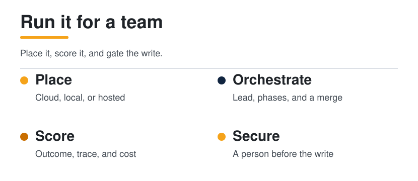
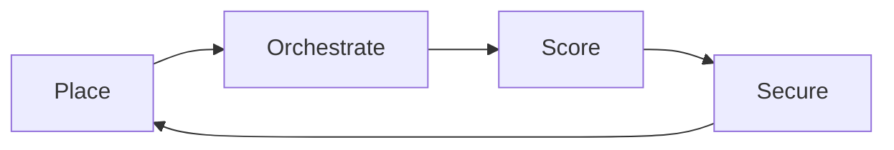

  <picture>
    <source media="(prefers-color-scheme: dark)" srcset="../../assets/diagrams/operator-route-dark.svg">
    
  </picture>

  

# Operator

You run agents for other people. This path is production: where a run lives, how several agents share a plan, how you notice a regression, what a passing run costs, and what you refuse to let the system do.

| | |
| --- | --- |
| Path | Operator |
| Time | A few sittings. The placement note and the score sheet are the artifacts |
| You need | A [Builder](../builder/README.md) agent, or a hosted product a team already depends on |

A score that names only the model is unfinished. The harness is part of the result: what the run could see, which tools it could call, and which checks ran.

## Who this is for

People who keep agents running. You care about a teammate who was not in the room: they should be able to read your placement note and your score sheet and argue with them. Tuning a stuck loop one edit at a time, and designing a custom multi-agent workflow, is the [Power user](../power-user/README.md) guide. Here you put the run somewhere, watch it, and gate it.

## What you will be able to do

- Place a real task on cloud, local, or a named hosted product, and say which harness part it will stress.
- Draw a lead, three phases, and a merge.
- Score one trajectory on outcome, the steps, and cost.
- Read a trace as the observation you actually have: plan line, tool name, result, next decision.
- Name the threats in your own stack, and point at the human gate before a write lands.

## The route

| Order | Open | You can leave when |
| --- | --- | --- |
| 1 | [Harness engineering](../../docs/01-agent-patterns/harness-engineering.md) | You can say which part a task will stress, and read a SWE-bench line as a model–harness pair |
| 2 | [Cloud and local](../../docs/05-runtime-infra/cloud-and-local.md) | You can place a task and defend the side you chose |
| 3 | [Hosted agents](../../docs/10-hosted-agents/index.md) | One real task sits on a named product, with the stressed part written down |
| 4 | [Orchestration](../../docs/04-multi-agent/orchestration.md) | You can draw a lead, phases, and a merge |
| 5 | [Efficient inference](../../docs/05-runtime-infra/efficient-inference.md) | You can separate a paper's claim from a post's retelling, and say why a loop multiplies cost |
| 6 | [Evals](../../docs/06-evals/index.md) | You can name outcome, trajectory, and cost together |
| 7 | [Threat model](../../docs/07-security/threat-model.md) | Four threats in your own stack have names |
| 8 | [Find, review, fix, retest](../../docs/07-security/find-fix-retest.md) | You can point at the human gate |
| 9 | [Gateways and supply chain](../../docs/07-security/gateway-and-supply-chain.md) | A new proxy or skill has a review list |
| 10 | [Operate agents](../../docs/09-playbooks/operate-agents.md) | Three real tasks have a placement |
| 11 | [Score a run](../../docs/09-playbooks/score-a-run.md) | One trajectory has a written pass or fail |
| 12 | [Review a gateway](../../docs/09-playbooks/review-a-gateway.md) | The decision is use, sandbox only, or do not use |

## What "watch it" means here

Observability, in this guide, is the trace you stored, not a vendor dashboard. [Evals](../../docs/06-evals/index.md) asks you to keep, for each step, the plan line, the tool name, a redacted argument summary, a result summary, and the next decision. Secrets are redacted before the trace is saved. When success drops, read failing trajectories before you rewrite the prompt.

Cost sits in the same score. A chat product pays for one reply. An agent pays for every step, and [efficient inference](../../docs/05-runtime-infra/efficient-inference.md) is why that bill matters. Report tokens, time, and dollars per pass, together with the outcome. A cost with no success is not a saving.

## Quick wins

1. Pick one task your team already gives an agent. Write the placement in four words: local, cloud, hosted, or a person.
2. Open the last run's trace. If you cannot find the tool result the agent claimed to use, that gap is the observation problem.
3. Write the dollar, token, or time figure you would put next to a pass. If you have no figure, the score is not finished. Do not invent one.
4. Name the action that must wait for a person. Sends, purchases, deletes, and credential changes are the usual list. Your stack may add one.

## Hands on

### 1. Three placements

Do [Operate agents](../../docs/09-playbooks/operate-agents.md). One task stays local, one may go to the cloud, one you deliberately do not automate yet. The note should survive a teammate who disagrees.

### 2. One scored trajectory

Do [Score a run](../../docs/09-playbooks/score-a-run.md). Grade outcome, trajectory, and cost on the same sheet. A right answer after a reckless trajectory is not a pass. A careful trajectory that missed the goal is not a pass either.

### 3. The gate

From [Find, review, fix, retest](../../docs/07-security/find-fix-retest.md), point at the step where a person accepts a write. Then run [Review a gateway](../../docs/09-playbooks/review-a-gateway.md) if a proxy sits between you and the model. The result is use, sandbox only, or do not use.

## Checklist

- [ ] Three tasks have a placement, and one of them is "a person."
- [ ] A hosted product, if I use one, is named, with the harness part it stresses.
- [ ] I can draw a lead, phases, and a merge for one job that needs more than one agent.
- [ ] One trajectory is scored on outcome, steps, and cost.
- [ ] The trace redacts secrets.
- [ ] I can separate a paper's cost or compression claim from a post's retelling.
- [ ] Four threats in this stack have names.
- [ ] A write that matters waits for a person.
- [ ] A gateway or a new skill has a review outcome: use, sandbox only, or do not use.

## Check yourself

1. Why is "the model got 70%" an unfinished score?
2. What five fields belong in a step of the trace?
3. Which of your three placements did you refuse to automate, and what would have to change before you revisited it?

## Next level

[Power user](../power-user/README.md). Go there when the score sheet and the placement note would survive a teammate who was not in the room. Power user work is the next edit: harness tuning, a custom multi-agent workflow, and a stuck loop changed in one place.

## Sources

This page is a route. Benchmark pairs and the six-part frame stay on [Harness engineering](../../docs/01-agent-patterns/harness-engineering.md), from Guo, Hao, Wang, and colleagues, [From Question Answering to Task Completion](https://arxiv.org/abs/2606.20683). Product limits stay on [Hosted agents](../../docs/10-hosted-agents/index.md). Eval method on this path is the primer in [Evals](../../docs/06-evals/index.md): established practice, not a vendor's feature list.

## Continue

- [Cloud and local](../../docs/05-runtime-infra/cloud-and-local.md)
- [Evals](../../docs/06-evals/index.md)
- [Score a run](../../docs/09-playbooks/score-a-run.md)

---

[Map](../../docs/README.md) | [Paths](../../docs/learning-paths.md) | [Glossary](../../docs/glossary.md) | [References](../../docs/references.md)
