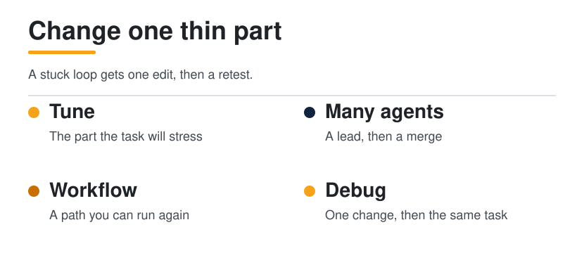
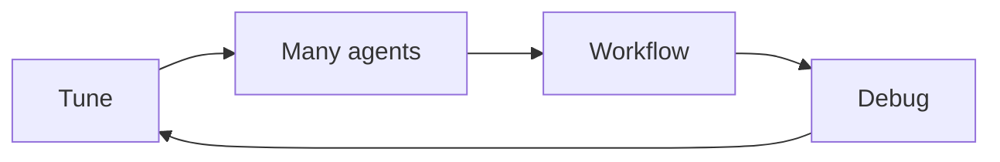

  <picture>
    <source media="(prefers-color-scheme: dark)" srcset="../../assets/diagrams/power-route-dark.svg">
    
  </picture>

  

# Power user

You already run agents. This path is the edit: tune the harness to the task, design a multi-agent workflow you can run again, and debug a stuck loop by changing one thin part.

| | |
| --- | --- |
| Path | Power user |
| Time | Ongoing. One diagnosis is a sitting. A workflow is longer |
| You need | An [Operator](../operator/README.md) score sheet, or a real failing trace |

Two changes at once teach you nothing. The trace says which part is thin. You change that part. You run the same task again.

## Who this is for

People who are past placement. You have a run, a trace, and a teammate who depends on the result. You want advanced orchestration, a workflow that is yours rather than a product default, and a way to unstick a loop without swapping the model first. If you do not yet have a score or a trace, finish [Operator](../operator/README.md) first. The trace is the instrument.

## What you will be able to do

- Match a task to the harness part it will stress, and write that match down where the next person will find it.
- Design a lead, phases, and a merge for a job you actually have, and say what the logs must show.
- Turn a repeated multi-step job into a workflow: a skill, a schema, and a gate.
- Take one stuck loop from symptom to a single change, then retest the same task.
- Add to this guide without inventing a number, a price, or a feature.

## The route

| Order | Open | You can leave when |
| --- | --- | --- |
| 1 | [Unstick a loop](../../docs/09-playbooks/unstick-a-loop.md) | A real failure has one diagnosis and one change |
| 2 | [Harness engineering](../../docs/01-agent-patterns/harness-engineering.md) | You can add a note on that page's terms without inventing a benchmark number |
| 3 | [Orchestration](../../docs/04-multi-agent/orchestration.md) | A job you have is drawn as a lead, phases, and a merge, with the log lines you require |
| 4 | [Write a skill](../../docs/09-playbooks/write-a-skill.md) | The workflow's repeated steps live in one file |
| 5 | [Research-agent playbook](../../docs/09-playbooks/research-agent.md) | The workflow's memory has raw, wiki, and schema |
| 6 | [Hosted agents](../../docs/10-hosted-agents/index.md) | You have run that page's checklist against one product you actually use |
| 7 | [Score a run](../../docs/09-playbooks/score-a-run.md) | The same task, after the one change, has a new pass or fail |
| 8 | [Case studies](../../docs/08-case-studies/index.md) | You have opened at least three of the source posts, and kept their claims marked |
| 9 | [Style guide](../../docs/style-guide.md) and [Contributing](../../CONTRIBUTING.md) | A page you would add matches the anatomy, and the source is linked |

[Review a gateway](../../docs/09-playbooks/review-a-gateway.md) belongs in this path when the workflow sends prompts through a proxy. The decision is still use, sandbox only, or do not use.

## Tune the harness

[Harness engineering](../../docs/01-agent-patterns/harness-engineering.md) treats a weak run as a thin part, not a weak model. Observation, context, control, action, state, verification: write which one the task will stress before you change a prompt. The survey's SWE-bench Verified reading stays on that page, as model–harness pairs, with the survey's caveats. A note you add names the source. It does not introduce a new percentage.

## Many agents, one workflow

[Orchestration](../../docs/04-multi-agent/orchestration.md) gives you three shapes: a pipeline, a fan-out, and a lead with workers. Worker names on the diagram are illustrative. They are not a product's roster. Pick the shape your job actually has.

A custom workflow, in this guide, is three files a teammate can rerun:

| Piece | Where it lives | Playbook |
| --- | --- | --- |
| The steps that repeat | `SKILL.md` | [Write a skill](../../docs/09-playbooks/write-a-skill.md) |
| What the next run must already know | raw, wiki, schema | [Research agent](../../docs/09-playbooks/research-agent.md) |
| What a person still accepts | the gate on the score sheet | [Score a run](../../docs/09-playbooks/score-a-run.md) |

If the job is a hosted product, the workflow includes that product's limits. The checklist on [Hosted agents](../../docs/10-hosted-agents/index.md) is synthesis from the official pages. Run it against the product you use. On Grok Bot, every bot shares the computer. On a dot, a password change stays with you, and proactive research is read-only.

## Quick wins

1. Write the symptom in one sentence that names a tool and a count. "It searched twelve times for the same fact" is a symptom. "It felt stuck" is not.
2. Circle one row in the [unstick table](../../docs/09-playbooks/unstick-a-loop.md). Close the other rows.
3. Before a multi-agent run, list the three log lines you will require: the phase, the worker's artifact, and the merge.
4. Open one case-study source post before you repeat a claim from the guide's retelling.

## Hands on

### 1. One stuck loop

Do [Unstick a loop](../../docs/09-playbooks/unstick-a-loop.md) on a real failure. Match it to one thin step. Make the smallest edit. Run the same task. Record the new trace next to the old one in [Score a run](../../docs/09-playbooks/score-a-run.md). If you changed two things, you do not yet know which one mattered.

### 2. A workflow you can hand over

Pick a job that already has more than one step. Draw it with [orchestration](../../docs/04-multi-agent/orchestration.md): lead, phases, merge, or a simpler pipeline if that is the truth. Put the repeated procedure in a skill. Put the durable notes in the wiki layout. Write the stop rule on the same page as the drawing.

### 3. A page the guide did not have

When the diagnosis is worth keeping, add it where the next person will look. [Contributing](../../CONTRIBUTING.md) is the shape. Link the source. Mark a post's claim as per post. Leave a gap where you did not check.

## Checklist

- [ ] A real failure is one sentence with a tool and a count.
- [ ] One thin harness part is named, and only that part changed.
- [ ] The same task was run again, and the new trace is stored.
- [ ] A multi-agent job is drawn as pipeline, fan-out, or lead / worker.
- [ ] The drawing says which log lines I require before I trust the merge.
- [ ] The repeated steps are in a skill file.
- [ ] Memory for that workflow is raw, wiki, and schema, or I have written why one of those is empty.
- [ ] A hosted product I use has been through the hosted-page checklist.
- [ ] Any number I repeat is still attached to the page that published it.

## Check yourself

1. Why does swapping the model come after the thin-step edit?
2. What three log lines do you want before you trust a merge?
3. Which file will you edit next month when the procedure changes: the prompt, or the skill?

## Next level

There is no fifth persona. The next level is the guide itself: a page edit someone else can use. Start at [Contributing](../../CONTRIBUTING.md), match the [style guide](../../docs/style-guide.md), and link the source on the day you add the claim. The [case studies](../../docs/08-case-studies/index.md) are the pattern for how a post stays a post.

## Sources

This page is a route. The thin-part frame is Guo, Hao, Wang, and colleagues, [From Question Answering to Task Completion](https://arxiv.org/abs/2606.20683), on [Harness engineering](../../docs/01-agent-patterns/harness-engineering.md). The order of fixes in a stuck loop is synthesis, as [Unstick a loop](../../docs/09-playbooks/unstick-a-loop.md) says. Hosted limits stay on [Hosted agents](../../docs/10-hosted-agents/index.md).

## Continue

- [Unstick a loop](../../docs/09-playbooks/unstick-a-loop.md)
- [Orchestration](../../docs/04-multi-agent/orchestration.md)
- [Contributing](../../CONTRIBUTING.md)

---

[Map](../../docs/README.md) | [Paths](../../docs/learning-paths.md) | [Glossary](../../docs/glossary.md) | [References](../../docs/references.md)
